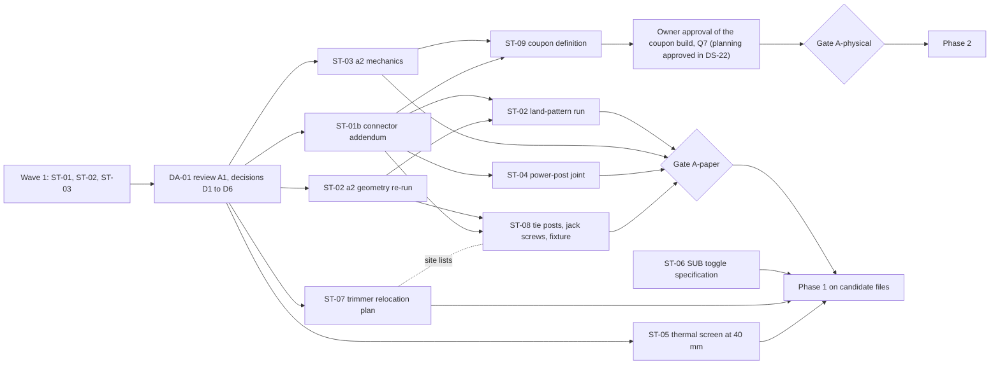

# Campaign osc-stack-20261114

Direct board-stack campaign, started on the owner's direction of 2026-11-14. Policy: [ORCHESTRATION.md](../../../ORCHESTRATION.md). Plan of record: [`decisions/osc-direct-stack-plan.mdx`](../../../../doc/src/content/docs/decisions/osc-direct-stack-plan.mdx) (PROPOSAL; NOT ADOPTED until Gate A). Decision log: [decisions.md](decisions.md).

Every schematic and PCB stays an unvalidated draft. This campaign creates no fabrication output and takes no outward action.

## Owner direction and decision authority

On 2026-11-14 the owner read the plan, asked to continue, and directed that the stack work runs autonomously as long-running work; a difficult architectural decision goes to a Fable design agent at high effort, which decides, and the work continues without waiting for the owner (project chat messages `cmsg_01Pv35emdXEU6gCRF3teSpo2W8nEGNoKNudGgdpt3nExqX` and `cmsg_01Pv35emdXEU6gCRF3teSpo2CKWZL4oD7iZ7K23pvXBhri`). The owner had already chosen board-to-board joints and the SUB toggle for OSC2 and OSC4.

| Matter | Decided by | Record |
| --- | --- | --- |
| Hard design and architecture decisions, including Gate A (Q1) and questions Q3, Q4, Q5, Q6 and Q8 of the plan | Design authority: an in-session Fable agent at high effort, started by the manager for each decision packet | [decisions.md](decisions.md), then the plan page |
| Design reviews marked "Design authority" in the plan | The same design authority, never the implementer | Task brief, review section |
| Dependency order, task briefs, allocations, integration and merges of green pull requests | Top-level manager | This file |
| Purchases, quotes, supplier contact, fabrication orders (including the coupon build, Q7), deployment, credentials | Owner only; never taken by this campaign | Reported to the owner |
| Jack and control positions | Fixed by `design/grid/placements.lock.json`; never moved | Fit conflicts are reported with dimensions |
| Panel artwork and legends | Owner styling | Proposed only |
| Calling a draft validated, qualified or released | Nobody in this campaign | n/a |

A decision of the design authority selects a design; it never performs the outward action that the design later needs. Each decision record states how to reverse it, so the owner can overrule it at any time.

## Control record

| Field | Value (observed 2026-11-14 UTC) |
| --- | --- |
| Base | `main` at `b4daa754012cb557bf9a189afbbac7795009fc69` (merge of #352). Its tree equals #352's head `0de1319`, whose CI run [43613777463](https://github.com/Takazudo/zudo-osc-hole-field/actions/runs/43613777463) passed 7 of 7 jobs, including `regen-all.sh --check`. |
| Merged since the base | #353 at `dc8a2aaf` (CI run [43625579211](https://github.com/Takazudo/zudo-osc-hole-field/actions/runs/43625579211), 7 of 7): this record, the briefs and the owner direction on the plan page. #354 carries the wave-1 evidence and the DA-01 record. |
| Regeneration at the base | `bash scripts/checks/regen-all.sh --check` in the manager VM at `b4daa754`: exit 0 in 347 s through `heavy-guard.sh` (verdict PASS), no tracked change. This is the campaign's one start-of-work regeneration; Phase 0 children do not repeat it. |
| Top-level manager, sole dispatcher and integrator | One Claude Code Cloud Project thread session (`https://claude.ai/code/session_01JXThoP3HSxfTMwSDwrkxP8`). Selected model family: Fable, confirmed from the session record at 17:52 UTC (configured and last-served model agree). |
| Earlier campaign `osc-cloud-20261111` | No runnable task: T9c and T10 are BLOCKED and its thread shows as done. No live session or Actions run of that campaign was found at 17:52 UTC; the only run in progress was ordinary CI on the merge commit. Its records are untouched. |
| Canonical boards | K2226-parts439 / JL184-parts439 / JR192-parts439 and the P, EL and O drafts, per `circuit/routing/osc-pcb-current-checkpoint.json` (2026-11-13). Phase 0 changes none of them. |
| K interface routing | **HOLD**: no "signal-escapes" stage and no transaction that ends on a GH pad, an F.Cu trimmer or a power-land neighbourhood until Gate A is decided. Interior K routing is not held by this campaign, but no routing task is admitted here. |
| Grok / Cursor | Excluded |

## Capabilities actually available

| Capability | Evidence | Limits |
| --- | --- | --- |
| In-session subagents | Agent tool with `model` (`fable`, `opus`, `sonnet`, `haiku`) and `effort` parameters | Share this VM's CPU and RAM; not extra compute |
| Additional Project threads | Only through the coordinator on request | None requested |
| Cloud VM (manager) | 4 vCPU, 15 GiB RAM (15 GiB available at start), no swap, 28 GiB free disk | Lifetime is the session's; reclaimed when idle |
| Native oracle in the VM | Docker 29.9.2 daemon started by the manager at 17:50 UTC; pinned `kicad/kicad@sha256:18693567…` pulled; `bash scripts/kicad/run.sh kicad-cli version` prints `10.0.6` | One heavy native process at a time. The daemon does not survive a container restart; start `dockerd` again and re-check the version before any native run |
| Pinned numerical packages | `numpy==2.2.6`, `scipy==1.15.3`, `shapely==2.1.2` installed for the VM user from `scripts/pcbgen/numerical-requirements.txt` | Python is 3.13 here and 3.12 in CI; CI is the reference |
| GitHub Actions | MCP tools list and read runs and jobs | Only ordinary CI is used in Phase 0. Account-wide concurrency is not visible |
| Push scope | This session may push only `claude/project-thread-zao1qg` in each repository | One open pull request from the campaign branch at a time |
| Local machines | Not connected in this campaign | A local run needs a recorded reason and a new approval |

## Allocations (finite)

- Children: at most **3** concurrently. Each writer has its own worktree `/home/user/wt/<task-id>` and local branch `stack/<task-id>`. Children commit locally and never push.
- Heavy and native work: one process at a time through `heavy-guard.sh`. Phase 0 children run no `regen-all.sh`, no full Python suite and no native oracle command unless their brief admits it. The manager and CI run the aggregate gates.
- Actions: ordinary CI only, 7 jobs per push, one pull request at a time. No compute fan-out is admitted in Phase 0.
- Model usage: not exposed per agent. Bounded-turn policy: one attempt and at most one continuation per task; reviews are batched into three packets; the manager does not poll healthy children. The manager reads the session's usage-limit status at each wave boundary and stops dispatch, with the state checkpointed here, if it reports a limit.
- Retry: at most one, only for a proven transient failure.
- No paid capacity is added by this campaign.

## Dependency graph

## Tasks

Phase 0 writes new candidate files only, under `design/stack/`, `scripts/stack/` and new candidate evidence bundles. It does not edit `design/partition/partition.json`, the placement lock, a routed board, a receipt, the checkpoint or a decision register.

| ID | Deliverable | Model / environment | State | Depends on | Review |
| --- | --- | --- | --- | --- | --- |
| S0 | This record, the wave-1 briefs, the owner direction recorded in the plan page | Manager | DONE (`91246e9`) | none | n/a |
| ST-01 | Connector and spacer evidence, selection proposal ([brief](st-01.md)) | Opus child, worktree `/home/user/wt/st-01`; web access for primary documents | REPORTED 18:21 UTC: `NEEDS_DESIGN` (`5ab8306`; store commit `f04bdd7`). DA-01 rejected the recommended SMM pair and its 7.874 mm bound (findings C1, C2). ST-01b REPORTED 19:12 UTC: `NEEDS_DESIGN` for the EL pass-through, post survey PARTIAL (`5eda60f`; store commit `2401d54`, which retains the ten documents DA-01 fetched and the CLT print). All eleven working codes are CONFIRMED against the prints with the margins of D3. The stacker pad span of 5.54 mm and courtyard width of 6.04 mm are confirmed and the courtyard length is corrected to 2n + 0.75 mm. The factory channel lists the three sockets, the CLT socket and the 2×4 stacker, and none of the five K-joint stackers. The 1×3 stackers take no pick-and-place pad and lead style −07 is not supplied on tape and reel. Manager check: allowed writes only; all 25 distinct cited hashes match the store. No candidate bundle: the pin-asset check needs KiCad assets. ST-01c REPORTED 19:24 UTC under DS-19: `NEEDS_DESIGN` on the EL socket code, post survey PARTIAL (`ae82b6b`; store commits `af04372`, `07dcaa6`). The MMS and CLT land patterns are SOURCED (courtyards 5.94 × (2n + 1.19) mm and 6.42 × 8.70 mm). The documents show a pin passing through the CLT socket only for its bottom-entry version. Posts: an exact catalogue spacer at 17.00 mm; the nearest parts to 18.8 mm are 18.90, 18.65 and 19.00 mm and to 12.8 mm 12.65 and 13.00 mm; no maker states a current rating or a contact resistance; two makers' pages could not be fetched (one HTTP 403, one refused by the session's permission layer and not retried). Manager check: allowed writes only; all 35 distinct cited hashes match the store | DA-01 | DA-01 done; ST-01b and ST-01c at Gate A-paper |
| ST-02 | Retained stack-geometry candidate and checker ([brief](st-02.md)) | Opus child, worktree `/home/user/wt/st-02` | REPORTED 18:26 UTC: DONE (`a95ff38`; 32 tests; `check.py` PASS with 0 errors). Continuation c1 REPORTED 18:59 UTC: all eight code review findings fixed (`a9e1b25`). Manager check: allowed writes only; 39 tests pass in 26 s; a second `generate.py` and `check.py` run leaves the tree clean. One figure corrected (K free area at courtyard level F 37.5 %, B 39.0 %); totals 115 reproduced, 3 corrected, 31 not checkable, 1 not run. Attempt a2 REPORTED 19:26 UTC under DS-18: `NEEDS_DESIGN` on two items (`15aa448`, `ce4fd00`, `d09f724`; 50 tests). The checker verdict is FAIL with 5 errors and is kept: two relief holes of EL site E1 overlap two EL reserves by 0.85 mm, and no selector adapter has a point clear on all four faces for a standoff. Planes, gaps, the rear envelope at 40 mm, the wider P tab, the 6.8 mm passages and the double-row pairs fit at courtyard level. 40 mm rule: 97 pairs miss from the posts and kept supports, 27 with the 66 interior candidates counted, 0 with the five provisional sites added. 825 positions per side. Manager check: allowed writes only; tests pass; regeneration is a no-op. A trial of the land-pattern run with ST-01c's envelopes gave the same five errors; it is finished by the child as c2 (DS-21), **folded into the geometry continuation that follows DA-02 (DS-23)** | DA-01; ST-01b for the socket land pattern | Independent reviewer (packet C), pending |
| ST-03 | Stack mechanics: datums, closing order, stack-ups, separation, coupon definition ([brief](st-03.md)) | Opus child, worktree `/home/user/wt/st-03` | REPORTED 18:24 UTC: PARTIAL with six `NEEDS_DESIGN` items (`d0dd0b3`; 14 tests). DA-01 decided the six items and changed four conclusions. Attempt a2 REPORTED 19:17 UTC: `NEEDS_DESIGN` (`8aebd35`, `d099a2d`; 21 tests; code review findings F1 and F2 fixed; XY now read from the geometry candidate with its hash pinned). Capture: the median worst pair is 0.344 to 0.401 mm against 0.39 mm and the 95th percentile is 0.52 to 0.59 mm on JL, JR and P. Final alignment: at least 0.27 mm at the median worst pair against 0.07 mm, as DA-01 expected. Z: JL and JR close with the five provisional sites, P does not (1.316 mm needed against 0.74 mm). 40 mm rule: 107 pairs miss it from the retained fixings and 67 with the five sites. K dishes 1.3 to 3.5 mm under the mating load in its largest bay without a fixing. Toggle gap 0.26 mm at the low end against a 0.3 mm washer window. Manager check: allowed writes only; tests pass on the integrated tree after the plan-page pin was refreshed (`ead15c8`) | DA-01 | DA-02, then Gate A-paper |
| DA-01 | Design review A1 of ST-01 and ST-03, and decisions D1 to D6 ([brief](da-01.md), [record](reviews/da-01.md)) | Design authority: Fable agent at high effort, worktree `/home/user/wt/da-01` | REPORTED 18:56 UTC: DONE (`aca64a6`). The stack continues as a changed design and is not adoptable before a coupon; decisions are rows DS-11 to DS-17 of [decisions.md](decisions.md). Manager check: only its two allowed files changed. It fetched ten vendor documents, which ST-01b retains | ST-01, ST-02, ST-03 | n/a |
| DA-02 | Design review A2 of the second-pass evidence (ST-01b and ST-01c, ST-02 a2, ST-03 a2) and decisions E1 to E10 on their `NEEDS_DESIGN` items, with the SUB clock-node decision of ST-06 ([brief](da-02.md)) | Design authority: Fable agent at high effort, worktree `/home/user/wt/da-02` | **RUNNING: attempt a1 launched 19:30 UTC** from `stack/wave-1` `90a14c9` | ST-01c, ST-02 a2, ST-03 a2, ST-06 | n/a |
| ST-04 | Power-post joint design and electrical re-derivation ([brief](st-04.md)) | Opus child, worktree `/home/user/wt/st-04` | **REPORTED: attempt a1** at `4b7f942` (13 min), merged into `stack/wave-1` at `70f0efb`. On paper, nothing selected or measured: a joint is 0.404 mΩ (JL, JR) or 0.395 mΩ (P) on assumed face and body resistances, against a derived ceiling of 2.328 mΩ; distribution drop 7.104 / 6.963 / 4.858 mV against 20 mV; rail plus return 0.181 / 0.179 / 0.147 V against 0.20 V. The worst header contact carries 0.54 to 0.57 A, above the 0.5 A limit that was set for the wire contacts; a limit of 1.6 A is proposed from the maker's qualification report, for the design authority. Six lands need a new site (four on JR beside locked clip LEDs, two on P beside a locked pot), and P's four tab lands move to y = 175 with the tab grown to y = 171.0. 123 K footprints sit in the 18 post keep-outs, 24 of them without a free position within 12 mm (courtyard screen). Catalogue post only at 17.00 ± 0.15 mm; 18.80 mm needs a made-to-drawing body. Hot Kelvin measurement #65 NOT RUN. Manager check: allowed writes only; 12 tests pass before and after the merge; one commit was refused by the automatic permission check and repeated once without the co-author trailer | ST-01c, ST-03 a2, DA-01 | Design authority (Gate A-paper) |
| ST-05 | Thermal paper screen ([brief](st-05.md)) | Opus child, worktree `/home/user/wt/st-05` | PLANNED; the comparison uses a 40 mm case and keeps the 34 mm figures as a second row (DS-17); launch after DA-02 reports (DS-23) | DA-01 | Independent reviewer (packet C) |
| ST-06 | SUB toggle specification for OSC2 and OSC4 ([brief](st-06.md)) | Opus child, worktree `/home/user/wt/st-06` | REPORTED 18:52 UTC: DONE, all eight items specified, none `NEEDS_DESIGN`. Commit `019fc7a`. Manager check: allowed writes only; 20 tests pass; `spec.json` matches its generator. One decision is requested: the node that clocks the divider (a squared sawtooth from the spare comparator half, proposed, or the existing pulse) | none | Design authority (packet B), pending |
| ST-07 | Trimmer and test-point relocation plan ([brief](st-07.md)) | Opus child, worktree `/home/user/wt/st-07` | PLANNED; runs as briefed with K's rear face at −32.0 mm (DS-17); launch after DA-02 reports (DS-23); exchanges site lists with ST-08 and reads the post keep-outs and proposed re-sites of ST-04 | DA-01 | Design authority (packet B) |
| ST-08 | Tie posts, jack screws and the closing fixture: the smallest set of tie sites for the fixing rule, part moves by reference, adapter standoffs, pilot pins, the jack-screw element and its load per point, ceramics near every site. Writes `design/stack/fixings/` only ([brief](st-08.md)) | Opus child, script-backed, worktree `/home/user/wt/st-08` | PLANNED (new under DS-17); launch after DA-02 (DS-20) | ST-02 a2, ST-01c, ST-03 a2, DA-02 | Design authority (Gate A-paper) |
| ST-09 | Coupon definition as a retained specification: boards, parts, variants, measurements and the pass numbers of DS-16. Definition only; no order file ([brief](st-09.md)) | Opus child, worktree `/home/user/wt/st-09` | **REPORTED: attempt a1** at `8a4e407` on `stack/st-09` (14 min); **not merged, continuation c1 pending (DS-23)**. Definition only, nothing drawn: 10 board designs, 9 specimens (18 boards), 312 pairs, 1,576 positions per side, 17 part codes, 9 measurements, and the 5 pass numbers of DS-16 held as data. It returns two questions (DQ-1: may the ladder stand in for the gate at 0.25 mm; DQ-2: may the coupon shrink) and nine proposed additions (PA-1 to PA-9) for the design authority. Launched before ST-01c and ST-02 a2 were merged, so 8 of its 16 pinned sources have changed. Manager check: allowed writes only; checker PASS; 27 tests pass; regeneration is byte-identical; one commit was refused by the automatic permission check and repeated once without the co-author trailer | ST-03 a2, ST-01b | Design authority (packet B) |
| GA-paper | Gate A-paper: confirm or end the changed stack as the working design for Phase 1 on candidate files; re-decide the routing hold DS-06; decide Q6 and Q8 as far as the evidence allows | Design authority: Fable agent at high effort | PLANNED | ST-01b, ST-02 a2 with the land-pattern run, ST-03 a2, ST-04, ST-08 | n/a |
| GA-physical | Gate A-physical: adopt the stack on the coupon report and release Phase 2 (conditions in DS-16) | Design authority: Fable agent at high effort | WAITS for the settled coupon definition (ST-09 c1), then for the owner's separate approval of the build (planning approved in DS-22), then for the coupon report. If the owner declines the build, the gate is negative for the K joints and the cable partition stays | ST-09; the owner's build and measurements | n/a |
| Phase 1 to 3 | ST-10 to ST-31 of the plan page | Mapped at the campaign revision that follows Gate A-paper | NOT PLANNED IN DETAIL. Phase 1 runs on candidate files only; Phase 2 needs Gate A-physical | Gate A-paper | n/a |

Launch receipts: the three wave-1 children were started through the Agent tool with `model: opus` and no effort setting, each bound to its own worktree and brief. The in-session agent identifiers are kept in the manager session; they are not valid outside it and are not recorded here. DA-01 was started with `model: fable` and `effort: high`, as the owner directed; ST-06 with `model: opus` and no effort setting. The second passes of 19:02 to 19:07 UTC (ST-01b, ST-03 a2, ST-02 a2) continue the same three children. ST-01c continued the ST-01 child at 19:14 UTC. ST-09 (19:20 UTC) and ST-04 (19:26 UTC) were started with `model: opus` and no effort setting; DA-02 (19:30 UTC) with `model: fable` and `effort: high`.

Review packets: the design review of ST-01 and ST-03 was taken early as DA-01 (DS-09). What remains is batched as follows. Packet A is the design authority's review of ST-01b, ST-02 a2, ST-03 a2, ST-04 and ST-08 together with the Gate A-paper decision. Packet B is the design review of ST-06, ST-07 and ST-09, with the decision on the node that clocks the SUB divider. Packet C is the independent review of ST-05 and of the code that ST-02 a2 and ST-03 a2 add, by a reviewer that implemented neither. The code of ST-02 and ST-03 had its first independent review on 2026-11-14 with the built-in code review at medium effort over `scripts/stack/geometry` and `scripts/stack/mechanics`: ten findings, all verified or accepted by the manager, none changing a headline result. The eight in ST-02's files are fixed (continuation c1, `a9e1b25`); the two in ST-03's calculator (an RSS term missing from one strain case, and geometry constants that have diverged from the ST-02 candidate) are in the scope of its attempt a2.

## Open design items for Gate A-paper

| Item | From | Options on record |
| --- | --- | --- |
| Whether a stacker pin can pass through the CLT socket on EL into relief holes | ST-01b: the socket print does not state it | The code of DS-14 with the pass-through ASSUMED until the coupon; the socket's bottom-entry option; the fallback of DS-14 (six short harnesses). ST-01c collects the documentary facts |
| Supply form of the K-joint stackers | ST-01b | None of the five K-joint stacker codes is listed in the factory channel; the 1×3 stackers take no pick-and-place pad; lead style −07 is not supplied on tape and reel. These feed owner item 3 and the coupon's placement variants |
| Capture at the worst pair of a board | ST-03 a2 | Median 0.344 to 0.401 mm against 0.39 mm (P misses by 0.011 mm); 95th percentile 0.52 to 0.59 mm on JL, JR and P. The pilot pins are not credited. DA-02 |
| Z on P and the fixing rule | ST-03 a2 | P needs 1.316 mm against 0.74 mm with the five provisional sites; 67 pairs still miss 40 mm (JL 9, P 58). DA-01's count of 27 assumed the 66 clear sites as fixings. DA-02, then ST-08 |
| Toggle washer window | ST-03 a2 | Worst-case gap 0.26 mm against the 0.3 to 2.1 mm window of DS-15. DA-02, then ST-12 |
| The node that clocks the SUB divider | ST-06 | A squared sawtooth from the spare comparator half (proposed) or the existing pulse; batched into DA-02 (DS-20) |
| Per-contact current of a header contact | ST-04 | The worst contact carries 0.54 to 0.57 A against the 0.5 A limit set for the wire contacts. Proposed: 1.6 A from the maker's qualification report 154341 (all adjacent contacts powered, 30 °C rise, 20 % de-rating), with the transfer from the tested partner to the TW-SM stacker ASSUMED. Gate A-paper |
| Post lands that do not fit where the wires land | ST-04 | Four JR lands 2.774 mm from locked clip LEDs: shift +1.0 mm in x on JR and K (proposed), an M2.5 thread, or a press-in element. P's AGND2 and AGND3: a second tab segment at y = 175 (proposed) or a captive threaded element (unsourced). P's power-tab lands to y = 175 with the tab grown to y = 171.0. Pointed out to DA-02 at 19:41 UTC; otherwise Gate A-paper |
| Post length tolerance | ST-04, ST-01c | The catalogue post is 17.00 ± 0.15 mm against the 0.05 mm that ST-03 assumed; a body made to drawing at 17.00 and 18.80 ± 0.05 mm is proposed, with catalogue alternatives at 18.90 and 19.00 mm. DA-02 item E10 |
| Coupon scope | ST-09 | 18 boards and 312 pairs follow the D5 floor of 20 pairs per board. DQ-1, DQ-2 and the proposed additions PA-1 to PA-9. Design authority, as a continuation of DA-02 (DS-23) |

## Integration procedure

1. A child reports with its result section filled and its commits on `stack/<task-id>`.
2. The manager checks the allowed-writes list against `git diff --stat`, re-runs the task's own checks, and sends the result to its review packet. When a later task or the design authority must read the result first, the manager merges it into the local integration branch `stack/wave-<n>` as candidate evidence with its review pending (DS-10); review findings are then fixed by follow-up commits.
3. After review, the manager merges the child branch into `claude/project-thread-zao1qg` with a regular merge, runs `pnpm circuit:check`, `pnpm check` and the aggregate gates that the change touches, pushes, and opens one pull request per wave. CI on the pull request is the reference for the full Python suite, the native checks and `regen-all.sh --check`.
4. A green pull request is merged with a regular merge. The branch is then fast-forwarded to `main`.
5. This file and [decisions.md](decisions.md) are updated at every wave boundary; they are the durable checkpoint for a restart.

## Restart checkpoint

On restart, read this file and [decisions.md](decisions.md), list `/home/user/wt/` and `git branch --list 'stack/*'`, and query running agents before starting anything. A child whose worktree has uncommitted work and no result section is `UNKNOWN`, not failed: reconcile it before any replacement. Start `dockerd` and re-check `kicad-cli version` before a native run.

## Time accounting

Wall time and model usage per attempt, from the Agent tool's completion notices (the manager's own usage is not included):

| Task | Attempt | Wall time | Subagent tokens | Tool uses |
| --- | --- | --- | --- | --- |
| ST-01 | a1 | 18 min (1084 s) | 315,119 | 121 |
| ST-02 | a1 | 22 min (1329 s) | 324,202 | 62 |
| ST-03 | a1 | 21 min (1250 s) | 299,324 | 65 |
| ST-06 | a1 | 23 min (1363 s) | 298,356 | 66 |
| DA-01 | a1 | 27 min (1593 s) | 98,031 | 78 |
| ST-02 | c1 | 6 min (361 s) | 365,912 | 20 |
| ST-01 | c1 (ST-01b) | 10 min (585 s) | 114,549 | 54 |
| ST-03 | a2 | 13 min (756 s) | 144,608 | 43 |
| ST-01 | c2 (ST-01c) | 10 min (580 s) | 246,015 | 75 |
| ST-02 | a2 | 19 min (1126 s) | 252,143 | 54 |
| ST-09 | a1 | 14 min (869 s) | 240,016 | 38 |
| ST-04 | a1 | 13 min (768 s) | 247,292 | 61 |

The token figure is the one the completion notice reports; what it counts across a continuation is not documented. The wall times that the children wrote into their result sections are their own estimates; the figures here are the measured ones. ST-01's result section says about 2.5 h, which is wrong.
