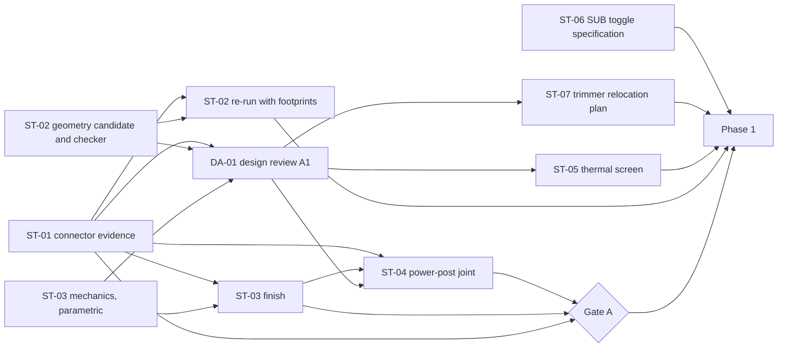

# Campaign osc-stack-20261114

Direct board-stack campaign, started on the owner's direction of 2026-11-14. Policy: [ORCHESTRATION.md](../../../ORCHESTRATION.md). Plan of record: [`decisions/osc-direct-stack-plan.mdx`](../../../../doc/src/content/docs/decisions/osc-direct-stack-plan.mdx) (PROPOSAL; NOT ADOPTED until Gate A). Decision log: [decisions.md](decisions.md).

Every schematic and PCB stays an unvalidated draft. This campaign creates no fabrication output and takes no outward action.

## Owner direction and decision authority

On 2026-11-14 the owner read the plan, asked to continue, and directed that the stack work runs autonomously as long-running work; a difficult architectural decision goes to a Fable design agent at high effort, which decides, and the work continues without waiting for the owner (project chat messages `cmsg_01Pv35emdXEU6gCRF3teSpo2W8nEGNoKNudGgdpt3nExqX` and `cmsg_01Pv35emdXEU6gCRF3teSpo2CKWZL4oD7iZ7K23pvXBhri`). The owner had already chosen board-to-board joints and the SUB toggle for OSC2 and OSC4.

| Matter | Decided by | Record |
| --- | --- | --- |
| Hard design and architecture decisions, including Gate A (Q1) and questions Q3, Q4, Q5, Q6 and Q8 of the plan | Design authority: an in-session Fable agent at high effort, started by the manager for each decision packet | [decisions.md](decisions.md), then the plan page |
| Design reviews marked "Design authority" in the plan | The same design authority, never the implementer | Task brief, review section |
| Dependency order, task briefs, allocations, integration and merges of green pull requests | Top-level manager | This file |
| Purchases, quotes, supplier contact, fabrication orders (including the coupon build, Q7), deployment, credentials | Owner only; never taken by this campaign | Reported to the owner |
| Jack and control positions | Fixed by `design/grid/placements.lock.json`; never moved | Fit conflicts are reported with dimensions |
| Panel artwork and legends | Owner styling | Proposed only |
| Calling a draft validated, qualified or released | Nobody in this campaign | n/a |

A decision of the design authority selects a design; it never performs the outward action that the design later needs. Each decision record states how to reverse it, so the owner can overrule it at any time.

## Control record

| Field | Value (observed 2026-11-14 UTC) |
| --- | --- |
| Base | `main` at `b4daa754012cb557bf9a189afbbac7795009fc69` (merge of #352). Its tree equals #352's head `0de1319`, whose CI run [43613777463](https://github.com/Takazudo/zudo-osc-hole-field/actions/runs/43613777463) passed 7 of 7 jobs, including `regen-all.sh --check`. |
| Regeneration at the base | `bash scripts/checks/regen-all.sh --check` in the manager VM at `b4daa754`: exit 0 in 347 s through `heavy-guard.sh` (verdict PASS), no tracked change. This is the campaign's one start-of-work regeneration; Phase 0 children do not repeat it. |
| Top-level manager, sole dispatcher and integrator | One Claude Code Cloud Project thread session (`https://claude.ai/code/session_01JXThoP3HSxfTMwSDwrkxP8`). Selected model family: Fable, confirmed from the session record at 17:52 UTC (configured and last-served model agree). |
| Earlier campaign `osc-cloud-20261111` | No runnable task: T9c and T10 are BLOCKED and its thread shows as done. No live session or Actions run of that campaign was found at 17:52 UTC; the only run in progress was ordinary CI on the merge commit. Its records are untouched. |
| Canonical boards | K2226-parts439 / JL184-parts439 / JR192-parts439 and the P, EL and O drafts, per `circuit/routing/osc-pcb-current-checkpoint.json` (2026-11-13). Phase 0 changes none of them. |
| K interface routing | **HOLD**: no "signal-escapes" stage and no transaction that ends on a GH pad, an F.Cu trimmer or a power-land neighbourhood until Gate A is decided. Interior K routing is not held by this campaign, but no routing task is admitted here. |
| Grok / Cursor | Excluded |

## Capabilities actually available

| Capability | Evidence | Limits |
| --- | --- | --- |
| In-session subagents | Agent tool with `model` (`fable`, `opus`, `sonnet`, `haiku`) and `effort` parameters | Share this VM's CPU and RAM; not extra compute |
| Additional Project threads | Only through the coordinator on request | None requested |
| Cloud VM (manager) | 4 vCPU, 15 GiB RAM (15 GiB available at start), no swap, 28 GiB free disk | Lifetime is the session's; reclaimed when idle |
| Native oracle in the VM | Docker 29.9.2 daemon started by the manager at 17:50 UTC; pinned `kicad/kicad@sha256:18693567…` pulled; `bash scripts/kicad/run.sh kicad-cli version` prints `10.0.6` | One heavy native process at a time. The daemon does not survive a container restart; start `dockerd` again and re-check the version before any native run |
| Pinned numerical packages | `numpy==2.2.6`, `scipy==1.15.3`, `shapely==2.1.2` installed for the VM user from `scripts/pcbgen/numerical-requirements.txt` | Python is 3.13 here and 3.12 in CI; CI is the reference |
| GitHub Actions | MCP tools list and read runs and jobs | Only ordinary CI is used in Phase 0. Account-wide concurrency is not visible |
| Push scope | This session may push only `claude/project-thread-zao1qg` in each repository | One open pull request from the campaign branch at a time |
| Local machines | Not connected in this campaign | A local run needs a recorded reason and a new approval |

## Allocations (finite)

- Children: at most **3** concurrently. Each writer has its own worktree `/home/user/wt/<task-id>` and local branch `stack/<task-id>`. Children commit locally and never push.
- Heavy and native work: one process at a time through `heavy-guard.sh`. Phase 0 children run no `regen-all.sh`, no full Python suite and no native oracle command unless their brief admits it. The manager and CI run the aggregate gates.
- Actions: ordinary CI only, 7 jobs per push, one pull request at a time. No compute fan-out is admitted in Phase 0.
- Model usage: not exposed per agent. Bounded-turn policy: one attempt and at most one continuation per task; reviews are batched into three packets; the manager does not poll healthy children. The manager reads the session's usage-limit status at each wave boundary and stops dispatch, with the state checkpointed here, if it reports a limit.
- Retry: at most one, only for a proven transient failure.
- No paid capacity is added by this campaign.

## Dependency graph

## Tasks

Phase 0 writes new candidate files only, under `design/stack/`, `scripts/stack/` and new candidate evidence bundles. It does not edit `design/partition/partition.json`, the placement lock, a routed board, a receipt, the checkpoint or a decision register.

| ID | Deliverable | Model / environment | State | Depends on | Review |
| --- | --- | --- | --- | --- | --- |
| S0 | This record, the wave-1 briefs, the owner direction recorded in the plan page | Manager | DONE (`91246e9`) | none | n/a |
| ST-01 | Connector and spacer evidence, selection proposal ([brief](st-01.md)) | Opus child, worktree `/home/user/wt/st-01`; web access for primary documents | REPORTED 18:21 UTC: `NEEDS_DESIGN`. Commit `5ab8306`; vendor files in `circuit-dev-resources` commit `f04bdd7` (its pull request 6). Manager check: allowed writes only; all 13 cited source hashes match the stored files. The candidate bundle was not created, because the pin-asset check needs a KiCad symbol and footprint that the brief excluded; it follows the family selection | none | DA-01, then packet A |
| ST-02 | Retained stack-geometry candidate and checker ([brief](st-02.md)) | Opus child, worktree `/home/user/wt/st-02` | REPORTED 18:26 UTC: DONE. Commit `a95ff38`. Manager check: allowed writes only; 32 tests pass in 8.8 s; `check.py` PASS with 0 errors and unchanged report bytes. Reconciliation: 116 reproduced, 2 corrected, 31 not checkable, 1 not run. ST-01 retained no land pattern, so the default envelope stays; a re-run follows the `h` that DA-01 sets | none | Independent reviewer (packet C), pending |
| ST-03 | Stack mechanics: datums, closing order, stack-ups, separation, coupon definition ([brief](st-03.md)) | Opus child, worktree `/home/user/wt/st-03` | REPORTED 18:24 UTC: PARTIAL with six `NEEDS_DESIGN` items; the paper stack does not close on worst case. Commit `d0dd0b3`. Manager check: allowed writes only; 14 tests pass. Of the eight ST-01 figures that finish it, only the insertion and withdrawal force are sourced; the finish follows DA-01 | ST-01 figures to finish | DA-01, then packet A |
| DA-01 | Design review A1 of ST-01 and ST-03, and decisions D1 to D6 ([brief](da-01.md)) | Design authority: Fable agent at high effort, worktree `/home/user/wt/da-01` | RUNNING: attempt a1 launched 2026-11-14 18:30 UTC from `stack/wave-1` `d74bce0` | ST-01, ST-02, ST-03 | n/a |
| ST-04 | Power-post joint design and electrical re-derivation ([brief](st-04.md)) | Opus child, worktree `/home/user/wt/st-04` | PLANNED; brief written; held for DA-01 (D6) | ST-01, ST-03, DA-01 | Design authority (packet A) |
| ST-05 | Thermal paper screen ([brief](st-05.md)) | Opus child, worktree `/home/user/wt/st-05` | PLANNED, wave 2; brief written; held for DA-01 (D6) | DA-01 | Independent reviewer (packet C) |
| ST-06 | SUB toggle specification for OSC2 and OSC4 ([brief](st-06.md)) | Opus child, worktree `/home/user/wt/st-06` | RUNNING: admitted by DS-08; attempt a1 launched 2026-11-14 18:30 UTC from `78246cf` | none | Design authority (packet B) |
| ST-07 | Trimmer and test-point relocation plan ([brief](st-07.md)) | Opus child, worktree `/home/user/wt/st-07` | PLANNED, wave 2; brief written; held for DA-01 (D6) | DA-01 | Design authority (packet B) |
| GA | Gate A: adopt or reject the direct stack on the Phase 0 evidence; decide Q3, Q4, Q5 and Q8 | Design authority: Fable agent at high effort | PLANNED | ST-01, ST-03, ST-04 | n/a |
| Phase 1 to 3 | ST-10 to ST-31 of the plan page | Mapped at the campaign revision that follows Gate A | NOT PLANNED IN DETAIL | Gate A | n/a |

Launch receipts: the three wave-1 children were started through the Agent tool with `model: opus` and no effort setting, each bound to its own worktree and brief. The in-session agent identifiers are kept in the manager session; they are not valid outside it and are not recorded here. DA-01 was started with `model: fable` and `effort: high`, as the owner directed; ST-06 with `model: opus` and no effort setting.

Review packets: A is the design review of ST-01, ST-03 and ST-04 together with the Gate A decision; B is the design review of ST-06 and ST-07; C is the independent review of ST-02 and ST-05 by a child that implemented neither.

## Integration procedure

1. A child reports with its result section filled and its commits on `stack/<task-id>`.
2. The manager checks the allowed-writes list against `git diff --stat`, re-runs the task's own checks, and sends the result to its review packet. When a later task or the design authority must read the result first, the manager merges it into the local integration branch `stack/wave-<n>` as candidate evidence with its review pending (DS-10); review findings are then fixed by follow-up commits.
3. After review, the manager merges the child branch into `claude/project-thread-zao1qg` with a regular merge, runs `pnpm circuit:check`, `pnpm check` and the aggregate gates that the change touches, pushes, and opens one pull request per wave. CI on the pull request is the reference for the full Python suite, the native checks and `regen-all.sh --check`.
4. A green pull request is merged with a regular merge. The branch is then fast-forwarded to `main`.
5. This file and [decisions.md](decisions.md) are updated at every wave boundary; they are the durable checkpoint for a restart.

## Restart checkpoint

On restart, read this file and [decisions.md](decisions.md), list `/home/user/wt/` and `git branch --list 'stack/*'`, and query running agents before starting anything. A child whose worktree has uncommitted work and no result section is `UNKNOWN`, not failed: reconcile it before any replacement. Start `dockerd` and re-check `kicad-cli version` before a native run.

## Time accounting

Wall time and model usage per attempt, from the Agent tool's completion notices (the manager's own usage is not included):

| Task | Attempt | Wall time | Subagent tokens | Tool uses |
| --- | --- | --- | --- | --- |
| ST-01 | a1 | 18 min (1084 s) | 315,119 | 121 |
| ST-02 | a1 | 22 min (1329 s) | 324,202 | 62 |
| ST-03 | a1 | 21 min (1250 s) | 299,324 | 65 |

The wall times that the children wrote into their result sections are their own estimates; the figures here are the measured ones. ST-01's result section says about 2.5 h, which is wrong.
