# Campaign osc-stack-20261114

Direct board-stack campaign, started on the owner's direction of 2026-11-14. Policy: [ORCHESTRATION.md](../../../ORCHESTRATION.md). Plan of record: [`decisions/osc-direct-stack-plan.mdx`](../../../../doc/src/content/docs/decisions/osc-direct-stack-plan.mdx) (PROPOSAL; NOT ADOPTED until Gate A). Decision log: [decisions.md](decisions.md).

Every schematic and PCB stays an unvalidated draft. This campaign creates no fabrication output and takes no outward action.

## Owner direction and decision authority

On 2026-11-14 the owner read the plan, asked to continue, and directed that the stack work runs autonomously as long-running work; a difficult architectural decision goes to a Fable design agent at high effort, which decides, and the work continues without waiting for the owner (project chat messages `cmsg_01Pv35emdXEU6gCRF3teSpo2W8nEGNoKNudGgdpt3nExqX` and `cmsg_01Pv35emdXEU6gCRF3teSpo2CKWZL4oD7iZ7K23pvXBhri`). The owner had already chosen board-to-board joints and the SUB toggle for OSC2 and OSC4.

| Matter | Decided by | Record |
| --- | --- | --- |
| Hard design and architecture decisions, including Gate A (Q1) and questions Q3, Q4, Q5, Q6 and Q8 of the plan | Design authority: an in-session Fable agent at high effort, started by the manager for each decision packet | [decisions.md](decisions.md), then the plan page |
| Design reviews marked "Design authority" in the plan | The same design authority, never the implementer | Task brief, review section |
| Dependency order, task briefs, allocations, integration and merges of green pull requests | Top-level manager | This file |
| Purchases, quotes, supplier contact, fabrication orders (including the coupon build, Q7), deployment, credentials | Owner only; never taken by this campaign | Reported to the owner |
| Jack and control positions | Fixed by `design/grid/placements.lock.json`; never moved | Fit conflicts are reported with dimensions |
| Panel artwork and legends | Owner styling | Proposed only |
| Calling a draft validated, qualified or released | Nobody in this campaign | n/a |

A decision of the design authority selects a design; it never performs the outward action that the design later needs. Each decision record states how to reverse it, so the owner can overrule it at any time.

## Control record

| Field | Value (observed 2026-11-14 UTC) |
| --- | --- |
| Base | `main` at `b4daa754012cb557bf9a189afbbac7795009fc69` (merge of #352). Its tree equals #352's head `0de1319`, whose CI run [43613777463](https://github.com/Takazudo/zudo-osc-hole-field/actions/runs/43613777463) passed 7 of 7 jobs, including `regen-all.sh --check`. |
| Merged since the base | #353 at `dc8a2aaf` (CI run [43625579211](https://github.com/Takazudo/zudo-osc-hole-field/actions/runs/43625579211), 7 of 7): this record, the briefs and the owner direction on the plan page. #354 at `97b002f3` (CI run [43631845630](https://github.com/Takazudo/zudo-osc-hole-field/actions/runs/43631845630), 7 of 7): the wave-1 evidence, the DA-01 record and the second-pass results up to ST-03 a2. #355 at `db3abc2f` (CI run [43634454064](https://github.com/Takazudo/zudo-osc-hole-field/actions/runs/43634454064), 7 of 7): design review A2, the power-post design of ST-04 a1, the geometry re-run of ST-02 a2 and the records up to DS-34. #356 at `e0988be5`: design review A3 (flat links), the printed spacer models and the link evidence. #357 at `ce472615`: the room, coupling and mechanics studies for flat links, with their code reviews. #358 at `6b864b14` (CI run [43658893542](https://github.com/Takazudo/zudo-osc-hole-field/actions/runs/43658893542), 8 of 8): the flat-link ruling, the ruled fixing list, the refined room search, the spacer set and the CI job split (DS-90). #359 at `94acfe58` (CI run [43662094541](https://github.com/Takazudo/zudo-osc-hole-field/actions/runs/43662094541), 8 of 8): the records DS-84 to DS-90 with the rulings of DA-03 c3 and the corrected mechanics code of ST-03 attempt a7. |
| Regeneration at the base | `bash scripts/checks/regen-all.sh --check` in the manager VM at `b4daa754`: exit 0 in 347 s through `heavy-guard.sh` (verdict PASS), no tracked change. This is the campaign's one start-of-work regeneration; Phase 0 children do not repeat it. |
| Top-level manager, sole dispatcher and integrator | One Claude Code Cloud Project thread session (`https://claude.ai/code/session_01JXThoP3HSxfTMwSDwrkxP8`). Selected model family: Fable, confirmed from the session record at 17:52 UTC (configured and last-served model agree). |
| Earlier campaign `osc-cloud-20261111` | No runnable task: T9c and T10 are BLOCKED and its thread shows as done. No live session or Actions run of that campaign was found at 17:52 UTC; the only run in progress was ordinary CI on the merge commit. Its records are untouched. |
| Canonical boards | K2226-parts439 / JL184-parts439 / JR192-parts439 and the P, EL and O drafts, per `circuit/routing/osc-pcb-current-checkpoint.json` (2026-11-13). Phase 0 changes none of them. |
| K interface routing | **HOLD**: no "signal-escapes" stage and no transaction that ends on a GH pad, an F.Cu trimmer or a power-land neighbourhood until Gate A is decided. Interior K routing is not held by this campaign, but no routing task is admitted here. Widened by DS-46: no interface routing at any of the 382 K-joint sites on K, JL, JR or P until Gate A-paper, because the flex design deletes those sites. |
| Grok / Cursor | Excluded |

## Capabilities actually available

| Capability | Evidence | Limits |
| --- | --- | --- |
| In-session subagents | Agent tool with `model` (`fable`, `opus`, `sonnet`, `haiku`) and `effort` parameters | Share this VM's CPU and RAM; not extra compute |
| Additional Project threads | Only through the coordinator on request | None requested |
| Cloud VM (manager) | 4 vCPU, 15 GiB RAM (15 GiB available at start), no swap, 28 GiB free disk | Lifetime is the session's; reclaimed when idle |
| Native oracle in the VM | Docker 29.9.2 daemon started by the manager at 17:50 UTC; pinned `kicad/kicad@sha256:18693567…` pulled; `bash scripts/kicad/run.sh kicad-cli version` prints `10.0.6` | One heavy native process at a time. The daemon does not survive a container restart; start `dockerd` again and re-check the version before any native run |
| Pinned numerical packages | `numpy==2.2.6`, `scipy==1.15.3`, `shapely==2.1.2` installed for the VM user from `scripts/pcbgen/numerical-requirements.txt` | Python is 3.13 here and 3.12 in CI; CI is the reference |
| GitHub Actions | MCP tools list and read runs and jobs | Only ordinary CI is used in Phase 0. Account-wide concurrency is not visible |
| Push scope | This session may push only `claude/project-thread-zao1qg` in each repository | One open pull request from the campaign branch at a time |
| Local machines | Not connected in this campaign | A local run needs a recorded reason and a new approval |

## Allocations (finite)

- Children: at most **3** concurrently. Each writer has its own worktree `/home/user/wt/<task-id>` and local branch `stack/<task-id>`. Children commit locally and never push.
- Heavy and native work: one process at a time through `heavy-guard.sh`. Phase 0 children run no `regen-all.sh`, no full Python suite and no native oracle command unless their brief admits it. The manager and CI run the aggregate gates.
- Actions: ordinary CI only, 7 jobs per push, one pull request at a time. No compute fan-out is admitted in Phase 0.
- Model usage: not exposed per agent. The owner stated on 2026-11-14 that the weekly usage warning needs no care (DS-49). Bounded-turn policy: one attempt and at most one continuation per task; reviews are batched into three packets; the manager does not poll healthy children. The manager reads the session's usage-limit status at each wave boundary and stops dispatch, with the state checkpointed here, if it reports a limit.
- Retry: at most one, only for a proven transient failure.
- No paid capacity is added by this campaign.

## Dependency graph

```mermaid
flowchart LR
  W1["Wave 1: ST-01, ST-02, ST-03"] --> DA01["DA-01 review A1"]
  DA01 --> W2["Second pass: ST-01b, ST-01c, ST-02 a2, ST-03 a2, ST-04"]
  W2 --> DA02["DA-02 review A2"]
  DA02 --> ST02a3["ST-02 a3 rigid candidate, the way back"]
  DA02 --> OWN["Owner decisions DS-35, DS-37, DS-38: no coupon, flex if acceptable, printed spacers"]
  OWN --> DA03["DA-03 review A3: flex links as the working design"]
  DA03 --> ST01d["ST-01d link and connector identity, check 1"]
  DA03 --> ST03a3["ST-03 a3 reduced mechanics"]
  ST01d --> OWN2["Owner decision DS-48: stock flat cables first"]
  OWN2 --> ST01e["ST-01e stock flat cables and latching connectors"]
  OWN2 --> ST02a4["ST-02 a4 link candidate as an option study, checks 2 and 5"]
  OWN2 --> ST04a2["ST-04 a2 coupling and ground current per option, checks 3 and 4"]
  ST01e --> DA03c1["DA-03 c1 ruling: the working cable and connector"]
  ST02a4 --> DA03c1
  ST04a2 --> DA03c1
  DA03c1 --> ST01h["ST-01h connector family evidence, check 1"]
  DA03c1 --> ST08a1["ST-08 part 1: the fixing list"]
  ST02a6["ST-02 a6 review corrections"] --> ST02g["ST-02 a7: the gate option placed on the FH12 field"]
  DA03c1 --> ST02g
  ST01h --> ST02g
  ST02g --> ST02p["ST-02 a7 part 2: the 24 links on a finer search"]
  ST02p --> DA03c3["DA-03 c3: the room, if links remain without a place"]
  ST02p --> ST02r["ST-02 a8 part 1: the placement of record on the ruled inputs"]
  ST02r --> ST02s["ST-02 a8 part 2: riders, consolidation and the re-placement search, checks 2 and 5"]
  DA03c3 --> ST02r
  ST08a1 --> ST03k["ST-03 a5: K on the fixing list"]
  ST03k --> DA03c2["DA-03 c2: ruling on the fixing list and the coupling table"]
  DA03c2 --> ST02r
  DA03c2 --> ST08a2["ST-08 a2: the ruled fixing list, checked"]
  ST08a2 --> ST03a6["ST-03 a6: K on the ruled list against the movement limit"]
  ST08a2 --> ST02r
  ST03a6 --> GAP
  ST03a6 --> DA03c3
  ST03a6 --> ST02r
  ST03a6 --> ST03a7["ST-03 a7: review corrections"]
  ST03a7 --> ST03a8["ST-03 a8: second round of review corrections"]
  DA03c1 --> ST04p["ST-04 a4 part 1: adapter lines and the ratio table"]
  ST04p --> DA03c2
  ST02s --> ST04f["ST-04 final ground share and ratio, checks 3 and 4"]
  ST02s --> ST08b["ST-08 part 2: threading procedure and service steps"]
  ST01h --> GAP{"Gate A-paper: five checks, amended"}
  ST04f --> GAP
  ST08b --> GAP
  DA03c2 --> GAP
  ST04p --> ST04f
  GAP --> P1["Phase 1 on candidate files"]
  GAP -. negative .-> OWN3["Owner: the alternatives of owner item 1"]
  ST02s --> ST07["ST-07 trimmer relocation plan"]
  ST08a2 --> ST05["ST-05 thermal screen at 40 mm"]
  ST06["ST-06 SUB toggle specification"] --> P1
  ST07 --> P1
  ST05 --> DA03c4["DA-03 c4: ruling on the thermal screen"]
  DA03c4 --> ST02s
  DA03c4 --> ST05b["ST-05 a2: corrections after the ruling and the code review"]
  ST05b --> P1
  ST05b -. information .-> GAP
  ST02s -. final places .-> ST05b
  ST05b --> DA03c5["DA-03 c5: the printed range of the panel pots and the front boards"]
  DA03c5 --> EV01["EV-01: the printed temperature ranges of the panel parts as bundle facts"]
  DA03c5 --> OWN4["Owner decision DS-108: the pots above their printed range"]
  EV01 --> ST05c["ST-05 a3: board means, panel classes, the second review corrections"]
  ST02s -. final places .-> ST05c
  ST05c -. information .-> GAP
  ST05c --> P1
  ST03a3 --> P1
```

## Tasks

Phase 0 writes new candidate files only, under `design/stack/`, `scripts/stack/` and new candidate evidence bundles. It does not edit `design/partition/partition.json`, the placement lock, a routed board, a receipt, the checkpoint or a decision register.

| ID | Deliverable | Model / environment | State | Depends on | Review |
| --- | --- | --- | --- | --- | --- |
| S0 | This record, the wave-1 briefs, the owner direction recorded in the plan page | Manager | DONE (`91246e9`) | none | n/a |
| ST-01 | Connector and spacer evidence, selection proposal ([brief](st-01.md)) | Opus child, worktree `/home/user/wt/st-01`; web access for primary documents | REPORTED 18:21 UTC: `NEEDS_DESIGN` (`5ab8306`; store commit `f04bdd7`). DA-01 rejected the recommended SMM pair and its 7.874 mm bound (findings C1, C2). ST-01b REPORTED 19:12 UTC: `NEEDS_DESIGN` for the EL pass-through, post survey PARTIAL (`5eda60f`; store commit `2401d54`, which retains the ten documents DA-01 fetched and the CLT print). All eleven working codes are CONFIRMED against the prints with the margins of D3. The stacker pad span of 5.54 mm and courtyard width of 6.04 mm are confirmed and the courtyard length is corrected to 2n + 0.75 mm. The factory channel lists the three sockets, the CLT socket and the 2×4 stacker, and none of the five K-joint stackers. The 1×3 stackers take no pick-and-place pad and lead style −07 is not supplied on tape and reel. Manager check: allowed writes only; all 25 distinct cited hashes match the store. No candidate bundle: the pin-asset check needs KiCad assets. ST-01c REPORTED 19:24 UTC under DS-19: `NEEDS_DESIGN` on the EL socket code, post survey PARTIAL (`ae82b6b`; store commits `af04372`, `07dcaa6`). The MMS and CLT land patterns are SOURCED (courtyards 5.94 × (2n + 1.19) mm and 6.42 × 8.70 mm). The documents show a pin passing through the CLT socket only for its bottom-entry version. Posts: an exact catalogue spacer at 17.00 mm; the nearest parts to 18.8 mm are 18.90, 18.65 and 19.00 mm and to 12.8 mm 12.65 and 13.00 mm; no maker states a current rating or a contact resistance; two makers' pages could not be fetched (one HTTP 403, one refused by the session's permission layer and not retried). Manager check: allowed writes only; all 35 distinct cited hashes match the store. **ST-01d REPORTED 20:32 UTC: `NEEDS_DESIGN`, PARTIAL** (`7f35685`; store commit `19d052d`, which retains the sixteen documents of DA-03), a fresh agent on the same worktree (DS-46, DS-47). Working codes, nothing selected: the 52271 right-angle slider connector at 16, 21 and 22 circuits (3.00 mm, 0.5 A, 30 matings; the factory lists it as extended, stock 10 at 22 circuits and 1488 at 16). No part of at most 5.0 mm is SOURCED above 0.5 A per contact. The maker's drawings of 52271 and 52610 stayed UNAVAILABLE (transfer cut off, one retry), so their land patterns and tails are UNSOURCED; a second candidate has a retained maker drawing (HDGC 1.0-B-nPWB, 4 to 35 circuits, 4.49 mm, 0.5 A, no latch). The distributor lists a 20-circuit 50 mm same-side flat cable and no 22-circuit cable between 30 and 80 mm. The factory's flex meets a 0.30 ± 0.05 mm tail and not a ± 0.01 mm one. Manager check: allowed writes only; all 15 cited files match the store. **ST-01e REPORTED 20:47 UTC: PARTIAL** (`92d32eb`; store commit `648b140`), the same agent (DS-48, DS-50). Stock flat cables of 30 to 80 mm and latching connectors both exist with stock of at least 100 at 4, 6, 8, 10, 12, 16 and 20 circuits at 1.00 mm pitch (same-side cables at 8, 12 and 20 only; the largest is the 20-circuit 50 mm same-side cable, stock 1014) and up to 40 circuits at 0.5 mm pitch (50 mm same-side cable, stock 990; flip-lock connectors with stock above 19,000). Three 1.00 mm latching connectors have a maker drawing: 2.0 to 2.5 mm high, bottom or dual contact; one is rated 0.4 A per contact and two state no current. The cable drawing gives a 0.303 ± 0.05 mm tail and a 0.035 × 0.65 mm conductor, and no current rating. Mating cycles are UNSOURCED for every part; the 52271 drawing stayed UNAVAILABLE after two more routes. Manager check: allowed writes only; earlier evidence unchanged; all 21 cited hashes match the store. **ST-01f REPORTED 20:52 UTC: PARTIAL** (`896e59b`; store commit `a699a2a`), the same agent (DS-52). The 1.00 mm dual-contact connector is read from a render of its drawing: 4 to 30 circuits, 2.00 ± 0.15 mm high and 3.1 mm open, body n + 4.04 mm by 5.30 mm, pads 0.50 × 1.50 mm, tail 0.30 ± 0.03 mm; current and mating cycles are not stated. The two 0.5 mm connector drawings are malformed files (the same bytes after one re-fetch), so their rows stay UNSOURCED. The 0.5 mm cable drawing gives a 0.3 ± 0.03 mm tail, a 0.035 × 0.3 mm conductor and a width of 0.5 × (n + 1) mm. One 50 mm conductor is 37.9 mΩ at 1.00 mm pitch and 82.1 mΩ at 0.5 mm (DERIVED). Manager check: allowed writes only; all 22 cited hashes match the store. **ST-01g REPORTED 20:58 UTC** (`5caedf6`; store commit `2aaef4c`), the same agent (DS-53). Two 0.5 mm connectors at 40 circuits have readable documents: both are flip-lock, bottom contact, 2.0 mm high, rated 0.5 A per contact and listed by the factory as extended with stock above 7,000. One maker's catalogue states 20 mating cycles and allows 70 % of the rated current when every contact carries current (0.35 A); the other states no mating cycles. Pads 0.30 × 1.25 to 1.3 mm; body about 24.4 × 5.1 mm at 40 circuits; cable 0.30 mm thick and 0.5 × (n + 1) mm wide. The height with the lock open and the side on which the lock opens are UNSOURCED for both. Manager check: allowed writes only; earlier evidence unchanged; all 25 cited hashes match the store. **ST-01h REPORTED 22:12 UTC** (`0539ea1`, merged at `61f9a01`; store commit `86da75d`), launched 22:09 UTC as a continuation of the ST-01d agent (DS-63, DS-68): the factory listing of FH12 at 8, 14 and 26 circuits, the open height of the lock, the pad-label render, the FH12 depth with leads, the stock cables of the ruling, short cables for the adapters, and the two sheets of the ruling into the private store. Result (DS-69): the factory lists FH12 at 8, 14, 26 and 40 circuits, all extended, with a stock of 2,291 to 11,278; the four stock cables are confirmed and an 8-circuit same-side cable of 40 mm exists. The FH12 land is 0.5 n + 5.1 mm across its two tabs, 1.0 mm longer than the body, and the part is 5.6 mm deep, so the room study of the gate option runs on a field of (0.5 n + 5.6) by 6.1 mm. UNSOURCED: the height of the open lock, the side on which it opens, the contact-1 end, and the maker drawings of the four cables. Manager check: allowed writes only; every code, stock figure and dimension was read back from the captures and the stored catalogue | DA-01 | DA-01 done; ST-01b, ST-01c and ST-01d at Gate A-paper |
| ST-02 | Retained stack-geometry candidate and checker ([brief](st-02.md)) | Opus child, worktree `/home/user/wt/st-02` | REPORTED 18:26 UTC: DONE (`a95ff38`; 32 tests; `check.py` PASS with 0 errors). Continuation c1 REPORTED 18:59 UTC: all eight code review findings fixed (`a9e1b25`). Manager check: allowed writes only; 39 tests pass in 26 s; a second `generate.py` and `check.py` run leaves the tree clean. One figure corrected (K free area at courtyard level F 37.5 %, B 39.0 %); totals 115 reproduced, 3 corrected, 31 not checkable, 1 not run. Attempt a2 REPORTED 19:26 UTC under DS-18: `NEEDS_DESIGN` on two items (`15aa448`, `ce4fd00`, `d09f724`; 50 tests). The checker verdict is FAIL with 5 errors and is kept: two relief holes of EL site E1 overlap two EL reserves by 0.85 mm, and no selector adapter has a point clear on all four faces for a standoff. Planes, gaps, the rear envelope at 40 mm, the wider P tab, the 6.8 mm passages and the double-row pairs fit at courtyard level. 40 mm rule: 97 pairs miss from the posts and kept supports, 27 with the 66 interior candidates counted, 0 with the five provisional sites added. 825 positions per side. Manager check: allowed writes only; tests pass; regeneration is a no-op. A trial of the land-pattern run with ST-01c's envelopes gave the same five errors; it is finished by the child as c2 (DS-21), **folded into the geometry continuation that follows DA-02 (DS-23)**. **Attempt a3 REPORTED `NEEDS_DESIGN`** at `6ee8edb` (14 min), merged into `stack/wave-1`: planes and gaps as DS-33 (K F.Cu −30.6 mm, 2.8 mm rear clearance at 40 mm); the four sourced land-pattern rules; the bottom-entry EL socket with 0.91 mm holes, which clear the shrunk reserves by 0.195 mm; the five errors of a2 are gone. Checker verdict FAIL with 108 errors, kept as data: every one is a pair farther than 40 mm from a declared fixing under DS-25 (JL 14, JR 10, P 84; 66 with the five provisional sites). P's AGND3 position at (110.0, 175) is provisional. 2,312 facing pairs have no retained height. 54 tests; regeneration is a no-op. The fixing sites and the AGND3 position wait for DA-03 (DS-36). Manager check: allowed writes only; mechanics pin refreshed, its figures are still those of attempt a2 at the DA-01 heights. **Attempt a4 REPORTED 21:05 UTC: `NEEDS_DESIGN`** (`d3cf4fc`, merged at `958603d`; 64 tests), a fresh agent on the same worktree (DS-51), before the ruling: the link candidate as an option study over four link sizes and two ground rules, with the link clusters, the connector fields on the front boards' and K's rear faces, the slots in K, the displaced footprints and the cable length per link (gate checks 2 and 5). It writes new files under `design/stack/geometry/links/` only. Attempt a3 stays as the rigid candidate, which is the way back (DS-40). Result: no option places every link (7 to 21 have no legal place, nearly all between P and K, whose panel pins leave windows narrower than a field with its slot), and the placed links alone displace 148 to 368 K footprints against the return criterion of 129. With one ground per two signals: 282 displaced and 17 unplaced at 1.00 mm and 20 circuits (45 links), 272 and 15 at 22 circuits (41), 148 and 8 at 0.5 mm and 30 circuits (33), 164 and 8 at 40 circuits (29). With a ground between every two signals: 365 and 20, 368 and 21, 213 and 10, 201 and 8. Every placed link is served by a 50 mm cable (37.3 to 39.3 mm needed). The search is greedy without backtracking on a 2.0 mm grid, so the counts are not minima; tails are not screened for height. JR to K carries 106 signals, not 108. Its questions go to DA-03 c1 (DS-54): the reading of the return criterion, the outer grounds, what to do at P, and the clustering rule. Manager check: new files only, the existing geometry files are unchanged; 64 tests pass on the integrated tree in about 52 s. Its next attempt also takes the JR post lands of DS-44 into `stack-candidate.json`. **Attempt a5 REPORTED 21:37 UTC: `NEEDS_DESIGN`** (`4a3971a`, merged at `1f197b8`; 72 tests), launched 21:24 UTC as a continuation of the a4 agent (DS-55): four corrections after the independent code review (the tail screens that the README states, a checker with the rules of the search, derived README verdicts, complete provenance hashes), and one optional improvement pass over the greedy placement. A fifth item was added at 21:28 UTC (DS-56): smaller stock links on P (0.5 mm with 8 to 14 circuits, 1.00 mm with 6 to 12), and the longest field that still finds a place at each P link that has none. Result of attempt a5 (DS-57): the four corrections change no count in any of the 12 options. Smaller stock links on P, P joint only: 0.5 mm with 8 circuits places every link (70 links and 199 K footprints displaced under one ground per two signals; 73 and 221 with a ground between every two), and so does 0.5 mm with 10 circuits under one ground per two signals (49 links, 147 displaced), where the stock cable at a stock of at least 100 has opposite-side contacts only. No 1.00 mm size of 6, 8 or 12 circuits places every P link. All joints with the best P option: 63 of 63 links and 215 K footprints displaced with JL and JR at 0.5 mm and 40 circuits, or 69 of 69 and 303 at 1.00 mm and 20 circuits, against the return criterion of 129. The improvement pass was NOT RUN, so no count is a minimum. Manager check: allowed writes only; 72 tests pass on the integrated tree in about 56 s; the link-electrical results file was regenerated after the merge (`3425627`). The second independent code review (21:50 UTC) returned ten findings on the a5 code, each confirmed by the manager (DS-58). The best P option and both all-joint combinations contain none of the two unscreened conflicts and stand; the 8-circuit P options carry 2 and 3 affected links. **Attempt a6 REPORTED 22:16 UTC: `NEEDS_DESIGN`** (`31a8616`, merged at `ff5a4ad`; 80 tests), launched 21:53 UTC as a continuation of the same agent: the ten corrections. Result of attempt a6 (DS-69): all ten findings are corrected. The three results that the ruling read are unchanged (49 links and 147 K footprints on P at 10 circuits; 63 of 63 at 215 and 69 of 69 at 303 for all joints). Eight other options move by 1 to 7 links; the P joint at 8 circuits still places every link, with 201 and 225 displaced K footprints. The field scan offers no way out: none of its 17 links can carry its own signals. Manager check: allowed writes only; an independent count finds no front field or tail over another link's slot in any of the 26 options; 80 tests pass on the integrated tree in about 69 s. The attempt on the gate option of DS-67 is split (DS-69). **Attempt a7, part 1 REPORTED 22:52 UTC: `NEEDS_DESIGN`** (`80c0b16`, merged at `8c331ed`; 92 tests), launched 22:27 UTC as a continuation of the same agent: the gate option placed on the FH12 field of (0.5 n + 5.6) by 6.1 mm, with the mixed sizes on P, the class rule of DS-62, the tail rule and the lengthened tails of DS-61 and the adapter links of DS-64. Attempt a8 follows a7 and part 1 of ST-08: the fixings of DS-66 as keep-outs, the DS-44 lands in the candidate and the re-placement search of DS-60. Result of attempt a7, part 1 (DS-71): the gate option has 71 links; 47 have a place, and 24 on P have none as stock links at 8 circuits under the 4.0 mm tail rule (96 of the 511 signals). Without that rule all 50 links place. The FH12 field alone keeps every 8-circuit P link placed. The placed links displace 269 K footprints and need 58 leads trimmed; each is within its cable; the adapters place at 14 and at 8 circuits. Manager check: allowed writes only; an independent count of the gate file agrees on the links, the 511 signals, the ground rule and the overlaps. The search grid is 2.0 mm, and many candidates miss by 0.03 to 0.35 mm. **Attempt a7, part 2 REPORTED 00:19 UTC on 2026-11-15: `NEEDS_DESIGN`** (`5c1a06f`, merged at `2ab52b5`; 94 tests in the folder), launched 23:12 UTC as a continuation of the same agent: the 24 links on a 0.5 mm grid with one improvement pass, the shortfall per remaining link, and a sensitivity table. Attempt a8 follows it and the ruling on the fixing list. DA-03 c2 for attempt a8 (DS-74, DS-76 to DS-79): the 18 posts, the four sleeves and the access hole in EL are the keep-outs, read from the fixing file of ST-08 attempt a2; the ten other sites of DS-45 are free; 25 mm re-placement radius for U4215, U4226 and U208; allocation under the logic-run rule, the outer-position preference and the 8-circuit adapter links; a link lost to a lower sleeve alone is reported for c3. Result of part 2 (DS-83): 69 of the 71 links have a place under the unchanged rules; two 8-circuit links in the lower middle of P miss the first 4.0 mm of the tail by 0.42 mm at the pads of two pots and carry 12 signals; every comparison run with one ASSUMED term changed, except the 36 mm radius, places every link. Manager check: allowed writes only; an independent count of the refined gate file agrees. The two links go to DA-03 c3; attempt a8 follows its ruling, with the cost of the gate test (220 s) in its scope. **Attempt a8, part 1 REPORTED 02:03 UTC on 2026-11-15: `DONE`** (`6bf0426` and `89c53c4`, merged at `a580a2d`; 117 tests in 193 s), launched 00:57 UTC as a continuation of the ST-02 agent (DS-89): the fixing list as keep-outs, the allocation of DS-77 to DS-79, the compliance screen of DS-87, the latch rule of DS-88, the twenty review findings and the test time. Part 2 follows: the ways out of DS-84 and DS-85, the consolidation pass, the re-placement search in the order of DS-97 and the report, with one row per displaced IC package of K (DS-97, DS-99). Result of part 1 (DS-100): 67 of 71 links have a place on the ruled inputs; four 8-circuit links of P miss the first 4.0 mm of the tail by 0.4167 mm and carry 24 signals; the fixing list alone costs two links; 346 K footprints displaced, 98 leads to cut, 13 connectors above 0.25 mm/N and none above 1.0 mm/N. Manager check: allowed writes only; an independent count agrees on signals, rules, fixings, compliance and overlaps, and the displaced lists contain every footprint that the floorplan courtyards give. **Attempt a8, part 2 REPORTED 02:50 UTC on 2026-11-15: `DONE`** (`e7819b7` and `67834e8`, merged at `b483876`; 146 tests in 220 s), launched 02:11 UTC as a continuation of the ST-02 agent (DS-100): the ways out for the four links, the consolidation pass, the re-placement search in the order of DS-97 and the report. Result of part 2 (DS-110): every link has a place, 61 stock flat cables carry all 511 signals (42 as riders) and no flex circuit is needed on paper; three links ride, one takes way 4, and the consolidation dissolves seven; 412 of 438 displaced footprints have a new position and 26 fourteen-pin packages have none within 25 mm (14 on K, six on JL, six on JR), which is the list of the gate; 122 latches, 83 parts with leads to cut, 12 connectors above 0.25 mm/N. Manager check: allowed writes only; an independent count agrees on signals, rules, riders, the unchanged places of part 1, way 4 and the legality of every new position. **Attempt a8, part 3 RUNNING: launched 03:22 UTC on 2026-11-15** as a continuation of the ST-02 agent (DS-112): the ten findings of the review of the code of part 2, each with a test; the record keeps every figure | DA-01; ST-01b for the socket land pattern | Independent reviewer (packet C): `links.py` reviewed at 21:21 UTC (four findings, corrected in attempt a5) and at 21:50 UTC with the P-joint addition (ten findings, corrected in attempt a6, DS-58); the code of a6 and of a7, part 1 reviewed at 23:04 UTC (ten findings, none on the placement figures, to correct in attempt a8, DS-71); the code of a7, part 2 reviewed at 00:30 UTC on 2026-11-15 (ten findings, two on the cause analysis and the improvement pass, none on a placed link, to correct in attempt a8, DS-83); both corrected in part 1 of a8 (DS-100); the code of part 1 of a8 reviewed at 02:13 UTC (ten findings, none on a placed link, one on a printed figure, corrected in part 2, DS-110); the code of part 2 reviewed at 03:19 UTC (ten findings, none on a figure of the record, to correct in part 3, DS-112) |
| ST-03 | Stack mechanics: datums, closing order, stack-ups, separation, coupon definition ([brief](st-03.md)) | Opus child, worktree `/home/user/wt/st-03` | REPORTED 18:24 UTC: PARTIAL with six `NEEDS_DESIGN` items (`d0dd0b3`; 14 tests). DA-01 decided the six items and changed four conclusions. Attempt a2 REPORTED 19:17 UTC: `NEEDS_DESIGN` (`8aebd35`, `d099a2d`; 21 tests; code review findings F1 and F2 fixed; XY now read from the geometry candidate with its hash pinned). Capture: the median worst pair is 0.344 to 0.401 mm against 0.39 mm and the 95th percentile is 0.52 to 0.59 mm on JL, JR and P. Final alignment: at least 0.27 mm at the median worst pair against 0.07 mm, as DA-01 expected. Z: JL and JR close with the five provisional sites, P does not (1.316 mm needed against 0.74 mm). 40 mm rule: 107 pairs miss it from the retained fixings and 67 with the five sites. K dishes 1.3 to 3.5 mm under the mating load in its largest bay without a fixing. Toggle gap 0.26 mm at the low end against a 0.3 mm washer window. Manager check: allowed writes only; tests pass on the integrated tree after the plan-page pin was refreshed (`ead15c8`). **Attempt a3 PLANNED, reduced** (DS-46): the toggle window, the six adapter pairs, K's strain under a latch pressed on its rear face and the printed spacer chain; the pair budgets for P, JL and JR are closed as records. **REPORTED 20:51 UTC: `NEEDS_DESIGN`** (`c3aeaa1`, `f64e403`; 29 tests), a continuation of the same agent (DS-50), merged into `stack/wave-1`. Heights are those of DS-33. The toggle gap is 1.36 mm nominal, 0.26 to 2.46 mm on worst case against the window of 0.4 to 2.3 mm, and 0.94 to 1.78 mm on root sum of squares. Six adapter pairs: final alignment 0.177 mm at the median worst pair (inside DS-35), capture 0.58 mm against 0.39 mm, selector misfit 0.352 mm against 0.2 mm, Z closes on root sum of squares only. K on 30 fixings: 20 microstrain under its own weight, 98 under 5 g, and about 16 N on its rear face reaches the limit of 593. Printed sleeves: without sorting the clearance runs from −0.15 to +0.55 mm; a long sleeve bends K to 1,488 microstrain and a short one drawn down to 5,455. Every force and model is ASSUMED. Four questions go to DA-03 c1 (DS-53). Manager check: allowed writes only; the tests pass on the integrated tree after the decision-log pin was narrowed to the cited rows (`8b2cfef`). It is not an input of the gate. An independent code review of the attempt a3 code at medium effort (21:04 UTC) returned ten findings; the manager confirmed each against the code. Three change published figures: the largest bay lies on the free upper edge of K, where a circular plate with a supported rim is no bound; the play of K is drawn once per adapter instead of once; the bow of K at the adapter pairs counts printed sleeves as fixings in Z. **Attempt a4 REPORTED 21:26 UTC: `NEEDS_DESIGN`** (`ec9108c`, `f799257`, merged at `639964e`; 35 tests), a continuation of the same agent (DS-54): the ten corrections. K is bounded by an inside bay and two free-edge regions, on the 18 posts alone: 81 microstrain under its own weight (20 before), 406 under 5 g (98), and about 10 N on a free edge reaches the limit of 593 (about 16 N before). Adapter capture 0.577 mm and final alignment 0.176 mm at the median worst pair; the Z worst case misses the closing side by 0.672 mm and the opening side by 0.322 mm. The toggle window, the selector misfit and the sleeve figures are unchanged. One more question goes to DA-03 c1: whether the free edges of K need a fixing (DS-56). Manager check: allowed writes only; tests pass on the integrated tree; regeneration is a no-op. The ruling closes the task for the toggle window (DS-65) and the adapter pairs (DS-64). One short pass remains: K on the fixings of DS-66 (the farthest point, the 5 g deflection, the 70 mm rule), after part 1 of ST-08 (DS-67, DS-68). **Attempt a5 REPORTED 22:54 UTC: `DONE`** (`c68c7f6` and `77c7831`, merged at `829cb79`; 42 tests), launched 22:41 UTC as a continuation of the ST-03 agent (DS-70): K on the fixing list of ST-08, with the 5 g deflection at the farthest points against the rear clearance, the strain at the five sleeves, the push on the rear face, the corner sleeves at the board edge, and the effect of one more fixing at the left edge. Result of attempt a5 (DS-71): on the list of ST-08, K moves at most 0.641 mm at 5 g, at the lower left corner, against 2.8 mm of rear clearance (8.7 mm on the posts alone). The sleeve strain stays below 593 microstrain (at most 539 at SLV-L2 for the worst case of 0.55 mm). A push above 10.3 N at a square corner exceeds the limit whatever the fixings. The corner sleeves bear on 22.7 of their 29.4 mm². Manager check: allowed writes only; the sleeve strains and the bearing areas recomputed; 42 tests pass on the integrated tree. **Attempt a6 REPORTED 00:20 UTC on 2026-11-15: `DONE`** (`d286067` and `eacace0`, merged at `e0b850c`; 56 tests), launched 23:57 UTC as a continuation of the ST-03 agent (DS-80, DS-81), with a compliance map of K for the room study: K on the ruled fixing list of ST-08 attempt a2 against the movement limit of DS-72 on the 2 mm grid, with the corrections of the code review of 23:18 UTC; the compliance per K connector follows the final places of the room study. Result of attempt a6 (DS-83): the ruled list meets DS-72 on the 2 mm grid, with 0.683 mm at the lower left corner against 1.4 mm and a strain figure of 292 against 593 microstrain; the comparison sets (reserve sleeve, the two alternatives of SLV-L1, SLV-L2 at (261, 227)) meet it as well; the compliance map is retained, with four corner regions above 1.0 mm/N. Manager check: allowed writes only; 56 tests pass on the integrated tree; the map read at the K connectors of the gate record. **Attempt a7 REPORTED 01:06 UTC on 2026-11-15: `DONE`** (`d81c59c` and `57896e4`, merged at `e870987`; 66 tests), launched 00:57 UTC as a continuation of the ST-03 agent (DS-89): the ten findings of the code review of 00:39 UTC; the compliance map stays byte-identical. Result of attempt a7 (DS-90): the ten findings are corrected, each with a test; the a1-list compliance at (314, 246) reads 1.113 mm/N where the README showed 0.807; the map is byte-identical. Manager check: allowed writes only; the ten new tests fail on the code of a6. **Attempt a8 REPORTED 01:30 UTC on 2026-11-15: `DONE`** (`f596f40` and `1f51879`, merged at `9b22f0e`; 76 tests), launched 01:20 UTC as a continuation of the ST-03 agent (DS-91): the ten findings of the code review of 01:15 UTC; the compliance map and `stackups.json` stay byte-identical; this attempt closes the review rounds on this code. Result of attempt a8 (DS-93): the ten findings are corrected, each with a test; no published figure or sentence changed; the map and `stackups.json` are byte-identical. Manager check: allowed writes only; the ten new tests fail on the code of a7; the diff read | DA-01 | DA-02; DA-03 for the reduced scope; the code of attempt a3 by the independent reviewer (packet C) at 21:04 UTC, ten findings, corrected in attempt a4; the code of attempt a5 at 23:18 UTC, six findings, corrected in attempt a6 (DS-83); the code of attempt a6 at 00:39 UTC on 2026-11-15, ten findings, one on a published comparison figure, corrected in attempt a7 (DS-90); the code of attempt a7 at 01:15 UTC, ten findings, none on a published figure, corrected in attempt a8 (DS-93); no further round (DS-91) |
| DA-01 | Design review A1 of ST-01 and ST-03, and decisions D1 to D6 ([brief](da-01.md), [record](reviews/da-01.md)) | Design authority: Fable agent at high effort, worktree `/home/user/wt/da-01` | REPORTED 18:56 UTC: DONE (`aca64a6`). The stack continues as a changed design and is not adoptable before a coupon; decisions are rows DS-11 to DS-17 of [decisions.md](decisions.md). Manager check: only its two allowed files changed. It fetched ten vendor documents, which ST-01b retains | ST-01, ST-02, ST-03 | n/a |
| DA-02 | Design review A2 of the second-pass evidence (ST-01b and ST-01c, ST-02 a2, ST-03 a2) and decisions E1 to E10 on their `NEEDS_DESIGN` items, with the SUB clock-node decision of ST-06 ([brief](da-02.md)) | Design authority: Fable agent at high effort, worktree `/home/user/wt/da-02` | **REPORTED: attempt a1** at `e68325e` (16 min), merged into `stack/wave-1` at `a2831f7`: decisions E1 to E10 are rows DS-24 to DS-33; 26 findings (16 major, none blocking); the stack continues as a changed design and is still not adoptable before the coupon. Manager check: allowed writes only. **Continuation c1 REPORTED** at `bdf56b7` (4 min), merged at `992ee15`: the coupon may shrink to one shared board set (minimum 3 boards and 60 pairs at the 17.0 mm gap; reduced 8 boards and 146 pairs, recommended; full 17 boards and 316 pairs). The ruling is kept as a record and is not applied, because the owner declined the coupon (DS-35) | ST-01c, ST-02 a2, ST-03 a2, ST-06 | n/a |
| DA-03 | Design review A3 on the owner's decisions DS-35 and DS-37: flex PCB with spacers researched as the preferred route and decided, the single gate, the measures that stay under the owner's acceptance, the simplest build, the post lands of ST-04 c1, and the printed spacer set with the power joints (DS-38) ([brief](da-03.md)) | Design authority: Fable agent at high effort, worktree `/home/user/wt/da-03` | **REPORTED: attempt a1** at `cfa4941` (11 min), merged into `stack/wave-1` at `3cac6cf`: flex links through slots in K become the working design and the rigid stack is kept as the way back; decisions F1 to F8 are rows DS-39 to DS-46 and seven items go to the owner. Sixteen documents were fetched; four downloads failed (three cut off after one retry, one HTTP 404), and one read of the proxy status endpoint was refused by the session's permission layer and not retried. Manager check: only its two allowed files changed; the sixteen SHA256 values match the files; the cited factory and connector figures were re-read in five of them. **Continuation c1 REPORTED 22:01 UTC** (`4fb0933`, merged at `43c58eb`; 15 min), launched 21:46 UTC (DS-50, DS-51, DS-57) as a continuation of the same agent, after ST-01e, ST-02 a4 and ST-04 a2, and after ST-03 a4, ST-04 a3 and ST-02 a5, which correct the findings of the code reviews (DS-54, DS-55): the two questions of ST-01d and the application of the owner's preference for stock flat cables (DS-48), and the four questions of ST-03 a3 (DS-53). Nine decisions are asked (G1 to G9): the room and the criterion for a flex circuit, the return criterion of DS-41, the working link, the ground rule with the coupling criterion, the geometry basis, the six adapter pairs, the toggle window, K's fixings with the printed sleeves, and the consequences per task. A ruling that would end the flat links goes to the owner as a recommendation. At 21:52 UTC the manager sent the ruling three review facts on the room figures (DS-58): the field-length scan measures room and not a place, and two screens are missing, which leaves the three main results unchanged. Ruling: the flat links stay the working design, on stock 0.5 mm same-side cables between Hirose FH12 connectors; decisions G1 to G9 are rows DS-59 to DS-67. The return rule of DS-41 is replaced by a re-placement check and a negative gate goes to the owner (DS-60); the coupling criterion is the level of the present harness (DS-62); the six adapter pairs move to flat cables (DS-64); the toggle window is accepted on root sum of squares (DS-65); printed sleeves are clamped only where no other fixing lies within 70 mm, and K gets fixings near its upper and lower edges (DS-66). Six items go to the owner, the first being the higher price (63 to 88 links against about 49), asked on a decision card at 22:06 UTC. Two documents were fetched; one download returned a script page and was deleted; nothing was refused by the permission layer. Manager check (DS-68): only its two allowed files changed; the three SHA256 values match; the cited figures were re-read in five sources and the five whole-instrument rows were recomputed and agree. **Continuation c2 REPORTED 23:34 UTC** (`6e8de21` and `ff857c6`, merged at `792dbd1`), launched 23:12 UTC as a continuation of the DA-03 agent (DS-70, DS-71): a short ruling on the fixing list of ST-08 (the left edge of K at 93.6 mm against the 90 mm rule, the corner sleeves that overhang the board edge by 1.0 mm, the footprints without a free position) and on the coupling table of ST-04 (logic lines at the cable edge, the reference of the analogue pairs, the adapter link). The room of the gate option follows in a continuation c3 after ST-02 attempt a7, part 2, if links remain without a place. The decision card of 22:06 UTC was withdrawn at 22:56 UTC, because its counts no longer hold. Result of c2 (DS-72 to DS-79): K is held by the 18 posts and four printed sleeves, none at a board edge, at (74, 28), (244, 24), (93, 276) and (244, 230); the 90 mm distance rule gives way to a movement limit of 1.4 mm under 5 g; a run of logic lines leaves the outer positions of a link; the reference of the analogue pairs is confirmed; each adapter link takes 8 circuits. The changed sites rest on scratch runs that ST-08 attempt a2 and ST-03 attempt a6 reproduce (DS-80). Manager check: allowed writes only; an independent count gives the same distances and coverage. **Continuation c3 REPORTED 00:45 UTC on 2026-11-15: `DONE`** (`ceca7a4`, merged at `e866900`), launched 00:33 UTC as a continuation of the DA-03 agent (DS-83): the two links without a place read on the comparison runs, what attempt a8 does at the lower sleeves, the three differences of the retained site scans, the compliance thresholds on the retained map, and the hand work of the tail rule. Result of c3 (DS-84 to DS-88): the tail rule stands at 4.0 mm; a link without a place gives its signals to unused positions of placed links, and the two links of the record dissolve on five hosts; attempt a8 gets five ordered ways out; SLV-L2 may take (261, 230) and (261, 227) is refused; the reserve sleeve is released; the limits of 0.25 and 1.0 mm/N are read as the largest map value in a K field; the hand work is confirmed. Manager check: allowed writes only; the rider table, three movement figures and the scan figures reproduce. **Continuation c4 REPORTED 01:41 UTC on 2026-11-15: `DONE`** (`6f5fee0`, merged at `0941ed9`), launched 01:31 UTC as a continuation of the DA-03 agent (DS-92): the standing of the thermal screen's result for the gate, the comparison of record, the options and the owner items, a thermal term for the re-placement search, and the scope of ST-05 attempt a2. Result of c4 (DS-94 to DS-98): the heat belongs to the closed case at this load and not to the stack; the result is a recorded risk and no gate check; the screen compares the board at the part with the limit of the exact part and prints one of three computed words; no option is followed on a board; the re-placement search gets an order and a report and no thermal term; attempt a2 of ST-05 has 13 points and ends `DONE`. Manager check: allowed writes only; the hottest cell, the low-heat load, the 91 packages of 100 mW or more and the displaced packages of the record reproduce (DS-99). **Continuation c5 REPORTED 02:44 UTC on 2026-11-15: `DONE`** (`d1725be`, merged at `dddf2e1`), launched 02:39 UTC on the manager's finding that the retained sheet of the panel pots prints an operating temperature of −10 to +50 °C. Result (DS-102 to DS-108): T1 stands and the gate gains no check; the pots read EXCEEDED ON PAPER in both case depths; the clause of DS-94 covers every class with a limit and is met when the 40 mm case lies flat; the limit of record of the pots is the printed +50 °C, with the derating curve as a second row; the printed ranges of the panel parts become bundle facts in the evidence task EV-01 before attempt a3 of ST-05; nothing changes in the stack; one decision goes to the owner. Manager check: one file, append only; the scratch figures reproduce in every cell (DS-109) | DA-02 with c1, ST-04 c1, DS-35, DS-37, DS-38 | n/a |
| ST-04 | Power-post joint design and electrical re-derivation ([brief](st-04.md)) | Opus child, worktree `/home/user/wt/st-04` | **REPORTED: attempt a1** at `4b7f942` (13 min), merged into `stack/wave-1` at `70f0efb`. On paper, nothing selected or measured: a joint is 0.404 mΩ (JL, JR) or 0.395 mΩ (P) on assumed face and body resistances, against a derived ceiling of 2.328 mΩ; distribution drop 7.104 / 6.963 / 4.858 mV against 20 mV; rail plus return 0.181 / 0.179 / 0.147 V against 0.20 V. The worst header contact carries 0.54 to 0.57 A, above the 0.5 A limit that was set for the wire contacts; a limit of 1.6 A is proposed from the maker's qualification report, for the design authority. Six lands need a new site (four on JR beside locked clip LEDs, two on P beside a locked pot), and P's four tab lands move to y = 175 with the tab grown to y = 171.0. 123 K footprints sit in the 18 post keep-outs, 24 of them without a free position within 12 mm (courtyard screen). Catalogue post only at 17.00 ± 0.15 mm; 18.80 mm needs a made-to-drawing body. Hot Kelvin measurement #65 NOT RUN. Manager check: allowed writes only; 12 tests pass before and after the merge; one commit was refused by the automatic permission check and repeated once without the co-author trailer. **Continuation c1 REPORTED `NEEDS_DESIGN`** at `fde437e` (6 min), merged: the ruled JR shift of +1.0 mm puts the locked jacks J1410 to J1710 inside the screw-head keep-out (only +0.5 to +0.75 mm clears jacks and LEDs); moving P's AGND2 and AGND3 keeps the spreading at 0.226 mΩ against 0.5 mΩ but leaves 8 of 10 P pairs in x 210 to 290 beyond 40 mm of a P fixing. Catalogue posts give 0.4045 and 0.3952 mΩ per joint; every limit is still met on paper; every contact case is inside the 1.0 A working limit; 16 tests. Both items go to DA-03 (DS-36). Its scope was: the rulings of DS-32 (catalogue posts at 19.00 and 17.00 mm, the K screen at the accepted re-sites, the 1.0 A working limit). **Attempt a2 REPORTED 21:07 UTC: PARTIAL, `NEEDS_DESIGN`** (`d1363b5`, merged at `de6a303`; 18 and 15 tests) (DS-46, DS-51, DS-53), a fresh agent: the JR lands at +0.5 mm and P's second tab segment (DS-44), the coupling bound per link option (gate check 4) and a bound for the ground contact current that does not need the field positions (gate check 3). The final ground share at the field positions follows ST-02 a4 and the ruling. Result: DS-44 changes no electrical figure (JR lands at x = 227.5, 244.5, 261.5 and 278.5; the keep-out screen now holds 34 F.Cu and 82 B.Cu footprints of K). Ground current: the worst link ground contact carries 0.086 A, and 0.095 A with one post open (0.044 and 0.049 A at 0.5 mm), inside every rating, so one ground per link is enough for current. Coupling, on ASSUMED classes, impedances, edges and limits: logic may share a flat cable with no other class, and analogue with neither precision nor wiper; the rule computed from that needs 94 to 109 grounds and 19 to 34 links, against 245 grounds under one per two signals and 517 to 544 under a ground between every two. Four assumptions carry the result: no filter credited at a wiper receiver, precision nets counted at full analogue slew, peak limits applied to spikes of nanoseconds, and a logic edge of 5 ns. Manager check: allowed writes only; tests pass on the integrated tree; the whole-file pin of the mechanics record was stale after the merge and is replaced by a pin of the cited object with a test (`be98ebe`, 19 tests). **Attempt a3 REPORTED 21:29 UTC** (`100d869`, `a17ced4`, merged at `cfea82d`; 26 tests), a continuation of the same agent (DS-54): the present harness as the baseline. It has a ground between every two signals and mixes classes across that ground, so the flat link is also measured against the harness it replaces. The independent code review of `link_electrical.py` (21:21 UTC) returned six findings, which are added to attempt a3 (DS-55): among them the counts under the two ground rules of DS-51, which are not counted as the room study counts them. Result of attempt a3: the calculator reproduces the present pattern (195 harnesses, no two signals side by side, nine class pairs across one ground). On the same equations a 50 mm flat link with one ground between two signals stays at or below the quietest present harness for every class pair that the harness shares (largest ratio 0.80); side by side it is up to 4.3 times the harness. The rule that follows is one ground between every two signals, with logic beside logic and wiper beside wiper allowed and logic and wiper never in one cable: 361 to 384 grounds and 24 to 47 links as a lower bound. All six review findings are corrected: 490 signals, JR 106, and the DS-51 rules counted per link (245 to 264 grounds and 21 to 40 links; 440 to 464 and 26 to 50 without outer grounds; 518 to 546 and 28 to 56 with them). The absolute limits stay ASSUMED criteria for the ruling. Manager check: allowed writes only; tests pass on the integrated tree; regeneration is a no-op. The ruling takes the level of the present harness as the criterion and the harness rule as the ground rule (DS-62). The final attempt follows ST-02's gate option: the ground share at the field positions, the ratio per link, and the class of the octave lines (DS-67, DS-68). **Attempt a4, part 1 REPORTED 22:53 UTC: `NEEDS_DESIGN`** (`0cd818c`, merged at `4a4bbf3`; 35 tests), launched 22:41 UTC as a continuation of the ST-04 agent (DS-70): the class of the adapter lines (8 or 14 circuits per adapter) and the ratio table of DS-62 at 40, 50 and 60 mm. Part 2 reads the gate file after ST-02. Result of part 1 (DS-71): the seven lines of each adapter are static, so the adapter link is 8 circuits with one ground. In the ratio table of DS-62 at 40, 50 and 60 mm, LOGIC beside LOGIC at the cable edge is above 1.0 on three cables (1.03, 1.08 and 1.17) and at most 0.82 in the middle of a cable; analogue and precision pairs across one ground reach 0.98 at the edge of the 60 mm cable. The reference of the analogue pairs rose from 0.923 to 1.115 mV with the static adapter lines, and the model now solves every conductor. Manager check: allowed writes only; the class rules and the 490 signals are unchanged; the table was read back; 35 tests pass on the integrated tree. The table goes to the design authority (DA-03 c2). DA-03 c2 (DS-77 to DS-79): part 2 computes the ratio per link at its actual order and length, checks the logic-run rule, states the adapter step for the order of DS-79 and counts every unused position as a ground | ST-01c, ST-03 a2, DA-01 | Design authority (Gate A-paper); the code of attempt a2 by the independent reviewer (packet C) at 21:21 UTC, six findings, corrected in attempt a3; the code of attempt a4, part 1 at 23:18 UTC, findings to correct in part 2 (DS-80) |
| ST-05 | Thermal paper screen ([brief](st-05.md)) | Opus child, worktree `/home/user/wt/st-05` | Planned until DS-89; the comparison uses a 40 mm case and keeps the 34 mm figures as a second row (DS-17); K's front face at −30.6 mm and 2.8 mm of rear clearance (DS-33); launch as a slot frees (DS-34). DA-03 adds the 3.00 mm rear connectors and the link loops (DS-46). It follows ST-02 a4 and is not an input of the gate (DS-47). DS-67: rear connectors 2.0 mm high and the link loops in the gap. **Attempt a1 REPORTED 01:20 UTC on 2026-11-15: `NEEDS_DESIGN`** (`805f083` and `0b3608f`, merged at `8293dbc` as candidate evidence; 35 tests), launched 00:57 UTC by a fresh Opus agent on the worktree `/home/user/wt/st-05` (DS-89; Amendment 2 of the brief): the planes of DS-33, the 22 fixings of DS-75, the flat links read as of the record, places on K by region. Result of attempt a1 (DS-92): at 40 °C ambient in a closed case K's mean reads 72 to 93 °C at 40 mm and 71 to 89 °C at 120 mm against 85 °C limits of the HC logic and the X5R capacitors; the normal planning load is 34.83 W, and the 35.4 W of the plan page is a fault case; no IC bundle holds a thermal figure. Manager check: allowed writes only; the three heat totals, the three limits and the 16 corners read back; an independent estimate agrees within 2 K. The question goes to DA-03 c4; attempt a2 follows its ruling. **Attempt a2 REPORTED 02:12 UTC on 2026-11-15: `DONE`** (`b424577` and `df13a1e`, merged at `85f32fa`; 55 tests), launched 01:55 UTC as a continuation of the ST-05 agent (DS-99): the 13 points of DS-98 and the ten findings of the code review; it ends `DONE` with the heading of DS-95. After part 2 of attempt a8 of the room study the manager runs the extraction and the renderer again (DS-98). Result of a2 (DS-101): the 85 °C limit of the HC logic and X5R parts on K is NOT SHOWN met in either case depth (board at the part 78 to 95 °C lying and 74 to 89 °C standing at 40 mm; −2.2 to +2.4 K against 120 mm for the classes with a limit); the low-heat load is 28.11 W; the front boards read 5 to 8 K warmer in the 40 mm stack than in the 120 mm case at the worst end when the instrument lies, which the gate packet shows as a cost of the stack. Manager check: allowed writes only; the ten tests of the findings fail on the code of a1; the planning-load figures equal the manager's own; the regeneration on the record of part 1 of a8 needed no code change. Attempt a3 follows the review of the a2 code; the review at 02:31 UTC has ten findings, and by DS-105 and DS-106 attempt a3 waits for the evidence task EV-01 and gains the table of board means, the rows of the panel classes and the computed heading. **Attempt a3 RUNNING: launched 03:13 UTC on 2026-11-15** as a continuation of the ST-05 agent (DS-111): point 0 (the folder is red on the merged tree after the record of part 2 and the new facts), the ten findings of review 11 and points 2 to 10 of DS-106, with the rule that only a fact with the verdict PASS makes a limit of record | DA-01 | Independent reviewer (packet C); the code of attempt a1 at 01:26 UTC on 2026-11-15, ten findings, none on a figure of the record, corrected in attempt a2 (DS-101); the code of attempt a2 at 02:31 UTC, ten findings, one on a printed figure (0.07 W in the supply-inside rows), to correct in attempt a3 (DS-109) |
| ST-06 | SUB toggle specification for OSC2 and OSC4 ([brief](st-06.md)) | Opus child, worktree `/home/user/wt/st-06` | REPORTED 18:52 UTC: DONE, all eight items specified, none `NEEDS_DESIGN`. Commit `019fc7a`. Manager check: allowed writes only; 20 tests pass; `spec.json` matches its generator. One decision is requested: the node that clocks the divider (a squared sawtooth from the spare comparator half, proposed, or the existing pulse). The clock node is decided: `SAW_LOGIC` (DS-30) | none | Design authority (packet B), pending |
| ST-07 | Trimmer and test-point relocation plan ([brief](st-07.md)) | Opus child, worktree `/home/user/wt/st-07` | PLANNED; K's rear face at −32.2 mm (DS-33); trimmers keep clear of up to 48 fixing sites, six pilot holes and the pusher pads (DS-24 to DS-26); exchanges site lists with ST-08 and reads the post keep-outs and accepted re-sites of ST-04; launch as a slot frees (DS-34). DA-03: the rear connector fields and the slots are keep-outs once ST-02 a4 lists them (DS-46); the 48 fixing sites, pilot holes and pusher pads no longer apply (DS-42). It follows ST-02 a4 and is not an input of the gate (DS-47). DS-67: rear connectors 2.0 mm high; the fixings of DS-66 and the fields, tails and slots of the gate option are the keep-outs | DA-01 | Design authority (packet B) |
| ST-08 | Fixing list, printed spacer data and assembly steps, re-scoped by DS-46: the 30 fixing sites with their screw lengths, the model data of the printed spacers and the assembly steps of DS-43; no tie posts, jack screws or closing fixture. Writes `design/stack/fixings/` only ([brief](st-08.md), written for the earlier scope) | Opus child, script-backed, worktree `/home/user/wt/st-08` | **Attempt a1, part 1 REPORTED 22:32 UTC: `NEEDS_DESIGN`** (`4f1d6d5` and `43c9a74`, merged at `e9036a1`; 17 tests), launched 22:09 UTC as a fresh agent on a new worktree (DS-68): the fixing list of DS-66 (which sleeve sites go under the 70 mm rule, which sites are added so that no point of K is farther than 90 mm from a fixing, the part moves at each added site), written to `design/stack/fixings/` for the room study, the mechanics study and the spacer README. Part 2 (the threading procedure, the screw operations and the service steps with at most 10 openings) follows the link positions. Re-scoped by DS-46 and DS-67; the fixing list is now an input of the gate option. The printed spacer models themselves come from the manager's script (`scripts/stack/spacers/`). An independent code review of that script at medium effort (20:59 UTC) returned ten findings on the generator and its tests; all ten are fixed (`0226e33`), with 25 tests, and the retained models are byte-identical. Result of part 1 (DS-70): the 70 mm rule is met, the 90 mm rule is not. The list holds the 18 posts, two kept sleeves at the upper corners and three added sleeves (SLV-U1 at (159, 38), SLV-L1 at (93, 276), SLV-L2 at (244, 230)); ten of the twelve sites of DS-45 go, four of them because they stand on locked pots of P. Three long and two short sleeves are needed. The farthest point of K is 93.6 mm from a fixing, at its left edge in front of the pot field. The list goes to the design authority after ST-03 attempt a5. Manager check: allowed writes only; an independent count gives the same coverage and spacing; 17 tests pass on the integrated tree after a regeneration of the provenance hashes. The study pins whole files and goes stale with every decision row: to correct in its next attempt. **Attempt a2 REPORTED 23:54 UTC: `DONE`** (`0ce7f62` and `2a94f51`, merged at `8b4b219`; 16 tests), launched 23:43 UTC as a continuation of the ST-08 agent (DS-80): the list ruled in DA-03 c2 as the input, checked by the study's screens; the site scans behind DS-73 and DS-74 reproduced; coverage as a screen; the access hole in EL and the working screw figure; pins on rows and objects; the ten findings of the code review. Result of a2 (DS-81): the four ruled sleeves pass every hard screen; twelve footprints lie in sleeve keep-outs and three gates wait for the room study; the site scans are reproduced with three stated differences that change no decision; the alternative SLV-L2 at (261, 227) fails the 70 mm rule at three posts. Manager check: allowed writes only; the distance screen equals the independent count; the checker has no finding; rows and objects are pinned, so a decision row no longer makes the file stale. Part 2 (threading procedure, screw operations, service steps) follows attempt a8 of ST-02. The spacer set and its page follow DS-75 and DS-76 since `0fcabe8` and `6ffd57b` (manager, DS-83): 2 long and 2 short sleeves in use, the delivered plate unchanged, the four places named by the panel hardware | ST-02 a2, ST-01c, ST-03 a4, DA-03 c1 | Design authority (Gate A-paper); the code of attempt a1 by the independent reviewer at 23:24 UTC, ten findings, to correct in attempt a2 (DS-80) |
| ST-09 | Coupon definition as a retained specification: boards, parts, variants, measurements and the pass numbers of DS-16. Definition only; no order file ([brief](st-09.md)) | Opus child, worktree `/home/user/wt/st-09` | **STOPPED after attempt a1 and CLOSED** (DS-35, DS-36, DS-46): the owner declined the coupon. The definition at `8a4e407` stays on `stack/st-09` as a record and is not merged: 10 board designs, 18 boards, 312 pairs, 9 measurements; checker PASS and 27 tests at its launch commit | ST-03 a2, ST-01b | Design authority (packet B) |
| CI-01 | The Python job of the Documentation CI split so that the replay of the superseded studies has a job of its own with the same 30 minute limit; no limit raised and no check dropped ([brief](ci-01.md)) | Opus child, worktree `/home/user/wt/ci-01` | **REPORTED 00:03 UTC on 2026-11-15: `DONE`** (`62be101` and `844912c`, merged at `1c61633`), launched 23:43 UTC as a fresh agent on a new worktree (DS-80). Cause: pull request 358, run 43649982591, the job "Python and native checks" cancelled at its limit with no failed test; the test step took 1582 s, of which the replay 774 s. Result (DS-82): the runner takes a mode, the replay runs as the third worker "Superseded study replay" with the same setup and limit, and the gate needs all three workers. Manager check: allowed writes only; the workflow diff read line by line; 19 tests of the two modules pass on the integrated tree. The proof is the CI run on the pushed head: run 43658893542 on `98014b7` passed 8 of 8 checks, with 1514 tests in the replay job (14 min 4 s) and 2287 in the Python job (22 min 56 s), and pull request 358 was merged at `6b864b1` (DS-90) | Pull request 358; the retained precedent `scripts/checks/CI-TIMEOUT-DIAGNOSIS.md` | Independent reviewer at 00:05 UTC on 2026-11-15, before the push: eight findings, none a defect of the split; one taken, seven recorded (DS-82) |
| EV-01 | The operating temperatures that the makers print for the panel parts and the trimmers, as facts of their bundles, from sources that the bundles already retain ([brief](ev-01.md)) | Opus child, worktree `/home/user/wt/ev-01` | **REPORTED 03:03 UTC on 2026-11-15: `DONE`** (nine commits `d293a82` to `30eefb5`, merged at `6f9809c`; store commit `1166eaa`), launched 02:53 UTC (DS-105, DS-109): thirteen bundles, no download, the nine fetched files into the vendor store. Result (DS-111): 23 facts and eight source entries; the pots read minus 10 to plus 50 °C, the tact switch minus 25 to plus 70 °C, the LEDs minus 40 to plus 85 °C as an absolute maximum, the trimmers minus 40 to plus 100 °C; the toggle ranges come from third-party copies and stay UNSOURCED; SRBV160803 and WQP518MA have no printed temperature. Manager check: every fact read on its page, the store files equal the bundle hashes, the validator, the generator and `pnpm check` pass on the merged tree | DA-03 c5 | Manager check of every fact against the page it cites |
| GA-paper | Gate A-paper: adopt or end the flex stack as the working design for Phase 1 on candidate files, on the five checks of DS-41 (identity, access, allocation, coupling, rework count); re-decide the routing hold DS-06; decide Q6 and Q8 as far as the evidence allows | Design authority: Fable agent at high effort | PLANNED; the single adoption gate (DS-35, DS-41), with the five checks as amended by DS-60, DS-62, DS-63 and DS-67 and run on the gate option of DS-67. All five checks are NOT RUN today. If the gate is negative, the design goes to the owner with the alternatives of owner item 1 (DS-60); nothing returns to the rigid stack by itself | ST-01h (check 1), ST-08 attempt a2 with ST-03 attempt a6 on the list ruled in DA-03 c2 (the fixings; the coupling rules of c2 are read in ST-04 part 2), ST-02 attempts a7 and a8 on the gate option, with DA-03 c3 if links remain without a place (checks 2 and 5), ST-04 final attempt (checks 3 and 4), ST-08 part 2 (the threading procedure of check 2), DA-03 c1 (the option) | n/a |
| GA-physical | Gate A-physical: adopt the stack on the coupon report and release Phase 2 (conditions in DS-16) | Design authority: Fable agent at high effort | **WITHDRAWN** by the owner's decision DS-35: no coupon is built, and the small misalignment of the K joints is an accepted risk. DS-41 records the conditions of DS-16 that become checks on the first real boards | ST-09; the owner's build and measurements | n/a |
| Phase 1 to 3 | ST-10 to ST-31 of the plan page | Mapped at the campaign revision that follows Gate A-paper | NOT PLANNED IN DETAIL. Phase 1 runs on candidate files only; Phase 2 needs Gate A-physical | Gate A-paper | n/a |

Launch receipts: the three wave-1 children were started through the Agent tool with `model: opus` and no effort setting, each bound to its own worktree and brief. The in-session agent identifiers are kept in the manager session; they are not valid outside it and are not recorded here. DA-01 was started with `model: fable` and `effort: high`, as the owner directed; ST-06 with `model: opus` and no effort setting. The second passes of 19:02 to 19:07 UTC (ST-01b, ST-03 a2, ST-02 a2) continue the same three children. ST-01c continued the ST-01 child at 19:14 UTC. ST-09 (19:20 UTC) and ST-04 (19:26 UTC) were started with `model: opus` and no effort setting; DA-02 (19:30 UTC) with `model: fable` and `effort: high`. The second wave of 19:48 UTC continues the ST-02, ST-04 and DA-02 agents; each was told to commit with the session line only, because the automatic permission check now refuses a commit message with a co-author line that names a model. DA-03 (19:59 UTC) was started with `model: fable` and `effort: high`. ST-01d (20:24 UTC) is a fresh agent with `model: opus` and no effort setting on the existing worktree and brief; the later follow-ups of ST-02 and ST-04 start as fresh agents too (DS-47). ST-01e (20:42 UTC) continues the ST-01d agent, and ST-03 attempt a3 (20:42 UTC) continues the ST-03 agent. ST-02 attempt a4 (20:47 UTC) is a fresh agent with `model: opus` and no effort setting (DS-51). ST-01f (20:50 UTC) continues the ST-01d agent (DS-52), and so does ST-01g (20:56 UTC). ST-04 attempt a2 (20:56 UTC) is a fresh agent with `model: opus` and no effort setting (DS-53). ST-03 attempt a4 and ST-04 attempt a3 (21:20 UTC) continue the ST-03 agent and the ST-04 a2 agent (DS-54). ST-02 attempt a5 (21:24 UTC) continues the ST-02 a4 agent (DS-55). DA-03 continuation c1 (21:46 UTC) continues the DA-03 agent, which was started with `model: fable` and `effort: high` (DS-57). ST-02 attempt a6 (21:53 UTC) continues the ST-02 a4 agent (DS-58). ST-01h (22:09 UTC) continues the ST-01d agent, and ST-08 attempt a1 (22:09 UTC) is a fresh agent with `model: opus` and no effort setting on a new worktree (DS-68). ST-02 attempt a7 (22:27 UTC) continues the ST-02 a4 agent (DS-69). ST-03 attempt a5 and ST-04 attempt a4, part 1 (22:41 UTC) continue the ST-03 agent and the ST-04 a2 agent (DS-70). ST-02 attempt a7, part 2 and DA-03 continuation c2 (23:12 UTC) continue the ST-02 a4 agent and the DA-03 agent, which was started with `model: fable` and `effort: high` (DS-71). ST-08 attempt a2 (23:43 UTC) continues the ST-08 agent, and CI-01 (23:43 UTC) is a fresh agent with `model: opus` and no effort setting on a new worktree (DS-80). ST-03 attempt a6 (23:57 UTC) continues the ST-03 agent (DS-81).

Review packets: the design review of ST-01 and ST-03 was taken early as DA-01 (DS-09). What remains is batched as follows. Packet A is the design authority's review of ST-01b, ST-02 a2, ST-03 a2, ST-04 and ST-08 together with the Gate A-paper decision. Packet B is the design review of ST-06, ST-07 and ST-09, with the decision on the node that clocks the SUB divider. Packet C is the independent review of ST-05 and of the code that ST-02 a2 and ST-03 a2 add, by a reviewer that implemented neither. The code of ST-02 and ST-03 had its first independent review on 2026-11-14 with the built-in code review at medium effort over `scripts/stack/geometry` and `scripts/stack/mechanics`: ten findings, all verified or accepted by the manager, none changing a headline result. The eight in ST-02's files are fixed (continuation c1, `a9e1b25`); the two in ST-03's calculator (an RSS term missing from one strain case, and geometry constants that have diverged from the ST-02 candidate) are in the scope of its attempt a2. Since DS-41, packet A is the design authority's review of ST-01d, ST-02 a4 and ST-04 a2 at Gate A-paper; packet C gains the code of ST-02 a3 and a4, ST-04 and the manager's spacer generator.

## Open design items for Gate A-paper

Design review A3 replaced the gate (DS-41), and its continuation c1 amended the checks and named the gate option (DS-60, DS-62, DS-63, DS-67). Gate A-paper needs five checks on candidate files, all NOT RUN today: identity (ST-01h), access with a threading procedure and the re-placement check (ST-02 on the gate option, ST-08), and the allocation with its ground share and the ratio to the present harness (ST-04). Beside the checks the gate packet shows five lines as information, none a criterion (DS-97, DS-102): from ST-05 the verdict line of the 85 °C classes on K, the verdict line of the panel classes with the pots EXCEEDED ON PAPER in both case depths, the cost of the stack (the shift per board in both orientations, the two classes that change their word when the case lies flat, and the same row on feet) and the state of the owner's decision of DS-108; from part 2 of attempt a8 the summary of displaced sensitive packages and trimmers. The gate does not wait for the owner's decision.

The rows below are the open items of the rigid stack as reviews A1 and A2 left them. They stay as the record of the way back (DS-40) and are not inputs of the gate.

| Item | From | Options on record |
| --- | --- | --- |
| Whether a stacker pin can pass through the CLT socket on EL into relief holes | ST-01b: the socket print does not state it | The code of DS-14 with the pass-through ASSUMED until the coupon; the socket's bottom-entry option; the fallback of DS-14 (six short harnesses). ST-01c collects the documentary facts |
| Supply form of the K-joint stackers | ST-01b | None of the five K-joint stacker codes is listed in the factory channel; the 1×3 stackers take no pick-and-place pad; lead style −07 is not supplied on tape and reel. These feed owner item 3 and the coupon's placement variants |
| Capture at the worst pair of a board | ST-03 a2 | Median 0.344 to 0.401 mm against 0.39 mm (P misses by 0.011 mm); 95th percentile 0.52 to 0.59 mm on JL, JR and P. The pilot pins are not credited. DA-02 |
| Z on P and the fixing rule | ST-03 a2 | P needs 1.316 mm against 0.74 mm with the five provisional sites; 67 pairs still miss 40 mm (JL 9, P 58). DA-01's count of 27 assumed the 66 clear sites as fixings. DA-02, then ST-08 |
| Toggle washer window | ST-03 a2 | Worst-case gap 0.26 mm against the 0.3 to 2.1 mm window of DS-15. DA-02, then ST-12 |
| The node that clocks the SUB divider | ST-06 | A squared sawtooth from the spare comparator half (proposed) or the existing pulse; batched into DA-02 (DS-20) |
| Per-contact current of a header contact | ST-04 | The worst contact carries 0.54 to 0.57 A against the 0.5 A limit set for the wire contacts. Proposed: 1.6 A from the maker's qualification report 154341 (all adjacent contacts powered, 30 °C rise, 20 % de-rating), with the transfer from the tested partner to the TW-SM stacker ASSUMED. Gate A-paper |
| Post lands that do not fit where the wires land | ST-04 | Four JR lands 2.774 mm from locked clip LEDs: shift +1.0 mm in x on JR and K (proposed), an M2.5 thread, or a press-in element. P's AGND2 and AGND3: a second tab segment at y = 175 (proposed) or a captive threaded element (unsourced). P's power-tab lands to y = 175 with the tab grown to y = 171.0. Pointed out to DA-02 at 19:41 UTC; otherwise Gate A-paper |
| Post length tolerance | ST-04, ST-01c | The catalogue post is 17.00 ± 0.15 mm against the 0.05 mm that ST-03 assumed; a body made to drawing at 17.00 and 18.80 ± 0.05 mm is proposed, with catalogue alternatives at 18.90 and 19.00 mm. DA-02 item E10 |
| Coupon scope | ST-09 | 18 boards and 312 pairs follow the D5 floor of 20 pairs per board. DQ-1, DQ-2 and the proposed additions PA-1 to PA-9. Design authority, as a continuation of DA-02 (DS-23) |

## Integration procedure

1. A child reports with its result section filled and its commits on `stack/<task-id>`.
2. The manager checks the allowed-writes list against `git diff --stat`, re-runs the task's own checks, and sends the result to its review packet. When a later task or the design authority must read the result first, the manager merges it into the local integration branch `stack/wave-<n>` as candidate evidence with its review pending (DS-10); review findings are then fixed by follow-up commits.
3. After review, the manager merges the child branch into `claude/project-thread-zao1qg` with a regular merge, runs `pnpm circuit:check`, `pnpm check` and the aggregate gates that the change touches, pushes, and opens one pull request per wave. CI on the pull request is the reference for the full Python suite, the native checks and `regen-all.sh --check`.
4. A green pull request is merged with a regular merge. The branch is then fast-forwarded to `main`.
5. This file and [decisions.md](decisions.md) are updated at every wave boundary; they are the durable checkpoint for a restart.

## Restart checkpoint

On restart, read this file and [decisions.md](decisions.md), list `/home/user/wt/` and `git branch --list 'stack/*'`, and query running agents before starting anything. A child whose worktree has uncommitted work and no result section is `UNKNOWN`, not failed: reconcile it before any replacement. Start `dockerd` and re-check `kicad-cli version` before a native run.

## Time accounting

Wall time and model usage per attempt, from the Agent tool's completion notices (the manager's own usage is not included):

| Task | Attempt | Wall time | Subagent tokens | Tool uses |
| --- | --- | --- | --- | --- |
| ST-01 | a1 | 18 min (1084 s) | 315,119 | 121 |
| ST-02 | a1 | 22 min (1329 s) | 324,202 | 62 |
| ST-03 | a1 | 21 min (1250 s) | 299,324 | 65 |
| ST-06 | a1 | 23 min (1363 s) | 298,356 | 66 |
| DA-01 | a1 | 27 min (1593 s) | 98,031 | 78 |
| ST-02 | c1 | 6 min (361 s) | 365,912 | 20 |
| ST-01 | c1 (ST-01b) | 10 min (585 s) | 114,549 | 54 |
| ST-03 | a2 | 13 min (756 s) | 144,608 | 43 |
| ST-01 | c2 (ST-01c) | 10 min (580 s) | 246,015 | 75 |
| ST-02 | a2 | 19 min (1126 s) | 252,143 | 54 |
| ST-09 | a1 | 14 min (869 s) | 240,016 | 38 |
| ST-04 | a1 | 13 min (768 s) | 247,292 | 61 |
| DA-02 | a1 | 16 min (945 s) | 284,624 | 34 |
| DA-02 | c1 | 4 min (225 s) | 314,273 | 5 |
| ST-04 | c1 | 6 min (348 s) | 303,817 | 19 |
| ST-02 | a3 | 14 min (831 s) | 369,574 | 29 |
| DA-03 | a1 | 11 min (654 s) | 191,926 | 34 |
| ST-01 | d (ST-01d) | 8 min (479 s) | 166,122 | 38 |
| ST-01 | e (ST-01e) | 4 min (254 s) | 213,663 | 21 |
| ST-03 | a3 | 9 min (520 s) | 241,365 | 26 |
| ST-01 | f (ST-01f) | 2 min (107 s) | 233,952 | 14 |
| ST-01 | g (ST-01g) | 2 min (108 s) | 258,145 | 10 |
| ST-02 | a4 | 18 min (1062 s) | 279,287 | 47 |
| ST-04 | a2 | 11 min (648 s) | 232,797 | 46 |
| ST-03 | a4 | 5 min (328 s) | 290,918 | 22 |
| ST-04 | a3, first notice (baseline) | 4 min (254 s) | 278,118 | 16 |
| ST-04 | a3, second notice (review corrections) | 8 min (472 s) | 326,577 | 32 |
| ST-02 | a5 | 13 min (796 s) | 359,068 | 26 |
| DA-03 | c1 | 15 min (884 s) | 383,152 | 28 |
| ST-01 | h (ST-01h) | 2 min (124 s) | 284,918 | 11 |
| ST-02 | a6 | 23 min (1380 s) | 165,000 | 56 |
| ST-08 | a1, part 1 | 22 min (1343 s) | 298,464 | 74 |
| ST-02 | a7, part 1 | 25 min (1497 s) | 316,033 | 41 |
| ST-04 | a4, part 1 | 10 min (575 s) | 104,440 | 40 |
| ST-03 | a5 | 11 min (669 s) | 364,923 | 24 |
| DA-03 | c2 | 21 min (1286 s) | 289,884 | 47 |
| ST-08 | a2 | 9 min (563 s) | 384,027 | 26 |
| CI-01 | a1 | 19 min (1149 s) | 141,019 | 51 |
| ST-02 | a7, part 2 | 65 min (3880 s) | 111,077 | 59 |
| ST-03 | a6 | 22 min (1325 s) | 199,103 | 47 |
| DA-03 | c3 | 11 min (674 s) | 108,389 | 33 |
| ST-03 | a7 | 8 min (485 s) | 253,930 | 18 |
| ST-05 | a1 | 22 min (1318 s) | 370,943 | 77 |
| ST-03 | a8 | 10 min (613 s) | 307,587 | 24 |
| DA-03 | c4 | 10 min (570 s) | 220,516 | 25 |
| ST-02 | a8, part 1 | 65 min (3891 s) | 348,355 | 71 |
| ST-05 | a2 | 16 min (990 s) | 288,041 | 60 |
| DA-03 | c5 | 5 min (312 s) | 268,394 | 10 |
| ST-02 | a8, part 2 | 37 min (2245 s) | 327,451 | 121 |
| EV-01 | a1 | 10 min (601 s) | 237,488 | 89 |
| EV-01 | a1, continuation | 1 min (52 s) | 246,237 | 8 |

The token figure is the one the completion notice reports; what it counts across a continuation is not documented. The wall times that the children wrote into their result sections are their own estimates; the figures here are the measured ones. ST-01's result section says about 2.5 h, which is wrong.
