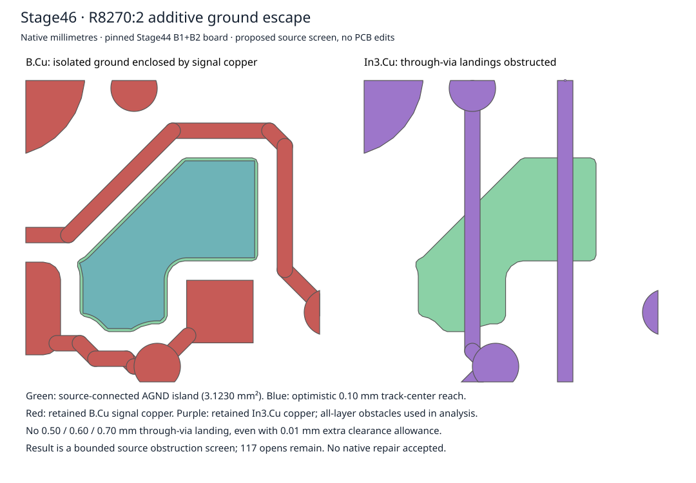

# Stage46: R8270 ground escape obstruction

No additive repair was accepted. The Stage44 disposable B1+B2 board still has
117 native opens; the requested 117→116 exact main-AGND merge was **not achieved**.
No candidate PCB was written, no copper moved, no canonical output changed.
Shared JL, fixed hardware, net partitions and parent286 remain preserved.

## Compared options

The pinned input is Stage44 B1+B2 SHA256
`d1f79d02ac20ecca28591a1332fd217603ac53ce114bcd4aa1290f78ba3d2b73`.
Native KiCad 10.0.6 read-only connectivity still reports 117 opens.
The complete occurrence-aware Stage44 snapshot remains authoritative for net
partitions; a shared zone UUID alone is not an electrical connection between
its disconnected filled polygons.

1. A **13×14 mm** corridor (native x263–276, y125–139), 0.05 mm grid,
   0.4 mm ground track / 0.25 mm clearance / 0.7 mm via, F/In2/B layers,
   targets two existing main-AGND vias: NOPATH. This expands the Stage45 window
   and changes its target evidence; it does not repeat the same narrow search.
2. Fanout to In1.Cu AGND with F/In1/In2/B routing, same window/grid/clearance,
   through-vias **0.7, 0.6 and 0.5 mm**, 0.3 mm drills: all NOPATH.
   Plane-mode routing alone would not prove actual filled-plane connectivity.
3. Continuous polygon screening accounts for the full source-connected B.Cu
   island, all available pad/island exits, all-layer foreign tracks/pads/vias,
   direct island-to-via overlap, and off-center track-to-via overlap. Widths
   0.4/0.15/0.1 mm and each via diameter above have no escape. The 0.1 mm width is
   an optimistic global-minimum screen, not an adopted ground width/current rating.

Ground clearance stays 0.25 mm; the Default-to-Default neckdown exception does
not apply. The 0.5/0.3 mm via meets global diameter/drill minima but is only a
proposal, not qualified manufacturing. The second source screen deliberately
under-inflates foreign copper by **0.01 mm**: this makes space larger, includes
exact tangency candidates, and exceeds the project's 0.005 mm geometric error
setting and the circular polygon approximation at this local scale. It does
not relax actual design rules. Even this optimistic screen has no via landing.

## Native fill and exact obstruction

R8270:2 is centered at native **(270.31,133.19)** on B.Cu. Its 3.1230107423 mm²
AGND island has bounds x268.469779–270.7995, y132.7005–134.949775. Native
HitTestFilledArea, raw Contains and audited unfractured Contains agree at all
806 sample witnesses. Native connected-items returns the source pad and its
B.Cu zone. This is an isolated island, not a path to main AGND.

Retained B.Cu LED_K copper above and right closes the escape pocket:

- `8a9f7b4d-2a19-5e84-aa57-57335d2d8f39`: (269.7,132.35)→(270.95,132.35), width0.2.
- `f3c671af-83ca-560f-8614-5a530082d051`: (271.15,132.55)→(271.15,134.15), width0.2.

Other pocket boundaries include R8270:1/SENSE and D8220:1 plus nearby traces;
all exported local objects, rather than just these two highlighted tracks, are
included in the calculation. In3.Cu prevents simply dropping a via:

- `e5c9ec98-084e-5361-a6f6-d8875087ae94`, `/M5B/1_PROTECTED`, x270.4,
  y131.6–135.9, width0.2, crosses directly under the source pad.
- `bc561018-527e-5043-89bb-ce65180311d9`, `/M5B/C3d7d3c_SENSE`, x269.2,
  y131.8–135.2, width0.2.

Their 1.2 mm center separation permits at most a zero-margin tangent locus for
0.5 mm vias at x269.8 before other layers are considered. The all-layer screen,
including the generous overlap and 0.01 mm allowance, excludes that locus too.
The most optimistic reachable track-center component stays over 1 mm inside
its 5×5 mm analysis window. Its track copper/island remains **0.61637 mm** from
all other local B.Cu ground copper (including every other filled island, whether
or not connected to main ground). Therefore this is a local obstruction, not
merely a search stopped at a window edge.

`geometry.json` contains exact native-derived local pad/fill polygons and
polygonized tracks/vias with input hashes. Objects within 1 mm of the analysis
window are retained; fill is clipped only outside that halo. Keepouts, holes,
board edges and foreign filled zones are omitted from the screen, enlarging
available space; they cannot turn this negative result into a route. This is
bounded source evidence for conventional additive tracks and through-vias,
not a universal impossibility proof or native DRC acceptance. Blind/buried vias,
stackup changes, jumpers and moving retained objects are outside this scope.

## Smallest next decision

Authorize a **disposable local reroute of retained signal copper around R8270**,
with fixed footprints, shared JL, netlist and stackup unchanged. Start by testing
whether moving the In3.Cu 1_PROTECTED segment creates a via landing; if not,
compare a local B.Cu LED_K detour. No assertion is made that one segment move
alone suffices or that a particular displacement is safe. Each moved object
must be explicitly inventoried and reviewed; the existing all-object-preservation
gate cannot silently be reused as if nothing moved. Acceptance remains exact
AGND merge117→116, zero new rule/parity errors and all other partitions preserved.

That decision belongs to the parent/owner. No such reroute is applied here.
Independent Cloud work can continue triaging other isolated nets against their
actual obstacles; physical measurements are not the blocker for this routing
study. No fabrication, ordering, energization, merge or canonical adoption.
