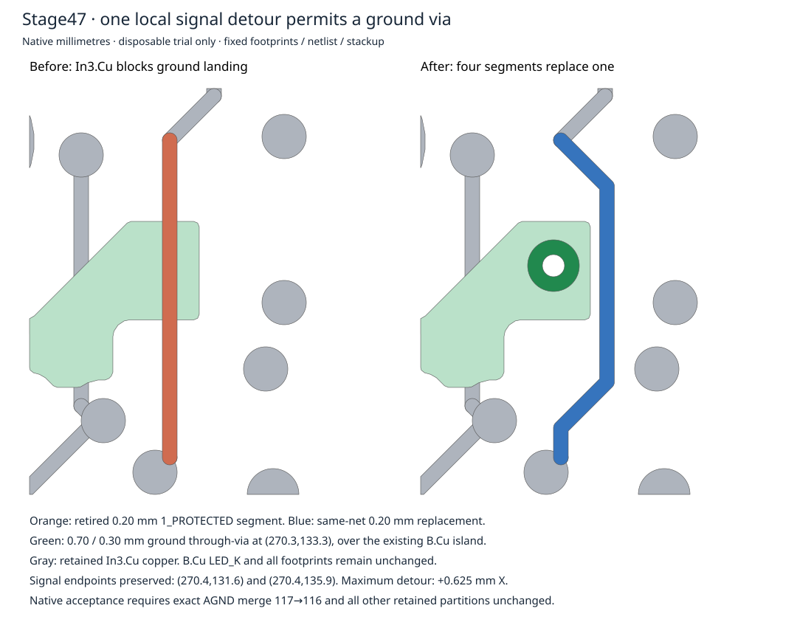

# Stage47: bounded local ground repair accepted in disposable native copies

The proposed local reroute closes **R8270:2 to the existing main AGND component**:
**117→116 native opens**, zero rule errors and zero schematic parity differences.
Two independent builds from the untouched Stage44 board produce identical saved
PCB bytes, complete native object/partition snapshots and acceptance results.
All other retained connectivity and all footprints are unchanged.

This is acceptance of one bounded native design study, **not canonical adoption,
full-board routing closure or physical/manufacturing qualification**. The116
remaining opens and 476 warnings are not waived. Stage46 and all history remain
unchanged; parent286 is preserved, and PR287 remains draft.



## Authorized scope and geometry

The parent explicitly selected a disposable local retained-signal reroute after
Stage46's additive-only obstruction result. That changes this trial's copper
preservation scope; it does not authorize manufacturing adoption or broad routing
relocation. Only the In3.Cu 1_PROTECTED obstruction needed to move. B.Cu LED_K,
fixed front hardware, contacts, footprints, components, netlist, stackup, outlines,
zone definitions and rules remain unchanged.

Retired object: **e5c9ec98-084e-5361-a6f6-d8875087ae94**, net
`X58FDDB7628A1C5322DD0` (`/M5B/1_PROTECTED`), 0.20mm In3.Cu segment,
from native(270.4,131.6) to(270.4,135.9).

Four new 0.20mm segments replace it on the **same net and layer**, through:

```
(270.4,131.6) → (271.025,132.225) → (271.025,134.875)
             → (270.4,135.5) → (270.4,135.9)
```

Maximum lateral displacement is 0.625mm; original endpoints remain fixed.
One 0.70mm through-via with0.30mm drill at native(270.3,133.3), net AGND, connects
the source B.Cu island to existing ground. No ground-track width reduction,
clearance relaxation or via technology/stackup change is used.

[proposal.json](proposal.json) records every retired/new ID, exact geometry and
net. Retirement is bound to its baseline raw block SHA256, top-level index,
kind, UUID and native geometry/net contract. Replacement UUIDs are new.

## Native preservation proof

Baseline Stage44 B1+B2 SHA256:
`d1f79d02ac20ecca28591a1332fd217603ac53ce114bcd4aa1290f78ba3d2b73`.
Accepted disposable PCB SHA256:
`82ffbc1be37b9b0317b0ee759d9b5f9138cad9a93338ade14f6ceda58aee2154`.
Proposal SHA256:
`d78bd59e9030712883b9ee4190d6a48e6cf5196fea40fec005da33c3869a1887`.

Complete native snapshots use geometry-aware copper identities and stable pad
identities, never UUID-set collapse. The saved board has 37790 objects versus
37,786 baseline: exactly one retirement and five additions.

- The original signal component has 162 objects including the retired segment.
  Its 161 retained members stay together. The four replacements join that exact
  component, now 165 objects; no signal partition changes.
- R8270:2's one-object native AGND component merges with the explicitly identified
  baseline main component of 1424 objects (anchor via
  `a6b5c1e1-3b03-53c1-aff3-69160966559d`). The resulting component has 1425 retained
  objects plus the new ground via. All 13 other AGND components stay unchanged.
- Every remaining net partition is identical after projecting out only the
  explicitly retired/new copper. There are no new-only islands, missing objects,
  duplicate component memberships, new nets or changed retained net identities.
- Full footprint hashes, pad identities/nets, other board objects, zone definitions,
  rule-area bytes and schematic/project/library-table dependency hashes match.
  The owned folders retain the baseline relative-library resolution depth.
- Both fresh native executions bind exact input bytes, saved bytes, dependencies,
  DRC report and complete connectivity snapshot. Settlement re-evaluates the
  gates for both copies instead of trusting saved acceptance booleans.

[settlement.json](settlement.json) includes every before/after component hash,
per-object membership, warning counts and local native artifact bindings.
[evidence-map.json](evidence-map.json) maps portable report copies to those exact
local originals. Oversized PCBs/snapshots stay ignored; no Git LFS.

## Warnings and limitations

Each accepted native run reports 476 warnings: 199silk_overlap,
199silk_over_copper, 43text_height, 22via_dangling, 8silk_edge_clearance,
3 track_dangling and 2 hole_to_hole. Every uncapped warning identity/count matches
baseline; no new or removed uncapped warnings. Native capped silkscreen samples
cannot establish exhaustive silkscreen identity nonregression, which remains
**UNRESOLVED**. Newly capped non-silk categories are rejected by the gate.

The first copy was one directory level too deep for its relative footprint
library paths. It produced 199 additional lib_footprint_issues warnings and was
rejected. Its logs/report remain. The corrected-depth and fresh builds used the
same proposal with unchanged rules/dependency contents and passed.

The via center and drill lie inside the existing R8270:2 SMT pad (native pad
bounds x269.88–270.74, y132.785–133.595). Via-in-pad assembly treatment is
**not established**. The native connection is not approval to manufacture that
land/via arrangement; this must be resolved before canonical adoption or release.

No electrical, analog, thermal, current, repeated-flex, assembly/service or physical
qualification follows from native connectivity. No fabricate/order/energize/
release/deploy/merge. Canonical JL still retains its original 117 opens; this repair
exists only in owned disposable copies and reproducible source/evidence.

## Next bounded Cloud work

Parent review can select another isolated ground/signal net against its actual
obstacles, starting from this hash-bound disposable result and preserving its
exact connectivity improvement. No further decision is required for Stage47;
canonical adoption or broader relocations require a separately selected scope.
