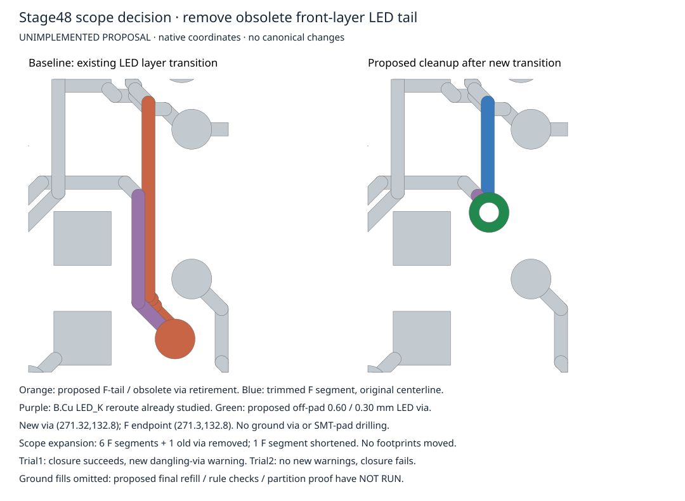

# Stage48 — off-pad escape reaches a scope boundary

Neither disposable trial is accepted. Stage47 remains intact at
ce732b7143f5e68d32bd6d967b83f088009d9edf; its exact-head CI39256731750 passed all
seven jobs. The Issue278 report and PR287 description were reconciled with that
terminal result without repeating Stage47 push/tests. No canonical adoption,
manufacturing output, footprint, hardware, netlist, stackup or historical stage
was changed. Parent286 remains b58068fbaeb65886958a67a4f4978613414e31c5.

The parent authorized a bounded local retained-signal reroute to remove Stage47's
via-in-SMT-pad dependency, requiring fresh-fill zero rule/parity errors, the same
117→116 intended ground closure and no unrelated connectivity change. A broader
scope must be reported with a visual **before implementation**. This checkpoint
stops at that boundary; it does not claim that all possible B.Cu routes fail.

## Executed candidates

Both independently start from the pinned Stage44 B1+B2 baseline
`d1f79d02ac20ecca28591a1332fd217603ac53ce114bcd4aa1290f78ba3d2b73`, preserving
Stage47 separately. Both retire only B.Cu LED_K segments
`f3c671af-83ca-560f-8614-5a530082d051` and
`a8007baf-45fa-5fc8-be0d-a0a22bae8b43`.

| Candidate | Exact proposed replacement, native mm | Fresh native result | Decision |
| --- | --- | --- | --- |
| Trial1 | 0.20mm B stub (271.15,132.55)→(271.3,132.8), ordinary 0.60/0.30mm LED_K through-via at (271.3,132.8) contacting retained F copper | 116 opens, 0 rule errors, 0 parity, 477 warnings | Rejected: one new dangling-via warning on the old LED via |
| Trial2 | Three 0.20mm B segments through (271.15,132.55),(271.345,132.745),(271.345,134.345),(271.7,134.7); no added via | 117 opens, 0 rule errors, 0 parity, 476 warnings | Rejected: intended ground closure absent |

Complete native object/partition audits confirm Trial1 merges exactly R8270:2's
AGND component with the specified main AGND component. Trial2 preserves all
baseline partitions, so it fails closure. Every other retained partition and all
footprints, pads, other copper and dependencies are preserved in both. Trial1's
old via `a63a488c-d65e-5563-90b3-e28bf3a61872` is connected only on F.Cu after the
B tail is removed; that new warning is not waived. Existing capped silk warning
identity nonregression remains unresolved. Native process success is not design
acceptance; neither rejected result is hardware qualification.

## Minimal explicit next scope — not implemented

Retain Trial1's local B transition, with the new LED via shifted +0.02mm to
**(271.32,132.8)** to balance source-derived foreign-copper clearance margins
at 0.030mm (pad gap0.280 versus0.250; nearest In2 signal gap0.230 versus0.200).
This shifted position has **not** been natively checked. No ground via is added.
Then expand to the obsolete F.Cu tail:

1. Remove old LED via `a63a488c-d65e-5563-90b3-e28bf3a61872`.
2. Remove six F.Cu segments:
   `02d727f2-84bb-57f4-b095-90a15351d259`,
   `14e5290c-3c0a-51c3-9ddb-c71c7f2b33c3`,
   `1a635a05-179c-56a8-9299-9bdfe2cc2ca5`,
   `41da91b3-066c-59be-a6d5-e465426e70e9`,
   `4987e593-215d-56a9-a415-0501896d057c`,
   `cdc72bb1-5b70-5452-ba71-e04b9c8105e1`.
3. Retire/replace `e70d01bd-e454-578a-b41f-6705ed031b1e`, shortening its original
   F.Cu centerline to (271.3,131.15)→(271.3,132.8), width0.20mm. The new endpoint
   overlaps the proposed via center by0.02mm; the source-side endpoint stays fixed.

Independent review scanned all66 LED_K pads/tracks/vias in the full native-derived
Stage45 dump, not merely the cropped drawing. No other same-net pad/branch touches
the six segments or trimmed portion. The old via's sole external contact is the
already-retired B segment a800…. This is a source-supported scope proposal,
not proof of native acceptance. No clearance, zone-width or manufacturing rule
is weakened. The actual B AGND zone minimum thickness is0.15mm, not the initial
exploratory0.25mm assumption; the executed Trial2 still fails connectivity.

**Requested parent decision:** permit this specifically enumerated F-tail/via cleanup as the
next disposable candidate. Next cloud work: generate that proposal from the
pinned baseline, native refill/DRC, exact retirement/partition proof, independent
fresh rebuild, review and exact-head CI. Stop if further scope is needed.

No physical measurements are needed to test that next proposal. Assembly,
fabrication, electrical behavior and reliability remain NOT RUN. Stage35–47
physical/mechanical/wire uncertainties remain unchanged. No energization,
fabrication, ordering, release, deployment or merge occurred.
