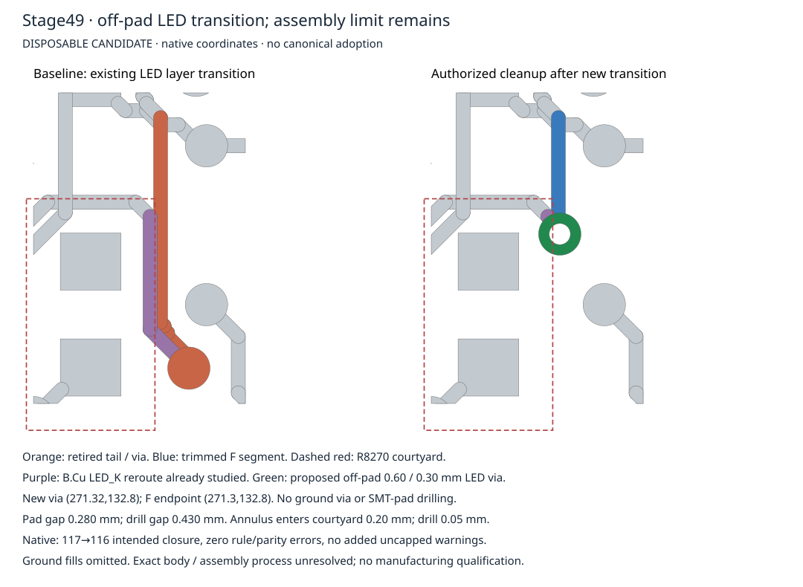

# Stage49 — authorized off-pad LED transition

The exact parent-selected cleanup passes bounded native acceptance on two
independent builds from Stage44: **117→116 intended AGND closure, zero rule and
schematic-parity errors, no added uncapped warnings**. Both retain476warnings;
capped silkscreen warning identity nonregression remains unresolved. This is a
disposable routing study, not canonical adoption or manufacturing qualification.

Stage48 CI39264821757 passed all seven jobs at
2f7a86f2459ac2c65fa3220cc168b605b47c7349 before any Stage49 mutation. Its report and
PR text were reconciled. Both rejected Stage48 trials, Stage47 and all historical
stages remain untouched. Parent286 remains b58068fbaeb65886958a67a4f4978613414e31c5.

## Exact permitted geometry

Only the ten explicitly reviewed LED_K objects are retired: the two Stage48 B.Cu
segments, obsolete via a63a488c…, six listed F.Cu tail segments, and e70d01bd… for
shortening. Full UUIDs, original raw hashes/indices and contracts are retained in
proposal.json. Added geometry is exactly:

- 0.20mm B.Cu stub (271.15,132.55)→(271.32,132.8).
- 0.20mm F.Cu segment on its original centerline (271.3,131.15)→(271.3,132.8).
- Ordinary0.60/0.30mm LED_K through-via at(271.32,132.8), inheriting both-side tenting.

No ground via is added. No additional geometry/scope was needed. Footprints,
pads, fixed hardware, netlist, stackup, zone definitions, rules, dependencies and all other
routed copper remain unchanged. Zone fill changes only through native refill. Exact added-object checks reject extra properties,
including tenting overrides. Canonical/manufacturing outputs remain unchanged.

## Native evidence

Baseline board SHA:
`d1f79d02ac20ecca28591a1332fd217603ac53ce114bcd4aa1290f78ba3d2b73`.
Both final disposable board SHA:
`05f85d8cb27dcbeec76327065e91526f0112ebc316054a1cec5cae5cbc80c441`.
Proposal SHA:
`a0c7e61600db44d8e70321ae53429f73f6929727b042210706212cfa7b42da41`.

Object count37786→37779 (-10+3). LED_K's original66-object component retains all56
non-retired members and joins all3 additions, giving59objects in one component.
AGND merges exactly the one-object R8270:2 source component with the1424-object
specified main component, adding no ground object. All13other AGND components
and every other net partition are preserved. Complete board bytes, native
snapshots and acceptance receipts agree across independent fresh builds; see
settlement.json. No post-review PCB change was needed.

## Assembly consequence — unresolved

The new via **does not overlap any solder pad** in the native-derived geometry.
Nearest R8270:2 copper gap is0.280mm; drill-to-pad gap0.430mm. Board mask expansion
is0 and the footprint/pads have no local mask/paste override; the via inherits
front/back tenting. Nominal pad apertures therefore remain separate. This removes
the geometric via-in-SMT-pad dependency, not every assembly risk.

The annulus still enters R8270's courtyard by **0.20mm**, and the drill by
**0.05mm**. Its center is0.10mm outside the courtyard. Exact populated R8270 MPN,
manufacturer and body envelope are absent; the shared R0603 receipt has family
fidelity with manufacturer dimensional correspondence unverified. Courtyard
intersection alone proves neither body collision nor a manufacturing violation.
Do not treat native DRC success as assembly approval. See assembly.json and the
independent assembly review.

Before any canonical adoption, obtain the exact R8270 populated variant/drawing
and body/termination envelope, placement tolerance and assembly clearance criteria;
confirm the shop's mask registration/tenting capability for this via size. An
unpowered mock-up should locate the actual body/termination relative to the via,
verify no contact or solder/paste bridging under the approved tolerances, and
inspect tenting/annulus exposure. A measured clearance is acceptable only against
those explicitly supplied process criteria; none are invented here. If these
inputs require another geometry change, propose its minimum scope before editing.

Next safe cloud work is source reconciliation of those exact assembly inputs or
an independently authorized next routing target. No fabrication, ordering,
energization, release, deployment, canonical adoption or merge occurred. Earlier
mechanical/wire and physical verification gaps remain unchanged.
