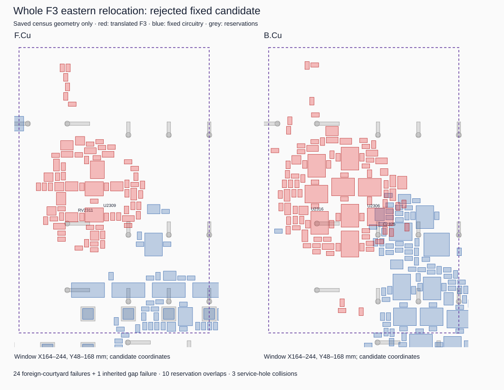

# The specified eastern F3 relocation does not fit

**Reject this exact rigid transform.** The single owner-approved audit completed
and found 24 location-dependent courtyard failures against fixed circuitry,
10 reservation overlaps and three service-hole collisions. These failures alone
reject the placement, independently of copper filtering or future routing.
There was no second placement attempt.

Input plan: [`c3e4bc95`](../../planning/f3-next-approach/README.md).
Reviewed audit source commit: `e565e278` (full SHA in the ledger).
Exactly 171 F3 parts and 502 pads were translated **(+71.25, −85.85) mm**,
with zero rotation and unchanged faces, including U2306 and RV2307–RV2313.
All other footprints, panel centres, harness identities/full pin order,
reservations and accepted boards remain unchanged. The disposable output is a
source geometry/evidence model, not a KiCad board or an adopted design.

## Fit failed against fixed N1 and service geometry

| Source gate | Measured outcome |
| --- | --- |
| Same-face courtyard spacing | 24 location-dependent failures, including 22 actual overlaps and two sub-0.35 mm gaps; one additional inherited internal failure |
| Fixed reservations | 10 overlaps at JR-K-15/K-16 holes/hooks |
| Analytic service holes | D2318, RV2311 and U2316 collide with JR-K-15-K; margins −0.28, −0.40 and −1.10 mm |
| Courtyard edge allocation | No violation of the 0.30 mm source allocation |
| Translated copper edge and saved copper keepouts | No violation of the 0.50 mm copper-edge screen or saved track/via keepout polygons |
| Bypass relative distances | Unchanged under the rigid transform; no new internal-distance relaxation |

The largest listed fixed-courtyard overlap is **U2306/RV6101: 20.553 mm²**.
U2306 also overlaps C6103, C6104, R6103, R6111 and U6103. The internal
C2325/U2306 courtyard gap remains **0.349999 mm**, below the strict 0.35 mm
source gate. It was retained as a failure, not rounded into acceptance.
All pair witnesses are in [placement.json](evidence/placement.json).

Rigid movement preserves all internal pad relationships. The C2312.1–U2306.5
span remains 28.925927 mm; U2312.12–U2306.5 remains 29.169635 mm. Those are
source distances, not newly imposed electrical limits. The audit records
14 inherited pad/copper clearance pairs and 25 inherited copper/copper pairs
under the conservative 0.25 mm screen, plus four inherited hole-policy pairs.
These are source-policy findings, **not fresh native DRC errors**; native
neck-down exceptions and polygon approximation are not adjudicated here.

No pad-access solver was run. U2309's own-pad geometry remains unchanged, but
prior fixed-rail access diagnoses cannot be transferred wholesale to this new
location: shared rails stayed fixed while F3 moved. The result establishes no
new pad escape, route, open-edge reduction or native acceptance.

## Internal copper can be identified, but the translated set is not accepted

The audit authenticated all **133,902** indexed source objects, including all
**133,551** original segments/vias, by exact source span and SHA-256. UUID alone
was never the identity key. The retained full K1402 artifact supplied all
13,406 pad records; all 3,793 complete footprint source blocks match the
canonical board byte-for-byte. The reduced two-A fixture's 6,121 pad geometries
also match their full-dump counterparts. This is recovered native evidence,
not a new native measurement.

All **4,491 internal-net objects (4,210 segments and 281 vias)** were classified
before transformation. They form 139 source contact components, with 14,492
directed same-net copper-contact records and 367 original pad-contact records.
Every component has an F3 pad contact and no detected fixed external-pad or
same-net-zone dependency. Thus all 4,491 qualified for the **source-contact-closed
translation** in the disposable model; none was left in place as a blocked
internal component. This does not mean the 122 internal nets are each fully
connected, or that zone/native continuity and destination clearance pass.

[Internal classification](evidence/internal-copper-classification.json.gz)
retains exact original records, contacts and component membership.
[Transformed copper](evidence/transformed-copper.json.gz) records every translated
object's geometry, net, layers and original identity. **All canonical copper
remains unchanged.** No cuts, replacement routes or whole-net changes were made.

The destination conflicts must be separated by source ownership:

| Pair census | Two-A objects | Shared rails | Other-candidate source objects | Total |
| --- | ---: | ---: | ---: | ---: |
| Moved pads versus copper | 71 (14 inherited) | 113 | 722 | 906 |
| Translated copper versus foreign-net copper | 249 (25 inherited) | 707 | 5,642 | 6,598 |
| Translated copper versus fixed pads | 26 | — | 854 | 880 |
| Moved pads versus fixed pads | 20 | — | 298 | 318 |

Other-candidate records remain full accepted-source accounting obligations;
these totals are not all retained-two-A blockers and give no permission to delete
anything. Pair counts are not counts of distinct objects or independent routing
failures. The ledger also records four moved-pad/drill pairs, 25 translated
copper/pad-drill pairs and 70 net-independent drilled-hole/annulus-policy pairs
(66 location-dependent, four inherited). See
[result counts](evidence/result-counts.json), the compressed conflict receipts,
and [independent result review](evidence/independent-result-review.json).

## Boundary signals and return/supply need reconstruction

All **18 signal nets at seven fixed headers**, plus **+12V, −12V and AGND**, keep
their full source endpoint and object inventories in
[boundary obligations](evidence/boundary-net-obligations.json.gz). Headers,
complete pin order and their fixed positions remain unchanged.

The move separates **112 original pad-to-fixed-copper contacts**: 35 signal and
77 rail/return contacts, involving 89 moved pads and 109 distinct fixed objects
across 20 nets. All 112 original contacts are lost at the proposed destination.
They are exact reconstruction obligations, not a sufficient route or cut set.
The remaining boundary net HP_CORE has zero original segment/via objects;
absence of an original contact does not satisfy its intended connectivity.
The report lists boundary pads without recorded original copper contacts too.

One new AGND pad-to-fixed-copper contact appears at the destination. It does not
restore the lost original contacts and is retained for group/return review.
No new same-net contact was found between translated internal copper and fixed
pads/copper. All five original zones remain unchanged and unresolved for native
refill, foreign-zone clearance, thermal/return and full connectivity gates.

## The bounded audit completed; the candidate failed

The single worker returned zero after **10.692 seconds**, with peak RSS
**697,300 KiB**, under the 2 GiB address-space and 180-second wall caps.
There were zero retries, alternative transforms, pose/router searches or native
calls. Input seals passed before and after. Source contact classification and
all programmed census stages completed; fresh native/zone acceptance did not.
The independent reviewer verified identities, counts, fixed interfaces and
limits from the saved output without rerunning the census.

The [ledger](ledger.json) seals source, evidence, checks and reviews. Synthetic
safety tests, `pnpm check`, pre/post `pnpm circuit:check`, and frozen-baseline
verification pass. The circuit validator's scope remains manual inventory:
68 lines, zero declared placements, no schematic/placement binding.
Full regeneration was NOT RUN because it invokes unadmitted native work.
Native original groups, DRC/parity, zone refill and full-warning/eligibility gates
remain NOT RUN. Accepted JL117/JR129/core1402 receipts are unchanged historical
evidence, not fresh measurements by this audit.

**Concrete next decision:** retire this exact eastern transform. Decide whether
to authorize a new planning step that relaxes F3's rigid internal placement while
keeping non-F3 circuitry, service geometry, panel and interfaces fixed, and
requires an exact internal-copper reconstruction contract before another test.
This result does not prove that every whole-F3 relocation is impossible, does not
identify a minimum sufficient reconstruction set, and does not authorize another
pose, a broader search, copper cuts, native work, adoption or merge.
