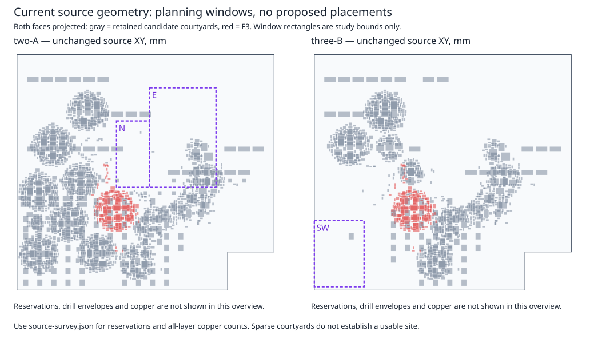

# F3: next approach after retiring the local proposal

**Recommendation: authorize one source-only audit of a rigid relocation of the
whole 171-part F3 cell into the eastern two-A region.** This is a bounded test of
destination obstructions and potential internal-copper retention. It is not a
placement result or a route-completion strategy already shown to work.

This document completes the owner-authorized planning step for [Epic #242](https://github.com/Takazudo/zudo-osc-hole-field/issues/242)
and [core lane #245](https://github.com/Takazudo/zudo-osc-hole-field/issues/245),
on integration PR260. Inputs are frozen at closeout
`1bc168efb41c369d1598733719b6a4befcc6e7cb`. No new group pose was evaluated,
no copper was moved or cut, and no native slot was admitted. All canonical boards,
source candidates and prior evidence remain unchanged.

## Why the local proposal is retired

The [last fixed-pose census](../../pilots/f3-copper-impact-v1/README.md) found
52 directly affected original copper objects, including 23 beyond the previous
29-object assumption. It also found three courtyard overlaps, two pad conflicts
and a failed bypass condition. The earlier 16,184-pose independent search found
no eligible pose for either integrator IC. These are failures of the particular
local contract; they do not establish that all other locations or architectures
are impossible. Repeating that contract or merely deleting the 29 objects is not
an approved next step. The minimum sufficient reconstruction scope is unknown.

## Four materially different choices

| Approach | Electrical and copper consequences | Space and feasibility | Decision |
| --- | --- | --- | --- |
| A. Keep U2306 fixed; move the other members of the original 24-ref group north in two-A | Smallest ownership expansion, but splits a sensitive cell from its fixed anchor. Any point in the northern rectangle is at least 34.605 mm from U2306 pad 5. This is a geometric lower bound, not a new electrical limit. Original internal copper cannot simply follow a partial group. | The 24-ref current envelope is 37.15 × 70.67 mm; fitting the rectangle by dimensions alone says nothing about individual destinations or fixed copper. Longer signal/return paths make this a weak next experiment. | Do not select. |
| B. Repack the expanded 59-ref group in northern two-A | Includes neighboring circuitry identified by the failed census, but still exposes 37 external signal nets, including BP/LP OTA signals, IABC and offset/control circuitry. Only 32 nets are wholly internal, covering 1,289 original segments/vias. It is an ownership-review closure, not a complete isolated electrical cell. Six internal trimmers and U2306 would need release. | Current envelope 47.900001 × 80.069999 mm does not fit the 40 × 80 mm northern window in either orthogonal orientation. Repacking, including altered bypass/sensitive-node geometry, would be required. | Defer: substantial new search with a poor electrical boundary. |
| C. Move the whole 171-part F3 cell rigidly into eastern two-A | 122 internal nets, 4,491 original segments/vias potentially retained; 18 external signal nets at seven fixed headers, plus +12V, −12V and AGND. Relative internal geometry and bypass relationships remain unchanged. External signal and return/supply connections still require exact reconstruction accounting. | Combined current courtyard/copper envelope 58.07 × 111.68 mm fits the 80 × 120 mm rectangle by dimensions. N1/M4 circuitry, fixed headers, reservations and substantial copper occupy this region. No collision fit is established. | **Select one bounded obstruction/retention audit**, because it tests a coherent boundary at a genuinely different location without first searching new internal poses. |
| D. Put the whole F3 cell in southwestern three-B | Same coherent 171-part electrical boundary, with the same seven header identities and full pin order retained. Three-B removes some two-A circuitry but adds M5 circuitry; it is not a subset. Shared return/supply and board-stack/service implications remain. | The 60 × 80 mm surveyed window cannot contain the current 58.07 × 111.68 mm rigid envelope in either orthogonal orientation. It has less retained candidate copper, but many support/hook reservations. Repacking or a different region would be needed. Simply selecting three-B at the existing F3 site preserves the same F3 obstacles. | Defer pending an explicit three-board architecture decision. |

Rigid relocation preserves the existing BP span and intrinsic internal pad-access
failures, including U2309 limitations. It also preserves the recorded
C2325/U2306 courtyard gap of approximately 0.349999 mm, below the strict 0.35 mm
gate. No tolerance waiver is proposed. A successful *accounting experiment* can
therefore still return a failed placement candidate. Its value is determining
whether the different environment and coherent copper boundary are worth any
later, separately authorized internal repair.

## What the existing source says about the regions

Coordinates below are candidate XY millimetres; accepted PCB coordinates add
(100, 50). Both candidates use the same notched 310 × 284 mm board envelope.
The descriptive [source survey](source-survey.json) examines three predeclared
windows. It does not optimize them or evaluate a moved group.

| Region | Rectangle [xmin, ymin, xmax, ymax] | Fixed source occupants and reservations | Accepted segment/via objects intersecting the window: same candidate / shared rails / other candidate |
| --- | --- | --- | --- |
| N-two-A | [124, 88, 164, 168] | Front J900050 and TP990012; back POWER R302. POWER-JL-6 and JL-K-25 hole/hook reservations. | 527 / 479 / 3,768 |
| E-two-A | [164, 48, 244, 168] | N1, M4A/M4B circuitry; J900036, J900102/104/106/108, POWER R303 and test lands; POWER-JR and JL/JR hole/hook reservations. | 2,654 / 1,624 / 13,284 |
| SW-three-B | [4, 208, 64, 288] | Front J900275; no intersecting back courtyard. Support 4/6 and numerous K-P hole/hook reservations. | 49 / 238 / 7,156 |

The survey's unoccupied polygon areas are descriptive area arithmetic, not an
inscribed placement envelope or available routing space. Copper counts include
all six layers, with width/annulus intersection, but do not apply pad clearances.
The five original zones are separate refill/continuity obligations. “Other
candidate” is an ownership classification under the candidate source contract;
it grants no authority to remove those objects. The audit must account for the
full accepted source before claiming eligibility. No foreign cell may be evicted
to make the eastern region work.

## Exact group and interface contract

[Group boundary](group-boundary.json) records the 42 source ownership seeds and
17 closure additions for the 59-ref alternative. Its
[electrical boundary](electrical-boundary.json) records all source net/pad joins.
The [whole-F3 boundary](whole-f3-boundary.json) fixes exactly the 171 `module == F3`
source-part refs and their complete pad/net ownership. It has 143 nets:
122 internal, 18 boundary signals and three shared rails.

The 18 signal ports terminate at **seven** existing fixed headers. Names below
are the F3 net suffixes; exact source tokens and pad sets are in the JSON.

| Fixed header | Signal net and pin |
| --- | --- |
| J900012 | RES_BUFFER:7, HP_CORE:1, IN_BUFFER:3, LP_CORE:5 |
| J900010 | FREQ_BUFFER:5, DRY_CORE:3, BP_CORE:1, GAIN_BUFFER:7 |
| J900235 | Cb3b460_W:1, Cb5b1dc_W:3 |
| J900239 | RES_REMOTE:3, REF5:1 |
| J900233 | C8c344f_W:1, Ca72ec0_W:3 |
| J900231 | C14689f_W:1, C2b474d_W:3 |
| J900237 | FREQ_REMOTE:1, GAIN_REMOTE:3 |

These are existing interfaces, not new connectors or permission to repack pins.
The three rails require full return/supply continuity accounting, including
shared objects that cannot follow the group. Whole-F3 includes seven internal
trimmers RV2307–RV2313 and the currently anchored U2306. It does not move actual
panel controls. All 438 panel centres, 195 harnesses, 390 endpoint Refs and complete
pin maps, noncore poses, fixed service/support geometry and six copper layers
remain fixed. Component values, packages, faces, pad UUIDs and net tokens are
preserved. No substituted electrical parts are proposed.

The 4,491 objects are a whole-net inventory, **not a transplant permission list**.
Their original source spans and hashes must identify duplicate-UUID-safe records;
contact checks must decide whether each can actually move coherently. Zones and
boundary/rail copper are not silently included in that number.

## One proposed next experiment — dormant until separately approved

Machine-readable contract: [next-experiment.json](next-experiment.json),
`F3-WHOLE-CELL-E-ONE-RIGID-AUDIT`.

1. Freeze the input seals and exact 171-ref roster. Independently review the
   future audit source and its source-object/contact selectors before execution.
2. In a disposable source proposal only, author one rigid translation:
   **dx +71.25 mm, dy −85.85 mm, rotation 0°, no face changes**. The old combined
   courtyard/internal-copper bbox `[93.75,134.85,151.82,246.53]` becomes
   `[165,49,223.07,160.68]`. This is arithmetic only; no transformed geometry has
   been evaluated. Keep every non-F3 footprint fixed, including all seven headers.
3. Classify original contact graphs and exact source-span/hash identities before
   moving any copper. For all 4,491 internal-net records, record preserved in
   place, verified rigid-transform eligibility, or explicit reconstruction/blocked
   status. Do not grant blanket eligibility by net name. Account for every
   boundary signal and shared-rail contact, all original zones, and source objects
   absent from reduced candidate fixtures. No cuts are authorized.
4. Run one complete source geometry/continuity census of that authored proposal
   against fixed pads/courtyards, retained candidate copper with full accepted
   source accounting, drills/vias, reservations and board edges. Keep the existing
   strict clearance and return/supply/bypass policies. Report both inherited
   internal failures and new destination failures; never convert either to PASS.
5. Produce the complete obstruction, contact and eligibility ledger, with exact
   original/transformed identity accounting, then stop. No nudges, alternative
   transforms, expanded ref scope, rail cutting, router call or second attempt.

**Resources:** one source worker, 2 GiB cap, 180-second geometry wall limit,
one authored transform, zero alternative transforms, zero router searches,
zero native calls and zero retries. If the census cannot finish within the bound,
return its explicit incomplete status; do not report acceptance. Source code
preparation is not permission to run another geometry experiment.

**Experiment completion:** reproducible input/output hashes and a complete
accounting of all 171 poses, all original internal copper, all boundary/rail
contacts and every obstruction. A negative result is useful evidence. Missing
identity, contact, zone or ownership information is a blocker, not assumed safe.
A placement fit requires all applicable strict source gates to pass; known
inherited failures currently prevent claiming that result. Even a source fit
would not establish native continuity, DRC/parity or final eligibility.

**Stop and decision boundary:** owner authorization must explicitly cover this
one source-only whole-cell proposal, releasing U2306 and all seven trimmers only
within that disposable proposal, and the stated copper classification scope.
The current planning approval does not authorize execution. Any reconstruction,
repacking, native run, canonical adoption or merge needs a separate decision.
Future native work would also require parent admission, pinned KiCad 10.0.6 and
the existing 300-second guard: at most two workers, 6 GiB each, 12 GiB aggregate,
2 GiB free. This plan requests no native slot.

## Evidence and verification

Input hashes are recorded in [source-survey.json](source-survey.json); source
copper inventory uses the full accepted 133,551 segments/vias and the existing
133,902-object hash accounting, not CI-capped unconnected-item counts. The
accepted core PCB hash remains
`fa60b4e1587a67501782fb55374f0e5d5133f65cd0bbe62624aef502441fda10`.
See [planning ledger](ledger.json) and [work note](WORK-NOTE.md) for review and
check receipts. Independent source review confirms the 171 refs, 122/18/3 net
boundary, seven headers/trimmers and 4,491 internal copper records. Its initial
copper-envelope review checked recorded arithmetic, not transformed geometry.
The final plan review is saved separately under `evidence/`.

Checks here cover document/source consistency and unchanged baseline inputs.
Native DRC/parity, full-original groups, refill, full-warning/eligibility gates
and full regeneration remain unrun. No improved open-edge count is claimed.
