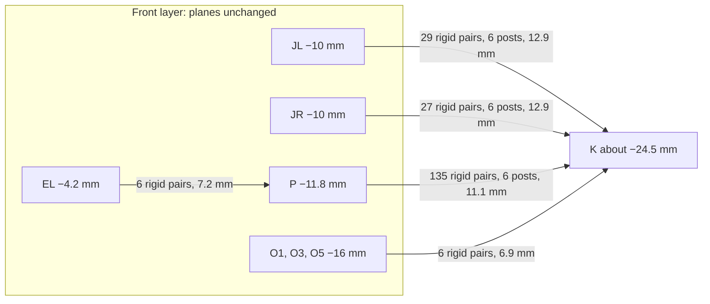

Authority: **PROPOSAL (planning, owner-delegated)**. Status: **NOT ADOPTED until Gate A; unvalidated draft**.

This page plans a successor to the [conditional ten-board partition](./osc-board-partition.mdx). It changes no adopted design data. `design/partition/partition.json`, the placement lock, the routed board drafts, both decision registers and every generated page are untouched. Until Gate A adopts the plan, the cable-based partition with K at −100 mm stays the working design.

The owner asked on 2026-11-14 for board-to-board joints in place of cable-only connections, with cables kept only where board heights justify them, accepted removing the OSC2 and OSC4 octave selectors, and chose a SUB toggle as their replacement. Every schematic and PCB remains an unvalidated draft. Fit, alignment, mating-force, thermal and electrical checks of this plan are **NOT RUN**: no exact connector is selected and no specimen exists.

## Owner direction of 2026-11-14: proceed, with design decisions delegated

The owner read this plan on 2026-11-14, asked to continue, and directed that the work runs autonomously. A difficult architectural decision goes to a Fable design agent at high effort, which decides, and the work continues without waiting for the owner. The campaign record is `circuit/orchestration/campaigns/osc-stack-20261114/plan.md`; its decision log is `decisions.md` in the same folder.

| Matter | Decided by |
| --- | --- |
| Gate A (Q1) and questions Q3, Q4, Q5, Q6 and Q8 below | The design authority: the Fable design agent, on the Phase 0 evidence |
| Design reviews marked "Design authority" in the sub-task tables | The same design authority, never the implementer |
| Purchases, quotes, supplier contact, fabrication orders including the coupon build (Q7), deployment | The owner only |
| Jack and control positions | Nobody: they stay fixed by the placement lock |
| Panel artwork and legends | The owner |

A decision of the design authority selects a design. It is recorded with the way to reverse it, and it never performs a purchase or an order that the design later needs.

## Design review A3 of 2026-11-14: flex links are the working design, and one paper gate decides

Three things happened after design review A1. Design review A2 changed its heights by 0.2 mm and added aids for the rigid pairs (decision rows DS-24 to DS-33). The owner then declined the connector coupon and accepted the small misalignment of the rigid pairs as a risk, asked for flex PCB to be researched and used if it is an acceptable way to go, and decided that the spacers are printed parts (rows DS-35, DS-37 and DS-38). Design review A3 decided for flex links (rows DS-39 to DS-46). The records are `reviews/da-02.md` and `reviews/da-03.md` in the campaign folder.

Nothing is adopted, selected or bought. The cable partition stays the working design, and coupling, current share, fit and every physical check stay **NOT RUN**.

Where this section and the sections below differ, this section holds. The section on design review A1 and the plan as first proposed stay below as the record of the rigid stack. The ruling on stock flat cables at the end of this section changes the link, the counts, the rigid pairs, the fixings and the gate rule of the table that follows.

| Item | After design reviews A1 and A2 (the way back) | After design review A3 (the working design) |
| --- | --- | --- |
| Joints to K | 197 rigid pairs with 777 positions; the stackers are hand soldered on a registration plate | About 49 flat links with a 1.00 mm FFC/FPC connector at each end replace 191 of the pairs. Twelve rigid pairs stay: six from EL to P and six at the selector adapters |
| Link | None | A flex circuit or a catalogue flat jumper; which of the two is open. The connectors that were read are rated for at most 30 matings |
| Sites | A pair at each harness connector site, with no neighbour moved | 382 sites are deleted and about 98 connector fields are placed anew. All 513 interface signals are re-routed on two boards each. K gets about 49 slots of about 24 × 1.5 mm, so that each link latches on K's rear face |
| K plane and depth | F.Cu at z = −30.6 mm, rear face at −32.2 mm, about 40 mm of inside depth | Unchanged |
| Gaps | 19.0 mm (JL, JR), 17.0 mm (P) and 13.0 mm (adapters) | Unchanged |
| Fixings | About 48, with every pair within 40 mm of one | 30: the 18 power posts and 12 printed spacers |
| Power | 18 bolted brass posts of 19.00 and 17.00 mm | Unchanged |
| Alignment aids | Pilot locators, a registration plate, a closing-load rule and a draw-down by jack screws | Withdrawn. Four measures stay: the toggle take-up window, oversize post holes in K, the panel as the soldering fixture and the strain limit near fixings |
| Closing | One closing of all pairs at about 750 N | 98 latches, closed one at a time; no mating load on the boards |
| Gate A | Two steps: A-paper, then A-physical on a coupon | One gate on paper with five checks. The coupon is declined and A-physical is withdrawn |

### The price of flex is a re-route of every interface signal

The alternatives table below rejected a few large connectors per board because every interface signal would be re-routed. That reason still holds. What changed is the other side of the comparison. Reviews A1 and A2 found that the rigid stack needs 197 hand-soldered stackers and a closing procedure of about 1,100 screw operations, and the owner declined both the coupon and that hand work.

- A link carries up to about 14 signals side by side over 40 to 60 mm. Coupling between neighbours is NOT RUN.
- The worst ground contact is computed at 0.54 to 0.57 A, above the 0.5 A of the right-angle connector that was read. The links have spare positions for more ground contacts; the new share is NOT RUN.
- A link can be mated at most 30 times, which limits how often K comes off.
- Lowering K with about 49 link tails through 49 slots is the awkward assembly step.

### Gate A-paper has five checks

1. **Identity.** One connector pair and one link type, from retained maker documents.
2. **Access.** Every link end can be plugged and latched with the boards on their spacers. The list of slots and connector fields on K, with the footprints each displaces.
3. **Allocation.** Each of the 513 signals on a link with its ground positions, and the worst ground contact inside the connector's rating.
4. **Coupling.** A computed bound for the worst neighbour pair, and a ground-layer or spacing rule where a precision net needs one.
5. **Rework count.** Footprints moved and nets re-routed per board.

As first ruled, the design returned to the rigid stack if the fields and slots displaced more K footprints than the rigid design would, or if coupling had no solution within a 2-layer flex. The ruling below replaces that rule and amends the five checks. On the first real boards the checks are continuity of every position, every latch closed by hand and one open-and-close of K.

### Six items are raised for the owner after design review A3

| Item | State |
| --- | --- |
| The price of flex: every interface signal re-routed and about 49 slots in K | Reported on 2026-11-14. The work continues on flex, because the owner asked for flex to be used if it is acceptable |
| Custom flex circuits or catalogue flat jumpers | Decided by the owner on 2026-11-14 (DS-48): stock flat cables wherever possible, and a flex circuit where the connections are too many for the room |
| Thirty matings per link | For information. After the ruling below K comes off about 10 times |
| Six adapter stackers may need hand soldering (30 joints) | Lapses with the ruling below: the adapter pairs move to flat cables |
| Printing 12 spacers plus spares | The models are in `design/stack/spacers/` and the owner has them. The ruling below keeps the models and changes the sites; ST-08 lists them and states the screw lengths |
| Purchases | None; nothing is selected |

### The ruling of 2026-11-14 keeps the flat links on stock 0.5 mm cables, at a higher count than first told

The owner asked for stock flat cables first, and for a flex circuit only where the connections are too many for the room (row DS-48). Three paper studies followed: the room for the links, coupling with ground current, and reduced mechanics. The design authority then ruled (rows DS-59 to DS-67; the record is the section "Continuation c1" of `reviews/da-03.md`). Where this subsection and the table above differ, this subsection holds. The owner's answer on the higher price is open, and the work continues on stock flat cables meanwhile.

| Item | After design review A3 | After the ruling |
| --- | --- | --- |
| Link | About 49 links at 1.00 mm pitch; flex circuit or flat jumper open | A stock 0.5 mm flat cable with same-side contacts between two Hirose FH12 connectors. 40 circuits on JL and JR; on P the largest of 40, 26, 14 and 8 circuits that finds a place. A flex circuit only for a link that finds no place as 8-circuit stock links; none today |
| Count | About 49 links and slots, 98 latches | 63 to 88 links and slots and 126 to 176 latches in the searched combinations. The option that the gate runs on is NOT RUN |
| Rigid pairs | Twelve: six from EL to P and six at the selector adapters | Six: the EL joint only. The adapter pairs move to flat cables, one link per adapter, unless no place is found on an adapter |
| Grounds | Spare positions for more ground contacts | One ground between every two signals, except logic beside logic and wiper beside wiper; logic and wiper never share a cable. This is the pattern of the present cable harness |
| Coupling criterion | A computed bound, with a ground-layer flex as the fallback | At or below the computed level of the quietest present harness that carries the same pair of signal classes. Neither level was ever measured |
| Matings | At most 30 | K comes off at most 10 times; the connectors are rated for 20 insertions |
| Fixings | 18 power posts and 12 printed spacers | 18 power posts, and a printed spacer only where no other fixing of K lies within 70 mm. Sites are added near K's upper and lower edges. ST-08 lists them; the spacer models do not change |
| Gate rule | Back to the rigid stack if the links displace more K footprints than the rigid design | The links displace 215 to 439 K footprints in the searched combinations, against 129 for the rigid design, so that rule fails by the letter and is replaced: every displaced footprint must find a free position within 12 mm, or a named remedy. A negative gate goes to the owner with the alternatives; nothing returns to the rigid stack by itself |

The counts are courtyard-level results of a greedy search on assumed parameters, and none is a minimum. Coupling, current share, fit and every physical check stay **NOT RUN**.

### Six items are raised for the owner after the ruling

| Item | State |
| --- | --- |
| The higher price: 63 to 88 links and slots at 0.5 mm pitch against about 49, and 215 to 295 parts of K to be placed again | Asked on 2026-11-14 with the recommendation to continue; open. The alternatives are the rigid headers and the cable harnesses |
| K can come off about 10 times | For information |
| Leads of panel hardware under a cable tail trimmed to 1.0 mm or less | Recommended to accept; the room study counts the tails concerned |
| A handling trial with one stock cable and a printed plate with a slot | Optional; offered when the threading procedure exists |
| Printed spacers: the same models at other places | For information; ST-08 lists the places |
| Purchases | None; nothing is selected |

## Design review A1 of 2026-11-14: the stack continues as a changed design and waits for a coupon

**Superseded in part by design reviews A2 and A3:** the coupon is declined, the heights changed by 0.2 mm and the joints to K become flex links; see the section above. This section stays as the record of the rigid stack, which is the way back.

The design authority reviewed the first Phase 0 evidence (ST-01 connectors, ST-02 geometry, ST-03 mechanics) and took six decisions. The record is `circuit/orchestration/campaigns/osc-stack-20261114/reviews/da-01.md`; the decision rows are DS-11 to DS-17 of `decisions.md` in the same folder. Nothing is adopted. The cable partition stays the working design, every figure in this section is a planning value on candidate files, and fit, force, alignment, strain and thermal checks stay **NOT RUN**.

Where this section and the sections below differ, this section holds. The sections below keep the plan as first proposed, so that the reason for each change stays readable.

| Item | As first proposed below | After design review A1 |
| --- | --- | --- |
| Connector pair at the joints to K | One 2.00 mm single-row family, to be found by ST-01 | An MMS −02 −SV socket on the front boards with a TW-SM stacker on K. These are working codes; nothing is selected or bought. The pair that ST-01 first recommended (an SMM socket) cannot give the three gaps |
| Mated heights to K | 6.9 mm (adapters), 11.1 mm (P), 12.9 mm (JL, JR) | 12.8 mm, 17.0 mm and 18.8 mm |
| K plane | F.Cu at z = −24.5 mm | F.Cu at z = −30.4 mm, rear face at −32.0 mm, rear parts to −37.0 mm |
| Inside depth | About 34 mm | About 40 mm. About 37 mm is recorded as the way back; it leaves less Z margin |
| EL to P joint | Single-row 1×6 pairs at 7.2 mm | Still 7.2 mm. Six double-row 2×4 pairs: a CLT socket on EL and a double-row TW-SM stacker on a wider P tab, with relief holes in EL |
| Header positions per side | 813 | 825: the six EL pairs carry 48 positions in place of 36. K's 777 are unchanged |
| Closing order | Build the stack on K and fit the panel last | The front boards go into the panel with their nuts loose, K is drawn on by jack screws, and the nuts are tightened last |
| Fixings | 18 power posts and interior fasteners at candidate sites | Every pair lies within 40 mm of a post or tie post. Five added tie sites are provisional. Posts are 17.0 mm (P) and 18.8 mm (JL, JR) long and double as jack-screw points |
| P in Z | Not stated | Free on its panel side; each toggle takes up Z through a compliant washer |
| EL fallback (Q5) | F1: harnesses plugged on K's front face | Six short harnesses from EL to the P unit. F1 is withdrawn: with K closing last, a plug on K's hidden face cannot be mated |
| Gate A | One decision on the Phase 0 evidence | Two steps: A-paper and A-physical |

### One alignment limit cannot be closed on paper, so Gate A has two steps

The manufacturer's specification allows 0.39 mm of initial misalignment along the contact row and 0.57 mm across it, and 0.07 mm and 0.16 mm of final misalignment. The paper budget meets the initial figure on root sum of squares. It misses the final figure along the row at the worst pair of a board in every closing order. Whether the real pair tolerates the expected 0.1 to 0.25 mm can only be measured.

- **Gate A-paper.** After the re-runs of ST-02 and ST-03, ST-04 and the new task ST-08 (tie posts, jack screws and the closing fixture), the design authority confirms or ends the changed stack as the working design for Phase 1. Phase 1 then runs on candidate files only.
- **Gate A-physical.** On the report of a connector coupon, the design authority adopts the stack and releases Phase 2. The conditions are in decision row DS-16: first-pass mating at an imposed offset of 0.25 mm per axis at each of the three gaps, at most 1.35 N per position, reflow float of at most 0.1 mm per half, and continuity over ±0.6 mm around the nominal gap.
- Without the coupon, Gate A is negative for the joints to K and the cable partition stays. A first article of the real boards is not accepted in its place.

The coupon build is a fabrication order and stays with the owner (Q7). The new task ST-09 writes its definition and creates no order file.

### Five items are raised for the owner

| Item | State |
| --- | --- |
| Build the connector coupon (Q7) | Asked on 2026-11-14; ST-09 writes the definition first |
| Grow the three selector apertures from 7.0 to 7.3 mm | Held until ST-12 shows whether the 0.2 mm budget is met without it |
| Questions to the assembler about stackers that have no pick-and-place pad or come in tubes | For the owner, when a coupon is quoted |
| Who solders the jacks, pots and toggles, and on which fixture | Open. On paper the hardware-on-board scatter exceeds the jack aperture clearance in any design, the cable one included, unless the panel or a plate drilled like it is the soldering fixture |
| Depth of about 40 mm | For information; enclosure and inlet planning under #57 start from it |

## Recommendation: stack K directly behind the front boards

Keep the circuit partition, every front board plane and every placed part apart from the OSC2 and OSC4 selector change. Change four things in the stack:

1. Move K's plane from −100 mm to about −24.5 mm.
2. Replace the harness headers on both boards of each mate by a rigid pin-and-socket pair at the same coordinates.
3. Join EL to P on a new P tab, and pass its signals to K through P.
4. Replace the eighteen soldered power wires by bolted conductive posts.

| Item | Working design today | This plan |
| --- | --- | --- |
| Circuit boards | 10: JL, JR, P, EL, O1–O5, K | 8: O2 and O4 removed |
| K F.Cu plane | −100 mm | about −24.5 mm (planning value) |
| Enclosure inside depth | 120 mm proposal | about 34 mm for the board stack |
| Wire harnesses between boards | 195: 127 GH3, 10 GH7, 58 GH8 | 0 |
| Rigid board-to-board pairs | 0 | 203: 197 on K and 6 between EL and P |
| Contact positions per side | 915 in harness housings | 813 in headers |
| Fitted crimps | 1,822 | 0 |
| Main power joints | 18 soldered AWG14 wires on 36 lands | 18 bolted posts; no soldering at final assembly |
| K latch-service apertures | 191 | 0 |
| Board outlines | as in the partition | unchanged except four tabs on P's upper edge |
| Custom selector parts | 2 shaft extensions, 5 knobs, stepped carrier | 0 extensions, 3 knobs, single-plane carrier |
| Panel centres | 438 fixed | 438 fixed; the two OSC2/OSC4 selector centres carry a SUB toggle by owner decision |

The supply inlet harness under #57 is outside this plan and would be the only cable left inside the instrument.

The cost is concentrated in mechanics that cables used to absorb. Each front board seats onto K as one rigid mate, the largest with 135 pairs. Two front planes must agree with one rigid K. K's front face is unreachable once the stack is closed. The risk table below lists each of these with its check.

## The current layout already has the geometry of a rigid stack

The measurements come from `design/partition/partition.json` and the board files at commit `38bcb4a`. They are courtyard-and-pad-level planning measurements made with ad hoc scripts. They are not copper clearances and not tolerance results. Task ST-02 replaces them with a retained checker.

| Finding | Measurement |
| --- | --- |
| Mates already face each other | All 191 K-side headers share the XY centre of their mate: JL 25, JR 27, P 123, EL 6, O1–O5 10. The front boards carry them on B.Cu and K on F.Cu. Only the four JL-to-P harnesses are not coaxial. |
| A footprint inside the GH courtyard drops in | The GH courtyards are 6.1 × 7.7 mm (GH3), 6.1 × 12.7 mm (GH7) and 6.1 × 13.94 mm (GH8). A replacement whose courtyard stays inside them fits in place at every site on both boards without moving a neighbour. |
| 2.00 mm single-row SMT satisfies that | A footprint of about 5.8 mm × (2n + 1) mm fits with n = 3 at all 127 GH3 sites, n = 5 at the GH7 sites checked (O1–O3; the adapters share one design) and n = 6 at all 58 GH8 sites. |
| Wider or longer parts do not | A 6.5 × 7.0 mm envelope fails at 35 of 123 K/P sites, and a 6.5 × 13.0 mm envelope at 19 of 25 JL/K and 22 of 27 JR/K sites. Seven- or eight-position 2.00 mm parts find no position within a 2 mm shift at 22 of 25 JL/K and all 27 JR/K sites. A 2.54 mm part is wider than the GH courtyard and, at six positions (15.24 mm), longer than the GH8 courtyard. |
| Through-hole parts do not | The opposite face is occupied behind all 127 P sites (pot and toggle bodies), all 56 J sites and 144 of the 191 K sites. |
| Power lands are nearly coaxial | 14 of 18 pairs are coaxial. The four P-branch pairs at x = 142, 159, 176 and 193 have the K land at y = 175 and the P land at y = 179. |
| The strip between the jack boards and P is empty at P's level | JL and JR end at y = 164, and P begins at y = 176 for x above 94. Between x = 211 and 311 the only parts in front of the strip are EL's six headers and five EL post holes. Between x = 139 and 196 nothing is in front of it. No jack-board or adapter outline reaches either area, so P can grow tabs there. |
| A toggle and its pair fit each freed selector position | At (31.5, 185) and (65.5, 185) the corridor between the neighbouring selector courtyards is 14.9 mm wide. A toggle courtyard of 8.64 × 6.5 mm leaves 3.13 mm at each side. A 1×3 pair above the toggle clears the toggle's pads and K's F.Cu for a centre at y = 180.15 to 180.85, once K's retired GH7 headers are gone. At the retired header centres themselves, y = 181.5 and 188.5, its envelope overlaps the toggle's pad clearance by 0.6 mm. |
| K has room, but not behind its power lands | K holds 3,986 footprints with 37.6% of F.Cu and 39.1% of B.Cu free at courtyard level. Every one of the 18 K lands has B.Cu footprints within 2.6 mm of its centre, 54 in total, and no F.Cu neighbour that close. |
| K's free area is fragmented | On a 0.5 mm grid K has no free position for a 13 × 5 mm through-slot in x = 182 to 312, y = 160 to 180, and none for a GH8 header on B.Cu in x = 182 to 312, y = 150 to 200. |
| Trimmers can change face | K has 44 trimmers on F.Cu and 56 on B.Cu. A free B.Cu courtyard position inside a ±30 mm search window exists for 42 of the 44; the median move is 8.9 mm and the longest 31.0 mm. |
| Interior fastener sites are uneven | Sites clear on both facing faces and on K's rear, thinned to 8 mm spacing: JL 37, P 26, JR 3. |

## Stack order: three board layers within 26.1 mm of the panel face

Z is measured from the panel front face, negative toward the rear, as in the existing partition.

| Layer | Board | F.Cu z, mm | Rear face z, mm | Mates | Mated height, mm | Change |
| --- | --- | --- | --- | --- | --- | --- |
| 0 | Panel | 0 | −2 | n/a | n/a | none |
| 1 | EL | −4.2 | −4.6 | P | 7.2 | six sites re-cut; plane unchanged |
| 2 | JL, JR | −10 | −11.6 | K | 12.9 | none |
| 2 | P | −11.8 | −13.4 | K | 11.1 | tabs on the upper edge; plane unchanged |
| 2 | O1, O3, O5 | −16 | −17.6; selector tails to −20.0 | K | 6.9 | none; O2 and O4 at −29 are removed |
| 3 | K | about −24.5 | about −26.1; rear parts to −31.1 | n/a | n/a | plane only |
| n/a | Enclosure inner rear | n/a | about −34 | n/a | n/a | from −120 |

### The selector adapters set K's plane

**Changed by design review A1:** `h_O` is 12.8 mm and K's F.Cu plane is at −30.4 mm; see the design review section near the top of this page.

K must sit behind the selector tails at −20.0 mm and leave the adapter pair its mated height: `z_K = −17.6 − h_O`. For a 2.00 mm SMT socket with a pin strip, catalogue pages of one candidate family give a minimum mated height of about 6.2 to 6.5 mm. That bounds K at about −24.1 mm or deeper. The planning value −24.5 mm gives `h_O` = 6.9 mm and 4.5 mm between the selector tails and K.

The mated heights of 6.9, 11.1 and 12.9 mm to K, and 7.2 mm between EL and P, follow from the board planes; they are not free choices. The front planes rest on hardware datums that are still UNSOURCED (jack shoulder, pot body, toggle seating; #65). If a front plane moves, only that pair's stacker height changes. K's final plane is fixed only when ST-01 shows one assemblable pair for every height.

`design/mechanical/selector-assembly.json` records an earlier provisional core plane at z = −24 mm, which the two rear selector envelopes (z = −33 to −21.5 mm) crossed. Removing the OSC2 and OSC4 selectors removes that crossing.

### Assembly order: build the stack on K and fit the panel last

**Changed by design review A1:** the stack now closes with the front boards in the panel and K drawn on last; see the design review section near the top of this page.

The planned order makes every mate a two-board mate:

1. Build the P unit: P, its body carrier and EL. EL's six pairs mate here.
2. With K lying face up, seat one front unit at a time and bolt its posts: the three adapters (2 pairs each), the P unit (135 pairs), JL (29 pairs) and JR (27 pairs).
3. Fit the panel over the assembled stack and tighten the panel hardware last.

Each front board then takes its XY position from K alone, so the front boards never have to agree with each other through the panel. The price moves to step 3: hardware at 438 centres is located by K and the connectors, and the panel apertures must accept the accumulated position error. ST-03 owns that stack-up and compares it with the reverse order, panel first and K last, in which all 197 K-side pairs would have to mate at once.

In Z, the jack shoulders seat JL and JR on the panel, and the 12.9 mm posts carry that plane to K. P follows K through its 11.1 mm posts, so P's panel-side fixings must take up the remaining difference with shims or paired nuts and must not pull P toward the panel.

Rear service reverses step 2 for K only: rear cover off, post screws and interior fasteners out, and K jacked off the front boards, which stay clamped to the panel. That unmates all 197 pairs together and needs jacking points (ST-03).

## Interconnect per board pair: one rigid family and bolted posts

| Pair | Today | Plan | Positions per side |
| --- | --- | --- | --- |
| P to K | 123 GH3 harnesses: 2 signals and AGND | 123 rigid 1×3 pairs, same pin order (signal, AGND, signal) | 369 |
| JL to K | 25 GH8 harnesses: 4 signals and 4 AGND | 25 rigid 1×6 pairs: 4 signals and 2 AGND, each signal beside a return | 150 |
| JR to K | 27 GH8 harnesses; one carries 2 signals and leaves 4 contacts unused | 27 rigid 1×6 pairs; 2 signal positions stay unused | 162 |
| JL to P | 4 GH3 harnesses from (x, 150) to (x, 276), x = 40, 57, 74, 91 | No direct joint. The 8 buffered nets pass through K on 4 new JL-to-K and 4 new P-to-K 1×3 pairs at the same header coordinates | 12 and 12 |
| O1, O3, O5 to K | 6 GH7 harnesses: 7 signals and 7 AGND per adapter | 2 rigid 1×5 pairs per adapter: 7 signals and 3 AGND | 30 |
| O2, O4 to K | 4 GH7 harnesses | Removed with the adapters | 0 |
| SUB toggles on P to K | None; the control is new | 2 rigid 1×3 pairs, one on each control tab: two select lines and AGND per oscillator. The pin map is a planning assumption that ST-06 fixes | 6 |
| EL to K | 6 GH8 harnesses: 3 signals, 2 AGND, +12 V, −12 V, +5 V | No direct joint. EL mates a new P tab on 6 rigid 1×6 pairs. P passes the 18 signals to K on 6 rigid 1×6 pairs at K's existing sites | 36 and 36 |
| Rails and AGND | 18 AWG14 wires up to 110 mm, soldered at both ends | 18 bolted conductive posts | 18 joints |

The totals are 203 rigid pairs and 813 header positions per side: 531 signal, 270 AGND and 12 rail positions. Of these, 197 pairs and 777 positions are on K. The 26 nets that cross an intermediate board are counted at both joints. Today's harnesses carry 513 signal, 380 return and 18 rail conductors.

### Connector requirements for the evidence task

No part is selected. ST-01 must show, from retained primary documents, a pin-and-socket pair that meets all of these:

1. Its courtyard stays inside the GH courtyard it replaces, on both boards.
2. Both halves are SMT. Through-hole tails are excluded by the occupied opposite faces.
3. One family, or the fewest possible variants, gives mated heights of 6.9, 7.2, 11.1 and 12.9 mm with 3, 5 and 6 positions.
4. Contact rating and resistance cover the per-contact return share derived in the power section.
5. The manufacturer states an allowed mating misalignment and a mating and unmating force per contact.
6. The factory can place it: a pick-and-place feature on three-position parts, stable reflow of a tall single-row stacker, and compatibility with through-hole soldering of jacks and pots on the same face.
7. The factory can obtain it through its own channel (question Q3).

The planning assumption puts a low socket on each front board, about as tall as today's GH header, and the stacker on K's F.Cu. ST-01 decides the side on process grounds.

Catalogue-level anchors, **NOT RETAINED** evidence: 2.00 mm SMT socket strips with SMT board stackers whose post height is ordered in 0.13 mm steps exist as a family (for example Samtec SMM with TMM or TW-SM), and SMT threaded steel spacers exist in M2 and M2.5 (for example Würth WA-SMSI). A 1.27 mm single-row pair would fit pin for pin and is the fallback; it is more fragile and less tolerant of misalignment.

### EL plugs into a P tab, so no cable ends on K

**Changed by design review A1:** the six EL pairs are double-row 2×4 pairs on a wider P tab, and the fallback is six short harnesses from EL to the P unit; see the design review section near the top of this page.

EL is the 0.4 mm indicator board at −4.2 mm. Its six GH8 headers sit at (218.5 + 17k, 172), k = 0 to 5, in the 12 mm strip between JR's edge at y = 164 and P's edge at y = 176. Only K lies behind that strip, 19.9 mm away. Two facing top-entry GH mates need 14.6 mm of it by the retained 7.3 mm reference height, which leaves about 5 mm of wire. A harness that ends on K's front face must also be re-mated on a hidden face whenever K is refitted.

The plan extends P by a tab of about 100 × 7.5 mm, x = 211 to 311 and y = 168.5 to 176, under the six EL sites. At P's level that area is free: no jack-board or adapter outline reaches it, and it clears the seam cross-member at y = 165 to 167 by 1.5 mm. Each site then carries two rigid pairs at the same XY:

- **EL to P, 7.2 mm.** Six 1×6 pairs give 36 positions: 18 signals, 6 AGND and 12 rail positions. EL takes its rails from P's planes instead of K's.
- **P to K, 11.1 mm.** Six 1×6 pairs on K's six existing EL sites: 3 signals and 3 AGND each.

A 1×6 footprint fits inside the GH8 courtyard, so K and EL change footprints in place, and K loses its last cable and all 191 service apertures. EL's eight-position pin map is re-cut to six positions per site. The five EL posts at (227 + 17j, 172), j = 0 to 4, pass through the tab.

Not yet checked: openings for the six pairs in P's body carrier, the stiffness of a 0.4 mm board under 36 positions of mating force (the local backing already assumed for its GH headers), and the seating and removal method. ST-02 and ST-03 own these. If the joint fails, the fallbacks are:

| Fallback | Measured cost |
| --- | --- |
| F1. Keep the six GH8 harnesses on K's front-face headers | No rework on any board; six harnesses and six service apertures stay. K can be released from the rear with the existing latch-hook method, but it cannot be refitted without removing the panel, because the plugs must be re-mated on K's hidden face |
| F2. Move K's six headers to its rear face beside cable slots | About 68 K part moves (52 B.Cu, 16 F.Cu) for six 13 × 5 mm slots and six headers. No free position exists within 12 mm at 5 of the 6 sites, and the slots cut planes beside the P-branch AGND posts at (210, 179) and (227, 179) |
| F3. A flex EL with an integral tail | A new EL design and a slot or edge path on K; not sized |

## Power joints: eighteen bolted posts replace eighteen soldered wires

Each branch keeps its six joints in the existing order: +12 V, −12 V, +5 V and three AGND. Each wire becomes a threaded conductive post between the facing 4 × 4 mm lands, clamped by a screw from K's rear face. No solder joint or cable then holds K. Today the soldered wires tether K, and removing it needs a factory desoldering procedure.

| Design fact | Consequence for ST-04 |
| --- | --- |
| Every K land has B.Cu footprints within 2.6 mm (54 in total) and no F.Cu neighbour | A screw head on K's rear needs those parts moved, or the joints re-sited |
| Four P-branch pairs are 4 mm apart in y: K at y = 175, P at y = 179 | A rigid post needs coaxial lands. A second P tab, from y = 176 up to about y = 172 between x = 139 and 196, lets the four P lands move to y = 175 with no change on K. The alternative, moving K's four lands to y = 179, meets nine K F.Cu and thirteen K B.Cu footprints within 2.6 mm |
| J lands are clear on both faces within 2.6 mm at all 12 | A screw from the J board's panel-side face can hold the post mechanically |
| P's panel-side face is clear at only 1 of its 6 present lands (pot courtyards) | The four lands moved onto the tab have a free panel-side face. The two that stay at (210, 179) and (227, 179) need a captive threaded element on P's rear face unless ST-04 finds a clear position |
| The present land is a via-in-pad array (5 × 5 vias at 0.7 mm) | A central screw hole removes vias; the transfer calculation must be redone for a ring pattern |

The existing rule that no solder joint or connector friction is a structural load path stays. A reflowed SMT spacer would put a solder joint in K's support path, so it needs an explicit reviewed exception; a mechanically fixed post does not. The posts also act as stack fasteners, together with interior fasteners. JR has only three clear candidate sites, so interior support there needs part moves on K or JR.

## K stays one board

| Option | Verdict | Reason |
| --- | --- | --- |
| Keep K as one board at the new plane | **Planned** | Preserves the adopted K2226 placement and routing, keeps every interface signal at its current XY, and adds no K-to-K joints |
| Split K into a jack half and a control half | Not planned | Module cores need both their jack and their control signals; a split near y = 170 mm needs a joint with hundreds of contacts |
| Modular rear cards on a middle board (the parked #278 study) | Not planned | Discards K2226 and adds depth; its lesson that power and return need separate low-resistance joints is reused here |
| Merge the core circuits into the front boards | Not planned | K's content needs more placement area than the rear faces of JL, JR and P offer, and every board would restart |
| Add a second core layer behind K | Contingency only | Depth is no longer scarce: one more layer costs about 13 mm. It would relieve K's routing density but re-partitions the core, so it is considered only if the K routing campaign cannot close |

## OSC2 and OSC4: a SUB toggle replaces each octave selector

The owner accepted on 2026-11-14 that OSC1, OSC3 and OSC5 keep their octave selectors and OSC2 and OSC4 lose theirs (project thread message `cmsg_01Pv35emdXEU6gCRF3teSpo2JX8TtTajWKmC4wwvNRZWvh`). On the same day the owner chose the SUB toggle, candidate A below, for both freed positions (decision card `cmsg_01Pv35emdXEU6gCRF3teSpo2BxKqjv97b5t2fmmH1R9aPY`).

Removal deletes the two adapters at −29 mm, four GH7 harnesses, both 13 mm shaft extensions, two custom knobs and the stepped carrier. The three remaining selectors sit at 34 mm pitch in one plane, which is the "front" group of the [selector assembly](./osc-selector-assembly.mdx) and already clears its own fixture check. OSC2 and OSC4 then set pitch with TUNE (nominal ±2 octaves), FINE and RANGE, and their octave input is held at zero octaves on K.

Decisions D04 (all 142 control positions are retained) and D06 (OCT is a real six-position switch) were taken with five octave selectors. The choice keeps all 142 positions and changes two of them from a selector to a toggle, so a new owner decision row is proposed in Phase 1. `project/osc-hole-field/decisions.json` is not edited here.

### The toggle switches the PUL output between the pulse and two sub-octave squares

| Item | Plan | Status |
| --- | --- | --- |
| Control | A three-position toggle at each fixed centre: PUL normal, −1 octave, −2 octaves | Owner decision |
| What the player gets | The PUL jack carries the oscillator's pulse, or a square one or two octaves below it that is locked to the same core. SIN, TRI and SAW do not change | Owner decision |
| Part | 2MS3T1B1M2QES, the three-position toggle already fitted eleven times on P | Planning assumption |
| Circuit | A two-stage divider, one SN74HC74 per oscillator, on K. The oscillator already squares its pulse into the 0/5 V signal `PULSE_LOGIC` ahead of the output scaler `PUL_SCALE`. The divider works in that logic domain and the selected square returns to the scaler input | Concept; ST-06 specifies it |
| Limits of the feature | The sub squares have 50% duty, so PW and PWM do not act in the two sub positions. A divider clocked from the pulse stops whenever the pulse width reaches 0% or 100% | ST-06 chooses the clock node |
| Joint to K | Two static select lines and AGND on one 1×3 pair per oscillator, in the pin order of every other P-to-K pair. No audio signal crosses the joint for this control | Planning assumption |
| Sensitive nodes | The pitch sum, the timing capacitor and the references are not touched | ST-06 confirms |

### The toggle and its pair fit the freed corridor if the control tab reaches y = 177

The freed centres are (31.5, 185) and (65.5, 185). The corridor between the neighbouring selector courtyards is 14.9 mm wide. A tab of P 11 to 14 mm wide, from P's edge at y = 194 up to about y = 177, carries the toggle at the fixed centre and its pair above it.

- The toggle courtyard of 8.64 × 6.5 mm leaves 3.13 mm to each selector courtyard.
- The 1×3 pair, with its long axis along x, clears the toggle's pads on the tab and K's F.Cu for a centre at y = 180.15 to 180.85 at OSC2 and y = 179.05 to 180.85 at OSC4. K is clear there once the retired GH7 header at y = 181.5 is deleted, so no K part moves.
- In place at the two retired header centres, y = 181.5 and 188.5, the pair's envelope overlaps the toggle's pad clearance by 0.6 mm.
- Below the toggle the pair misses a free K position by 0.4 mm at OSC2 (R1173) and by 0.15 mm at OSC4 (trimmer RVO1406).
- A tab that ends at y = 178, as first sketched, leaves the pair 0.55 mm short if it keeps 0.5 mm from the tab edge.

The placement window is 0.7 mm at OSC2. ST-02 must confirm it with the selected connector footprint; moving R1173 would open the position below the toggle as a second option.

The placement lock rows `C:O2.OCT` and `C:O4.OCT` keep their centres. Their identity, board domain and proposed panel hole (7.0 mm for the selector, 5.2 mm for the fitted toggles) change in the grid source that the lock is derived from. That revision is proposed in Phase 1 and is not made here. The panel aperture and legend are owner artwork.

### Candidates offered to the owner

| Candidate | What the player gets | Circuit effect | Risk | Outcome |
| --- | --- | --- | --- | --- |
| A. SUB toggle: PUL normal, −1 octave, −2 octaves | A phase-locked sub-oscillator square from the same core | One SN74HC74 and gating per oscillator, both already in the component inventory. No precision node is touched. The divided output has 50% duty, so PW and PWM do not act in the two sub positions | Low | **Chosen** |
| B. OCT ±1 toggle: −1, 0, +1 octave | Exact octave steps from the calibrated shared taps | No IC. The centre position is defined by a resistor to the 0 V tap; the existing selected-tap receiver stays | Lowest | Not chosen |
| C. FM mode toggle: exponential or linear | FM that keeps the pitch centre | Routes the buffered FM signal to the AS3340 linear input. It touches the sensitive `LINEAR_REF` node on K and reverses the first draft's rejection of linear FM | Medium: analogue rework and new characterization | Not chosen |
| D. Blank | Nothing | `OCT_SELECTED` tied to the 0 V tap on K; panel aperture closed in owner artwork | None | Not chosen |

A button (8.7 × 6.7 mm) would also fit. A pot-based feature such as glide was not offered: a PTV09A pot (13.5 × 13.35 mm) leaves 0.7 mm to each selector courtyard and would enter the precision pitch path. Normalled connections are excluded by the existing rule against additional signal normals.

## Routed drafts: K absorbs most of the rework, before its interface escapes exist

State is taken from `circuit/routing/osc-pcb-current-checkpoint.json` (2026-11-13).

| Board | Current state | Rework in this plan |
| --- | --- | --- |
| K, `osc-core` (K2226-parts439) | 2,226 open edges; the "signal-escapes" stage is not started | 187 header footprints swapped in place on F.Cu: 123 GH3, 58 GH8 and 6 GH7 sites. 8 new 1×3 sites for the pass-through nets; K is clear in place at 6, and R1286 and C1218 block the other 2. 2 new 1×3 sites for the SUB toggles near (31.5, 180.5) and (65.5, 180.5), clear once the retired headers are gone. The 4 GH7 sites of O2 and O4 and all 191 Ø2.2 mm service apertures deleted. 44 trimmers and 2 test pads move from F.Cu to B.Cu. 18 post holes at the existing land centres, with up to 54 B.Cu neighbour moves. Interior fastener holes. The SUB divider and gating added to the OSC2 and OSC4 cores |
| JL, `osc-jack-left` (JL184) | 184 open edges | 25 GH8 sites to 1×6, 4 GH3 sites to 1×3 now mating K, 6 post lands with holes |
| JR, `osc-jack-right` (JR192) | 192 open edges | 27 GH8 sites to 1×6, 6 post lands with holes, part moves for interior fasteners |
| P, `osc-control` (routed draft) | 0 open edges | 127 GH3 sites to 1×3. The EL tab with 6 sites on each face, 5 post holes and 18 pass-through nets. The power tab with four lands moved to y = 175. 6 post lands. Two control tabs, each with a SUB toggle and one new 1×3 site |
| EL, `osc-stage-optical` | 0 open edges | 6 GH8 sites to 1×6 with a new pin map; regenerate |
| O1, O3, O5 | 0 open edges | 2 GH7 sites to 2 × 1×5 each; regenerate |
| O2, O4 | 0 open edges | Retired |

The swap is cheapest now. K's interface escapes are not routed, so few tracks end on GH pads. The campaign holds K's "signal-escapes" stage and any transaction that ends on a GH pad, an F.Cu trimmer or a power-land neighbourhood until Gate A is decided (campaign decision DS-06). Interior K routing elsewhere is not held.

Every changed board is a new candidate through the existing promotion gate. Historical receipts keep their hashes and are not rebound.

## Power and AGND rules: limits unchanged, wire terms replaced

| Rule | Limit | Effect of the stack |
| --- | --- | --- |
| Common branch-plus-K AGND spreading resistance | ≤0.5 mΩ | Unchanged |
| Rail plane resistance | ≤1 mΩ | Unchanged |
| Distribution drop | ≤20 mV | The 1.63 mΩ wire term becomes the post joint. With a joint requirement of ≤0.5 mΩ the screen gives 7.75 / 7.60 / 5.35 mV for +12 / −12 / +5 V, against 15.321 / 15.058 / 11.113 mV today |
| Full rail-plus-return budget | 0.20 V | Unchanged |
| Single-return assumption | 4.6 A in any one return, no equal-sharing credit | Unchanged; it now applies to one AGND post |
| Per-contact return share | ≤0.5 A per GH contact; 0.482 / 0.478 / 0.479 A today | Must be re-derived for header contacts with exact part data. A short pin lowers the minimum contact-path resistance, which raises the share; a first estimate is 0.3 to 0.8 A against contact ratings of several amperes for this connector class. The lower resistance bound must come from part geometry, because vendors state maxima |
| Rails on signal connectors | EL only | EL only, now on the EL-to-P pairs; EL's load moves from K's planes to P's |
| Bulk capacitance and its ceilings | 4.7 µF per rail per board reserved; 150 / 150 / 100 µF ceilings | Unchanged |

The ≤0.5 mΩ joint figure is a planning requirement for two bolted faces and the post body. It is not a property of a selected part and needs a hot Kelvin measurement under #65.

## #59 stays open; three of its inventories change

Nothing in this plan closes a protection gate. `design/power/p59-full-onboard-plan.md` needs these restatements when the stack is adopted at Gate A:

- **SI-2 return integrity.** The local GND-loss matrix is written for "12 load-side wires, 195 GH harnesses". It becomes 18 posts of which 9 are AGND, 264 AGND header positions on K and 6 between EL and P. The unplugged-harness class disappears. A partly seated stack is a new fault class.
- **SI-3 and SI-6 permit distribution.** Headers have no spare positions apart from 2 on JR. Each cross-board permit or sense line needs a new site pair on both boards.
- **SI-5 isolation count.** The 30 octave receivers become 18, because OSC2 and OSC4 have no selector.
- **Reserved areas.** JL B.Cu [120,143,176.5,161], JR B.Cu [177.5,143,310,161] and K B.Cu [180,220,256,290] keep their XY. Parts in the J areas must fit the 12.9 mm gap less K's front parts, about 10 mm.

## E21 to E23 stay as written

The stack changes no load, no bank capacitance and no series element in the inlet path, so the wording of E21 (no-load start-up current limit), E22 (shutdown load bounds and the absent levels) and E23 (0.25 ms, 130 A, 0.1 A²s let-through) is unaffected. Three follow-ups remain:

1. E23's re-check against the selected inlet connector and cable gains the posts and lands. At 0.1 A²s a 0.5 mΩ joint absorbs about 50 µJ.
2. The rail ledger is refreshed for the OSC2/OSC4 change in ST-11. The SUB divider and its gating add +5 V logic load in two oscillators.
3. The inlet reservation at z = −85 to −45 mm does not exist in a 34 mm case and must be re-reserved under #57.

## Resulting depth: about 34 mm for the board stack

**Changed by design review A1:** K F.Cu at −30.4 mm, K rear face at −32.0 mm, rear parts to −37.0 mm and the enclosure inner rear at about −39.9 mm give about 40 mm of inside depth. The table below is the first proposal.

| Element | z, mm | Basis |
| --- | --- | --- |
| K F.Cu | −24.5 | Adapter rear −17.6 less a 6.9 mm mated pair |
| K rear face | −26.1 | 1.6 mm board |
| K rear parts | −31.1 | Existing 5 mm ceiling in `design/mechanical/core-rear-allowance.json` |
| Enclosure inner rear | about −34 | 2.9 mm nominal clearance; 13.4 mm today |

The 34 mm figure uses the existing convention, measured from the panel front face. It covers the board stack only.

- **Supply.** The external-source contract leaves the physical source NOT SELECTED. A supply inside the instrument needs its own pocket; the earlier tray study reserved 116 × 91 × 25 mm per body. The 34 mm figure assumes the source is outside the stack volume (Q6).
- **Inlet.** The requirement allows a 30 × 30 × 16 mm body and mate plus 15 mm of cable bend. K's notch at x 258–314, y 246–292 offers about 20 mm between P's rear face and the rear wall, less P's rear parts. The inlet needs a sideways cable exit or another position.
- **Sensitivity.** K follows the adapter plane millimetre for millimetre. A second, lower connector family at the three adapters would put K near −22 mm and the depth near 31.5 mm (Q4). K at −20 mm would need a different selector joint and is not planned.

## Risks that can stop the plan

| Risk | Why it matters | Planned check | Physical gate |
| --- | --- | --- | --- |
| Seating a front board on K | The largest single mate is the P unit: 135 pairs and 423 positions. SMT connectors without pegs float in reflow and tall pins can lean, so every pair on a board must land inside the allowed misalignment | ST-03 XY budget per board against the manufacturer's allowed misalignment; lead-in or guide features | #65 NOT RUN |
| Panel fitted over an assembled stack | Hardware at 438 centres is located by K and the connectors, not by the panel. The apertures must accept the accumulated error, and a tightened nut must not drag a board sideways | ST-03 aperture clearance stack-up per hardware class, compared with the panel-first order | #65 NOT RUN |
| Mating and unmating force | At a typical 0.5 to 1 N per position the P unit needs about 210 to 420 N, and jacking K off all 777 positions in rear service about 390 to 780 N. An estimate, not a part figure | ST-01 force per contact; ST-03 screw-driven closing and separation, jacking points and support under the boards | #65 NOT RUN |
| Two front planes and one rigid K | J is located by jack shoulders and P by its carrier and toggles, with UNSOURCED datums. The J and P post rows are 15 to 19 mm apart, so a plane error bends K over a short span near ceramic parts | ST-03 datum scheme: K takes its plane from the J boards and P follows K; P's panel-side fixings take up the difference, or the P posts are matched to the measured gap | #65 NOT RUN |
| Supports and carriers placed for the cable stack | The JL and JR supports at (6.5, 161.5) and (311.5, 161.5) are 1.5 mm from K's supports at (6.5, 160) and (311.5, 160). Five of P's six edge supports have Ø3.2 mm collars that overlap K's outline edge by 1.1 mm. The seam cradle and its cross-members lie at z = −13.6 to −11.6 mm inside the J-to-K gap and reach the enclosure frame. K's eight edge posts also fasten to that frame, which would close a second load loop through the panel | ST-03 decides the load path; ST-12 re-plans the supports, which are not panel hardware and may move | #65 NOT RUN |
| EL as a rigid mate | EL is 0.4 mm thick. Its six sockets take 36 positions of mating force and reach P through openings in the body carrier | ST-02 tab and carrier check; ST-03 seating and removal method; fallbacks F1 to F3 (Q5) | #65 NOT RUN |
| Tall SMT stackers and sockets near through-hole soldering | Lean in reflow, pad retention under unmating load, flux in open sockets | ST-01 process evidence; coupon definition in ST-03 | #65 NOT RUN |
| Calibration access | 44 trimmers and 2 test pads face the closed gap. The oscillator needs six accessible trimmers each | ST-07 moves them to K's rear with a per-node review; a rear-adjust part with an access hole is the fallback | #65 NOT RUN |
| Heat in a closed case | 34.83 W at the normal planning load, which the rail ledger counts on quiescent maxima, and 41.1 W as the supply contract. At 40 °C ambient in a closed case the paper screen reads the control board at 58.5 to 75.1 °C in the 40 mm stack and at 57.2 to 68.2 °C in the 120 mm case, and the sheet of the panel pots prints an operating range up to +50 °C, so that range is exceeded on paper in both case depths. It reads the core board at the HC logic and the X5R capacitors at 68.4 to 94.6 °C (68.3 to 92.7 °C in the 120 mm case) against their 85 °C, so that limit is not shown met on paper in either. Lying flat, the 40 mm stack reads the front boards 3.8 to 8.4 K above the 120 mm case and 1.7 to 6.0 K on feet, which is the share of the stack; standing, the two read within 4.1 K. Ventilation slots and feet belong to the enclosure and are the owner's, and so is the decision on the pots (DS-108) | ST-05 paper screen, attempt a3, at the 40 °C ambient corner of E19 (`design/stack/thermal/README.md`, DS-114); design review DA-03, continuations c4 and c5 (DS-94 to DS-98, DS-102 to DS-108) | #64 NOT RUN |
| Selector bushing and panel | Existing numbers put the Ø9 bushing end at z = −1.5 mm while the panel rear face is at −2.0 mm with a Ø7 aperture: a nominal 0.5 mm axial overlap. No retained check was found that includes the panel solid | ST-12 resolves it; each millimetre on the adapter plane moves K and the depth by the same amount | #55 NOT RUN |
| Sourcing | Four mated heights from one family may not be factory stock | ST-01 and Q3 | n/a |
| Collision with the active routing campaign | K interface work done now would be redone | Hold recommendation in the routed-drafts section | n/a |

## Alternatives considered and not planned

| Alternative | Why not |
| --- | --- |
| Keep the cable stack and only shorten the wires | 195 harnesses, 1,822 crimps and 18 soldered wires remain; K stays tethered |
| 2.54 mm headers, as on the owner's other boards | Through-hole or wider than the GH courtyard; fails at most sites without moving neighbours |
| 1.27 mm single-row pairs at every site | Fit pin for pin, but are fragile at 12.9 mm and tolerate less misalignment; kept as the fallback |
| Spring contacts pressing on pads | Tolerant of height and position, but hold a permanent preload of the same order as the mating force and depend on contact pressure for every signal |
| FFC or flex jumpers at every site | Still cables: 195 flex parts to plug |
| A few large mezzanine connectors per board | **The working design since design review A3, as flat links; since the ruling of 2026-11-14 on stock 0.5 mm flat cables, 63 to 88 of them in the searched combinations.** Its cost stands: every interface signal is re-routed to connector fields on boards whose routing is already the critical path |
| K at −20 mm | Needs windows in K or a different selector joint for 4 to 5 mm of depth |

## Phased sub-tasks

The rows are the plan. Their dispatch state lives in the campaign record `circuit/orchestration/campaigns/osc-stack-20261114/plan.md`, where each admitted task has a brief made from `circuit/templates/orchestration-task.md` with its exact paths; the paths named here are suggestions. Implementation children take the tasks; "design authority" marks reviews and decisions that go to the Fable design agent named in the owner direction above.

Rules for every task:

- Start with `bash scripts/checks/regen-all.sh` and commit tracked regeneration before task edits. Run `pnpm circuit:check` before and after. In Phase 0 the manager runs the regeneration once at the campaign base, because the children share one machine and write new candidate files only.
- Run KiCad 10.0.6 only through `scripts/kicad/run.sh`. A missing oracle is a failure, not a skip.
- Take no outward action: no purchase, quote, supplier contact, fabrication order or deployment. Public vendor documents may be downloaded; store them unmodified in `Takazudo/circuit-dev-resources` and cite path and SHA-256.
- Take fixed positions from `design/grid/placements.lock.json`. Report fit conflicts with dimensions; never move a jack or a control.
- Report unavailable checks as NOT RUN with the reason. Never call a draft validated.
- One writer per canonical board and per aggregate output.

### Phase 0: evidence, with no change to adopted data

Phase 0 writes new candidate files only, for example under `design/stack/`. It does not edit `design/partition/partition.json`, a routed board, a receipt or the checkpoint.

| ID | Deliverable | Depends on | Review |
| --- | --- | --- | --- |
| ST-01 | Connector evidence and a selection proposal | none | Design authority |
| ST-02 | Retained stack-geometry candidate and checker | none; re-run with ST-01 footprints | Independent reviewer |
| ST-03 | Stack mechanics: datums, closing order, tolerance stack-ups, separation, coupon definition | Parametric start; ST-01 figures to finish | Design authority |
| ST-04 | Power-post joint design and electrical re-derivation | ST-01 contact data; ST-03 datum scheme | Design authority |
| ST-05 | Thermal paper screen | none | Independent reviewer |
| ST-06 | SUB toggle specification for OSC2 and OSC4 | none; the owner answered Q2 | Design authority |
| ST-07 | Trimmer and test-point relocation plan | none | Design authority for sensitive nodes |

**ST-01.** Find exact candidates for 1×3, 1×5 and 1×6 at mated heights of 6.9, 7.2, 11.1 and 12.9 mm, and the conductive spacer class for ST-04. Establish every item of the connector requirements list from primary documents and mark each one SOURCED or UNSOURCED per candidate. Write candidate owner bundles through `component-spec-audit`, separate from the fitted inventory, and a comparison table. Done when one pair and one fallback are recommended with their open items. Escalate if no family covers all four heights.

**ST-02.** Generate a stack candidate from `partition.json` (planes, pairs, pin maps, posts, P tabs; never hand-copied) and write a checker with fault-injection tests. Check coaxial sites, courtyard fit on both boards, facing-height collisions in each gap from retained part heights, selector-tail clearance, the pin budget per pair, the pass-through sites, post coaxiality, and both P tab areas against every board, post and carrier envelope. Done when the checker passes on the candidate, fails on each injected fault, and reproduces or corrects every count on this page.

**ST-03.** Define which hardware sets each board's plane and position, and compare the two closing orders: stack first with the panel last, and panel first with K last. Produce the XY misalignment budget per board, the panel-aperture clearance stack-up per hardware class, the Z stack-up across the J and P planes with a stated board-strain limit, the closing and jacking method with its reaction path, the seating and removal of EL on the P unit, and the interior fastener sites (JL 37, P 26 and JR 3 candidates today). State which existing supports, cradle members and K edge posts stay, move or go. Define a small two-board coupon that would measure force, alignment yield and reflow lean. Done when the stack-ups close on paper or name the failing term. Building a coupon is an order and needs the owner (Q7).

**ST-04.** Design the 18 joints: hardware candidates with evidence, the resistance requirement and its allocation, the land and via pattern around a hole, a fixing to each front board that keeps solder out of the structural path, the K holes with the part moves listed by reference, and the P tab that makes the four offset pairs coaxial. Re-derive the distribution drop with EL fed from P, the per-contact return share and the E23 heating, and supply the SI-2 fault-matrix inputs. Escalate if a limit (0.5 mΩ common, 1 mΩ rail, 20 mV, 0.20 V, 4.6 A) cannot be met or a rule exception is needed.

**ST-05.** Build a power map per board from the retained current reports, compare the 34 mm and 120 mm cases at 40 °C ambient, name the hot parts and the vent or spreader options, and propose acceptance criteria for #64. The result is a screen; measurement stays NOT RUN.

**ST-06.** Specify the SUB toggle the owner chose for OSC2 and OSC4. Choose the divider's clock node: the existing `PULSE_LOGIC` stops when the pulse width reaches 0% or 100%, while the tied-off second half of the pulse comparator could square the sawtooth instead. Fix the select logic with parts from the inventory, the divider's power-up and sync behaviour, the level at the `PUL_SCALE` input and the octave input held at zero octaves. Give the panel binding at the fixed centres, the control-tab outline with the toggle and pair positions, the pin map of the pair, the rail-ledger delta, an ideal-model simulation plan and the checks ST-11 must run. Escalate if a pitch, timing or reference node would change.

**ST-07.** List each of the 44 F.Cu trimmers and 2 test pads with module, role, node sensitivity, proposed B.Cu position, distance and added vias. Keep summing, scale and high-frequency trim nodes local; where a move is unacceptable, propose a rear-adjust part with an access hole and its evidence need.

### Gate A: adoption on the Phase 0 evidence

**Changed by design reviews A1 and A3:** review A1 split the gate into two steps, A-paper and A-physical. The owner then declined the coupon, and review A3 set one gate on paper with five checks. See the design review sections near the top of this page.

Phase 1 starts only after the direct stack is adopted (Q1). By the owner's direction of 2026-11-14 the design authority takes that decision. The evidence is an assemblable pair for all four heights (ST-01), paper stack-ups that close (ST-03) and a feasible power joint (ST-04). If the evidence does not close, the design authority chooses between a changed stack, a fallback from this page, and keeping the cable partition, and records the choice.

### Phase 1: source re-plan

| ID | Deliverable | Depends on | Review |
| --- | --- | --- | --- |
| ST-10 | Partition source revision: connector pairs and pin maps, planes, P outline with tabs, posts, supports, enclosure, electrical screens; `partition35*.py`, `connector_packing35.py` and their tests; regenerated `partition.json` and pages; proposed decision rows and the proposed grid revision for the two SUB controls | Gate A, ST-01 to ST-04, ST-07 | Design authority |
| ST-11 | Schematic source: OSC2/OSC4 SUB variant, post lands, connector identities; regeneration, pinned ERC and netlist parity | Gate A, ST-06, ST-10 pin maps | Independent reviewer |
| ST-12 | Mechanical source: three-selector single-plane assembly with the bushing-to-panel correction, supports and carriers re-planned for the stack, carrier openings for the EL pairs, enclosure and inlet reservation, 3D preview | Gate A, ST-03 | Design authority |

ST-10 may be split into connector, mechanical and electrical parts with one writer for the aggregate output. The loom, ribbon and bend screens retire.

### Phase 2: board rework as bounded kept-candidate transactions

| ID | Board | Deliverable | Depends on |
| --- | --- | --- | --- |
| ST-20 | P | 127 site swaps, the EL tab with 12 new sites and 18 pass-through nets, the power tab, post lands, two control tabs with the SUB toggles and their sites, stubs re-terminated | ST-10, ST-11 |
| ST-21 | O1, O3, O5, EL | Regenerated adapters; EL sites re-cut to 1×6; O2 and O4 retired | ST-10 to ST-12 |
| ST-22 | JL | 29 site swaps, post lands, fastener sites | ST-10, ST-11 |
| ST-23 | JR | 27 site swaps, post lands, fastener sites with part moves | ST-10, ST-11 |
| ST-24 | K | 187 site swaps, 8 pass-through sites, 2 SUB sites, 191 apertures and 4 adapter sites deleted | ST-10, ST-11 |
| ST-25 | K | Trimmer, test-pad, post-neighbour and fastener-neighbour moves; SUB parts placed in the OSC2 and OSC4 cores | ST-24, ST-07, ST-04, ST-11 |
| ST-26 | K | Routing resumes on the new footprints, including "signal-escapes" and the 8 pass-through nets | ST-25 |

Each task re-reads the current generator and promotion tools before its brief is written, applies the change in the specification or generator, and regenerates. No board file is hand-edited.

### Phase 3: integration

| ID | Deliverable | Depends on |
| --- | --- | --- |
| ST-30 | Eight-board joined parity, interface pin-map receipts, electrical screens on the new source, #59 inventory rebind | Phase 2 |
| ST-31 | Pages, 3D preview, release-gate and first-article lists; #55, #57, #64 and #65 stay NOT RUN | ST-30 |

## Open questions and who decides them

The owner's direction of 2026-11-14 moves six of the seven open questions to the design authority. Each is decided when its evidence exists, and the decision is recorded in the campaign's decision log. Design review A1 answered Q3, Q4 and Q5 and split Q1 into two gate steps. The owner answered Q7 on 2026-11-14, and design review A3 changed Q1 and Q3.

| ID | Question | Decided by | State, or planning assumption until decided |
| --- | --- | --- | --- |
| Q1 | Adopt the direct stack as the working architecture, replacing K at −100 mm and the 120 mm enclosure, on the Phase 0 evidence? | Design authority, at Gate A | Working design since design review A3: the spacer stack with flat links (DS-39, DS-40), on stock 0.5 mm flat cables since the ruling (DS-61). Decided at one gate on paper with five checks (DS-41, amended by DS-60 and DS-67); a negative gate goes to the owner. The cable partition stays the adopted design until then |
| Q3 | May the stack connectors come from outside the usual factory stock if stock parts cannot give the four mated heights? | Design authority for the design choice; a purchase stays with the owner | Decided on 2026-11-14 (DS-13): yes for the design. One family from outside the usual factory stock, as working codes; nothing is bought. For the joints to K the family changes to a flat link with a connector at each end (DS-39): a stock 0.5 mm flat cable between two FH12 connectors as the working codes (DS-61); nothing is selected |
| Q4 | Depth target: about 34 mm with one connector family, or about 31.5 mm with a second, finer family at the three adapters? | Design authority | Decided on 2026-11-14 (DS-13): about 40 mm with one family; about 37 mm is recorded as the way back |
| Q5 | If the rigid EL joint fails its Phase 0 checks, which fallback: harnesses plugged on K's front face (K then needs the panel off to be refitted), harnesses plugged on K's rear face (about 68 part moves on K), or a flex EL? | Design authority | Decided on 2026-11-14 (DS-14): a rigid double-row joint through the P tab; if it fails, six short harnesses from EL to the P unit. F1 is withdrawn |
| Q6 | Where does the PD supply live, and on which side does the power cable leave? The depth figure assumes the supply is outside the stack volume | Design authority, as far as the stack needs it; the inlet itself stays under #57 | Supply outside; inlet position open under #57 |
| Q7 | Build a small connector coupon before the source re-plan? | **The owner**: it is a fabrication order and needs explicit approval | Decided by the owner on 2026-11-14 (DS-35): no coupon. The small misalignment of the rigid pairs is an accepted risk |
| Q8 | Confirm rear service: rear cover off, K jacked off the front boards, all trimmers on K's rear. It costs the trimmer moves and up to 54 small part moves on K's rear | Design authority | Rear service |

### Q2 is answered: SUB toggle

| ID | Question | Owner's answer |
| --- | --- | --- |
| Q2 | Which control replaces the OSC2 and OSC4 selectors: SUB toggle, OCT ±1 toggle, FM mode toggle, or blank? | SUB toggle, chosen on 2026-11-14 on decision card `cmsg_01Pv35emdXEU6gCRF3teSpo2BxKqjv97b5t2fmmH1R9aPY` |

## Validation boundary of this page

This page changes no design data, generator, board, receipt, decision register or generated page. The site-level counts and clearances are planning measurements at courtyard level from ad hoc scripts and are not retained evidence. The four P tabs are outline-level findings: carrier envelopes, posts and copper were not checked. The SUB circuit is a concept read from the oscillator source: no schematic, model or part allocation exists for it. Connector and spacer facts are catalogue-level and NOT RETAINED. The force, strain, resistance-share and temperature figures are estimates that the named tasks must replace. Routing, DRC, joined parity, fit, force, thermal and electrical checks of the stack are **NOT RUN**: no stack source, exact part or specimen exists. The physical gates #55, #57, #64 and #65 stay NOT RUN and #59 stays OPEN.
